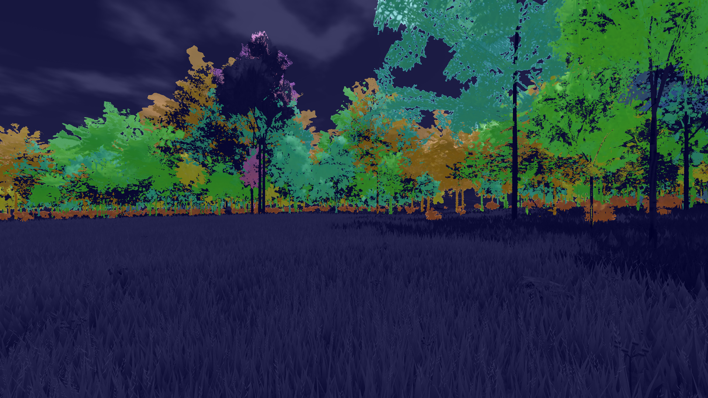
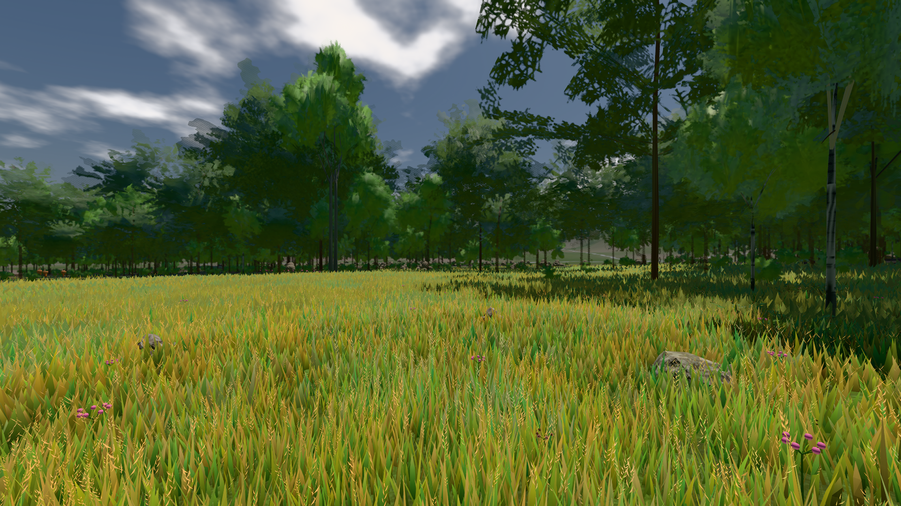
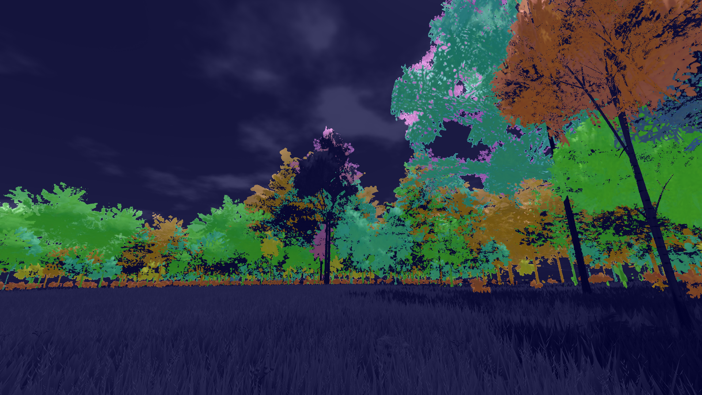
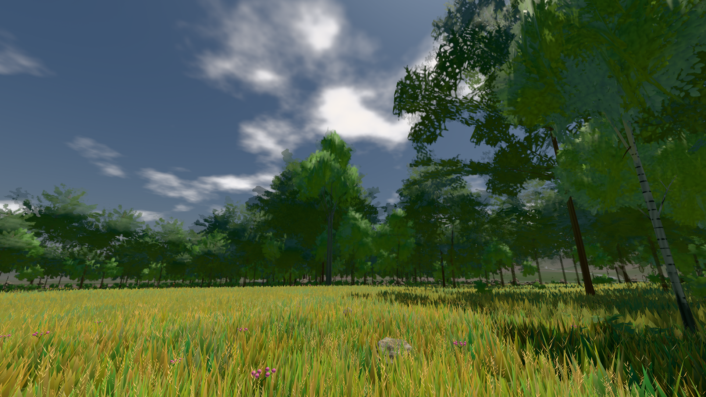

# GPU-PROBE bdd8411b — NACHGEGEBEN

Zweig `w28-strauch-gestalt` · Kopf bdd8411b50ec8838c316e749e12bec1eadb086d1 · Läufer gtx1050-desktop · 12.11. 17:00 · Wanduhr ab Push 506 s · Lauf https://github.com/MiguellD/AnazhRealm/actions/runs/43252452663

Ruf: `gate:laub-kante bild:wiese@0.5 bild:dorf@0.5`

## Läufer gtx1050-desktop — NACHGEGEBEN

GPU NVIDIA GeForce GTX 1050 · npm ci 51 s (package-lock bce2a607)
Schloss /c/Users/User/AppData/Local/Temp/claude/gpu-schloss hält „ci-runner 43252452663/1 probe“
- Hook 2026-11-12 16:52:32 start ci-runner 43252452663/1 probe: Schloss genommen (refs/heads/w28-strauch-gestalt bdd8411b50ec8838c316e749e12bec1eadb086d1 ws=C:\actions-runner\_work\AnazhRealm\AnazhRealm)

### gate:laub-kante — BEKANNT · 300 s · Läufer gtx1050-desktop

Adapter: ungenannt (die Probe nannte keinen Browser-Adapter) · ROT wie an main (bekannt): lod.K1#1 (main radeon: ungemessen)

```text
lod.K1#1 Tafel-Pose ROT [["f:birke:L0",0.195,139452,0,0,0],["f:birke:L1",0.2126,80858,0,0,0],["f:fichte:L0",0.1438,15910,0,0.0001,1],["f:fichte:L1",0.1826,136679,0,0,0],["f:tanne:L1",0.2097,16679,0,0,0],["fimp:birke:L2",0.192,12747,0,0,0],["fimp:buche:L2",0.2263,6350,0,0.0002,1],["fimp:eiche:L2",0.1761,59783,0,0,0],["fimp:fichte:L2",0.1892,98766,0.0003,0.0002,4],["fimp:strauch:L2",0.2853,20108,0,0,0],["fimp:tanne:L2",0.1874,140845,0.0001,0.0003,10]]
lod.K1#1 Spielgang ROT [["f:birke:L1",0.1762,125323,0,0,0],["f:fichte:L1",0.1798,152588,0,0,1],["f:tanne:L1",0.1835,8170,0,0,0],["fimp:birke:L2",0.2059,22856,0,0,0],["fimp:buche:L2",0.1969,6854,0,0.0007,3],["fimp:eiche:L2",0.1692,58541,0,0,0],["fimp:fichte:L2",0.1862,100404,0,0.0004,5],["fimp:strauch:L2",0.258,23991,0,0,0],["fimp:tanne:L2",0.1882,132784,0,0.0002,3]]
 "abnahme": "ABNAHME GRÜN · beweis · Sicht 0.0 % · Ziel Blickziel im Bild frei 12 m · Luma 91.5 σ 45.2 schwarz 0.0 % weiß 0.0 % · Stand 18.546.266 · Bühne summer sunny 0.50 Tiere gehalten · Gerät WebGPU nvidia pascal",
 "fehler": "lod.K1#1 ROT: Tafel-Pose fimp:buche:L2 0.2263, fimp:fichte:L2 0.1892, fimp:strauch:L2 0.2853, fimp:tanne:L2 0.1874 · Spielgang fimp:strauch:L2 0.258 (Soll ≤ 0,22, zweiton 0)"
```









### bild:wiese@0.5 — NACHGEGEBEN · 53 s · Läufer gtx1050-desktop

Adapter: [linse-gpu] nvidia/pascal · NACHGEGEBEN: Karten-Job „echt gtx1050 (GPU-Wände auf der Karte)“ (Lauf 43253602227) wartet auf diesen Läufer (gtx1050-gpu)

```text
[linse-gpu] nvidia/pascal
```

### bild:dorf@0.5 — NACHGEGEBEN · 2 s · Läufer gtx1050-desktop

Adapter: ungenannt (die Probe nannte keinen Browser-Adapter) · NACHGEGEBEN: Karten-Job „echt gtx1050 (GPU-Wände auf der Karte)“ (Lauf 43253602227) wartet auf diesen Läufer (gtx1050-gpu)

```text
NACHGEGEBEN: Karten-Job „echt gtx1050 (GPU-Wände auf der Karte)“ (Lauf 43253602227) wartet auf diesen Läufer (gtx1050-gpu)
```
