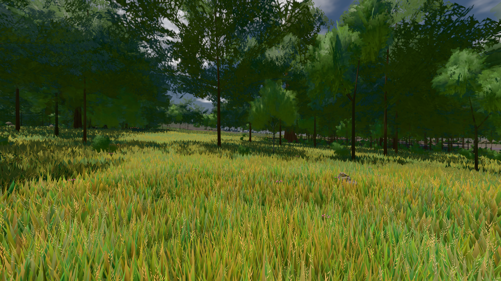
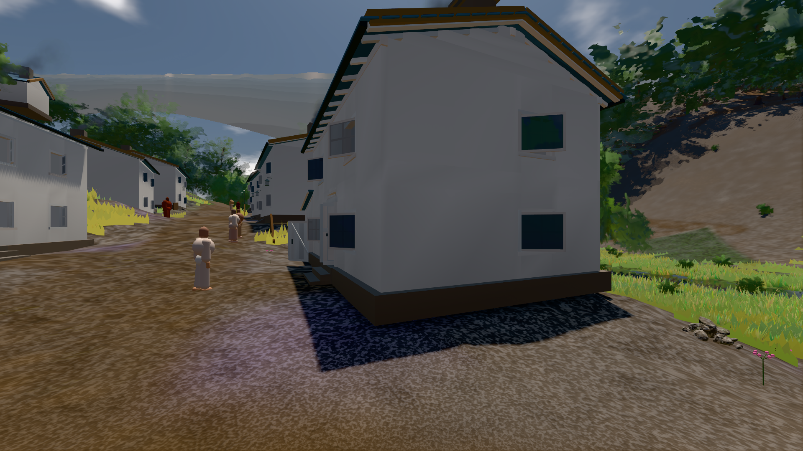

# GPU-PROBE bdd8411b — GRÜN · ROT wie an main (bekannt): gate:laub-kante: lod.K1#1 (main gtx: ungemessen) auf omen-gtx1060

Zweig `w28-strauch-gestalt` · Kopf bdd8411b50ec8838c316e749e12bec1eadb086d1 · Läufer omen-gtx1060 · 12.11. 17:40 · Wanduhr ab Push 2880 s · Lauf https://github.com/MiguellD/AnazhRealm/actions/runs/43252452663

Ruf: `gate:laub-kante bild:wiese@0.5 bild:dorf@0.5`

## Läufer omen-gtx1060 — GRÜN

GPU NVIDIA GeForce GTX 1060 · npm ci 45 s (package-lock bce2a607)
Schloss /c/Users/micha/AppData/Local/Temp/claude/gpu-schloss hält „ci-runner 43252452663/2 probe“
- Hook 2026-11-12 17:33:50 start ci-runner 43252452663/2 probe: wartet auf Schloss von 'omen-sg-vk-ankunft'
- Hook 2026-11-12 17:34:05 start ci-runner 43252452663/2 probe: Schloss genommen (refs/heads/w28-strauch-gestalt bdd8411b50ec8838c316e749e12bec1eadb086d1 ws=C:\actions-runner\_work\AnazhRealm\AnazhRealm)

### gate:laub-kante — BEKANNT · 149 s · Läufer omen-gtx1060

Adapter: ungenannt (die Probe nannte keinen Browser-Adapter) · ROT wie an main (bekannt): lod.K1#1 (main gtx: ungemessen)

```text
lod.K1#1 Tafel-Pose ROT [["f:birke:L0",0.195,139452,0,0,0],["f:birke:L1",0.2131,80859,0,0,0],["f:fichte:L0",0.1438,15910,0,0.0001,1],["f:fichte:L1",0.1824,136684,0,0,0],["f:tanne:L1",0.2097,16678,0,0,0],["fimp:birke:L2",0.1916,12751,0,0,0],["fimp:buche:L2",0.227,6355,0,0.0002,1],["fimp:eiche:L2",0.1763,59790,0,0,0],["fimp:fichte:L2",0.1892,98756,0.0003,0.0002,4],["fimp:strauch:L2",0.288,20129,0,0,0],["fimp:tanne:L2",0.1875,140857,0.0001,0.0003,10]]
lod.K1#1 Spielgang ROT [["f:birke:L1",0.1763,125331,0,0,0],["f:fichte:L1",0.1792,152570,0,0,1],["f:tanne:L1",0.1835,8169,0,0,0],["fimp:birke:L2",0.2063,22857,0,0,0],["fimp:buche:L2",0.1965,6850,0,0.0007,3],["fimp:eiche:L2",0.1679,58518,0,0,0],["fimp:fichte:L2",0.1859,100396,0,0.0004,5],["fimp:strauch:L2",0.2667,24183,0,0,0],["fimp:tanne:L2",0.1884,132784,0,0.0002,3]]
 "abnahme": "ABNAHME GRÜN · beweis · Sicht 0.0 % · Ziel Blickziel im Bild frei 12 m · Luma 91.5 σ 45.2 schwarz 0.0 % weiß 0.0 % · Stand 18.546.266 · Bühne summer sunny 0.50 Tiere gehalten · Gerät WebGPU nvidia pascal",
 "fehler": "lod.K1#1 ROT: Tafel-Pose fimp:buche:L2 0.227, fimp:fichte:L2 0.1892, fimp:strauch:L2 0.288, fimp:tanne:L2 0.1875 · Spielgang fimp:strauch:L2 0.2667 (Soll ≤ 0,22, zweiton 0)"
```


### bild:wiese@0.5 — GRÜN · 48 s · Läufer omen-gtx1060

Adapter: [linse-gpu] nvidia/pascal

```text
Kamera des Spiels → Blick (10.0 m): -280.40 29.71 -1045.60 -289.61 29.71 -1049.50
 "abnahme": "ABNAHME GRÜN · beweis · Sicht 0.0 % · Ziel Blickziel im Bild frei 10 m · Luma 81.8 σ 42.6 schwarz 0.0 % weiß 0.0 % · Stand 18.546.266 · Bühne summer sunny 0.50 Tiere gehalten · Gerät WebGPU nvidia pascal · Inhalt nahWiese 48.3 % (≥ 15.0 %) h 107° Luma 119",
```



### bild:dorf@0.5 — GRÜN · 77 s · Läufer omen-gtx1060

Adapter: [linse-gpu] nvidia/pascal

```text
Kamera des Spiels → Blick (5.2 m): -704.22 39.69 -880.02 -703.03 39.69 -874.96
 "abnahme": "ABNAHME GRÜN · beweis · Sicht 0.0 % · Ziel Blickziel im Bild frei 5.2 m · Luma 79 σ 30.7 schwarz 0.3 % weiß 0.0 % · Stand 18.546.266 · Bühne summer sunny 0.50 Tiere gehalten · Gerät WebGPU nvidia pascal · Inhalt bauSatz 29.9 % (≥ 2.0 %) Luma 78",
```


