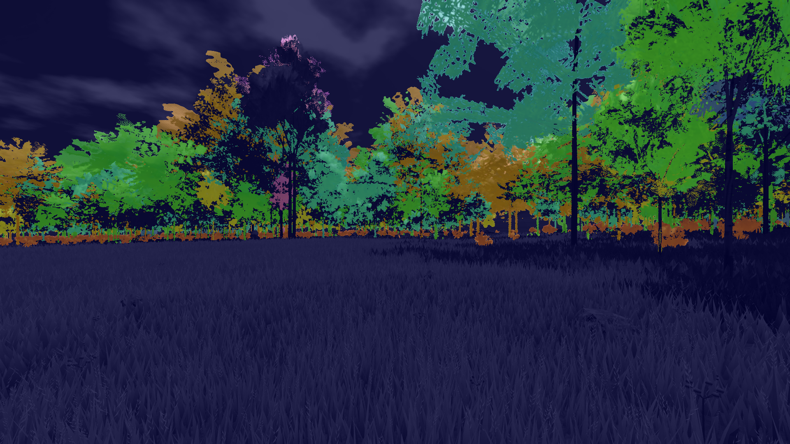
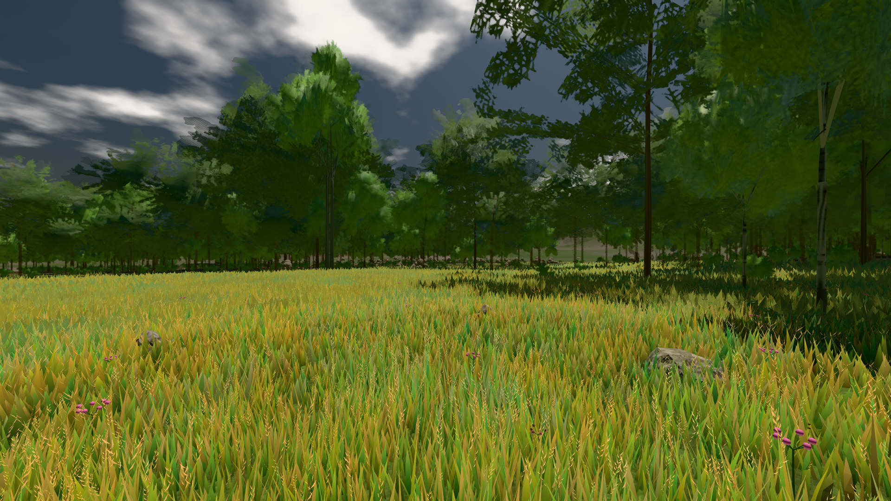
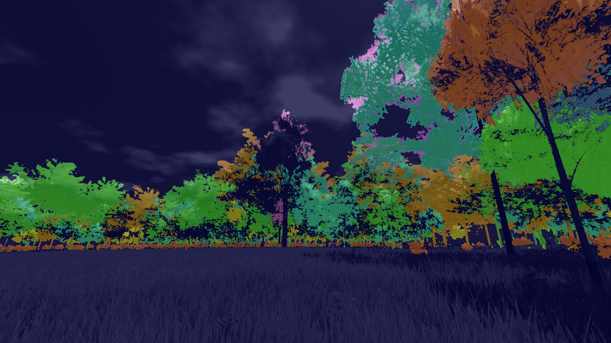
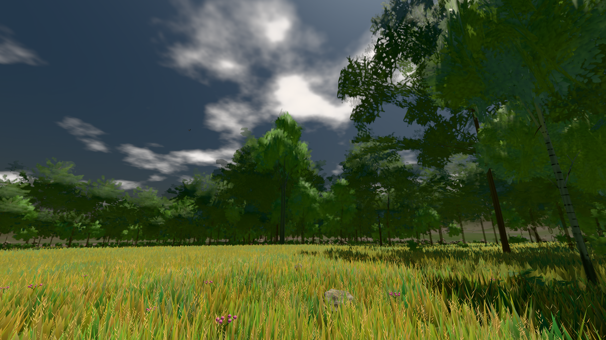
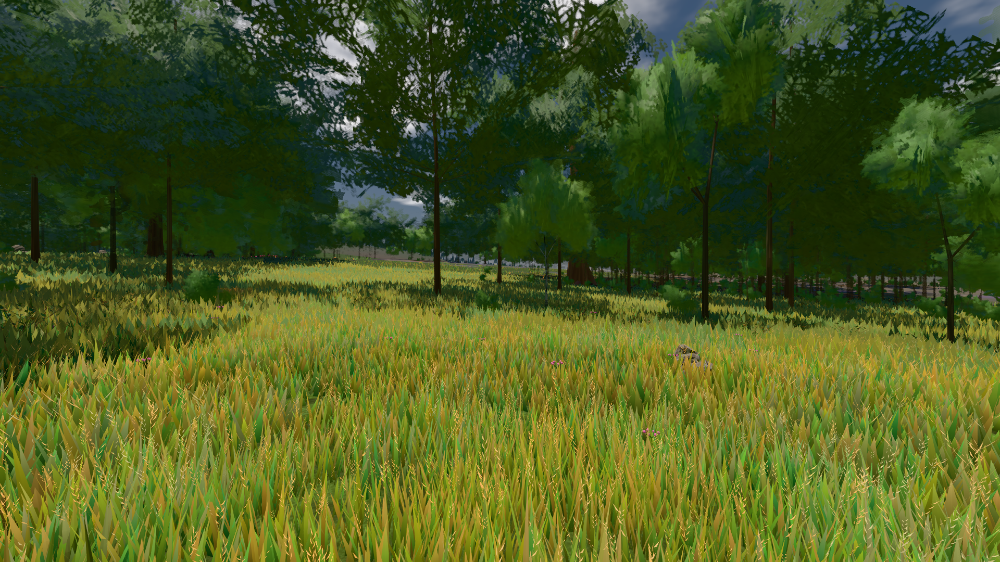
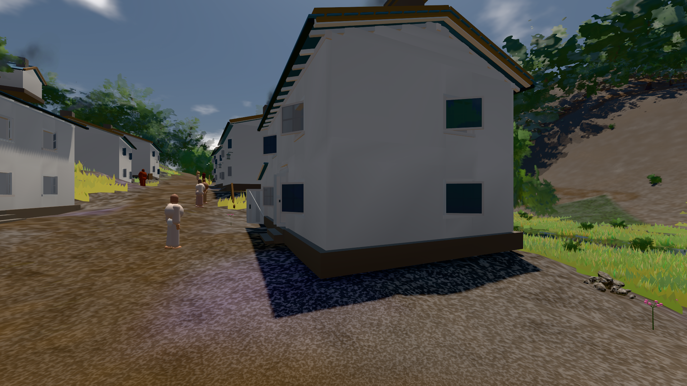

# GPU-PROBE d11815b8 — NACHGEGEBEN

Zweig `w28-strauch-gestalt` · Kopf d11815b833ef289bc201a31d931ef8f0610a839d · Läufer radeon-890m · 12.11. 14:21 · Wanduhr ab Push 446 s · Lauf https://github.com/MiguellD/AnazhRealm/actions/runs/43225300399

Ruf: `gate:laub-kante bild:wiese@0.5 bild:dorf@0.5`

## Läufer radeon-890m — NACHGEGEBEN

GPU AMD Radeon(TM) 890M Graphics · npm ci 47 s (package-lock c9c8a14d)
Schloss /c/Users/micha/AppData/Local/Temp/claude/gpu-schloss hält „ci-runner 43225300399/1 probe“
- Hook 2026-11-12 14:14:07 start ci-runner 43225300399/1 probe: Schloss genommen (refs/heads/w28-strauch-gestalt d11815b833ef289bc201a31d931ef8f0610a839d ws=C:\actions-runner\_work\AnazhRealm\AnazhRealm)

### gate:laub-kante — BEKANNT · 180 s · Läufer radeon-890m

Adapter: ungenannt (die Probe nannte keinen Browser-Adapter) · ROT wie an main (bekannt): lod.K1#1 (main radeon: ungemessen)

```text
lod.K1#1 Tafel-Pose ROT [["f:birke:L0",0.1933,129343,0,0,0],["f:birke:L1",0.2146,79872,0,0,0],["f:fichte:L0",0.1424,16040,0,0.0001,1],["f:fichte:L1",0.1788,134047,0,0,0],["f:tanne:L1",0.2114,15253,0,0,0],["fimp:birke:L2",0.1647,11330,0,0,0],["fimp:buche:L2",0.1962,5184,0,0.0002,1],["fimp:eiche:L2",0.1493,51959,0,0,0],["fimp:fichte:L2",0.1935,86602,0,0.0001,3],["fimp:strauch:L2",0.2882,19751,0,0,0],["fimp:tanne:L2",0.1797,128558,0,0.0004,8]]
lod.K1#1 Spielgang ROT [["f:birke:L1",0.1785,112613,0,0,0],["f:fichte:L1",0.1771,147756,0,0,1],["f:tanne:L1",0.1686,6520,0,0,0],["fimp:birke:L2",0.1901,19956,0,0,0],["fimp:buche:L2",0.1581,5320,0,0.0034,9],["fimp:eiche:L2",0.1576,48616,0,0,0],["fimp:fichte:L2",0.1934,88072,0,0.0002,3],["fimp:strauch:L2",0.2487,23391,0,0,0],["fimp:tanne:L2",0.1904,115688,0,0.0001,4]]
 "abnahme": "ABNAHME GRÜN · beweis · Sicht 0.0 % · Ziel Blickziel im Bild frei 12 m · Luma 87.6 σ 44.8 schwarz 0.0 % weiß 0.0 % · Stand 18.546.264 · Bühne summer sunny 0.50 Tiere gehalten · Gerät WebGPU amd rdna-3",
 "fehler": "lod.K1#1 ROT: Tafel-Pose fimp:strauch:L2 0.2882 · Spielgang fimp:strauch:L2 0.2487 (Soll ≤ 0,22, zweiton 0)"
```









### bild:wiese@0.5 — GRÜN · 53 s · Läufer radeon-890m

Adapter: [linse-gpu] amd/rdna-3

```text
Kamera des Spiels → Blick (10.0 m): -280.40 29.71 -1045.60 -289.61 29.71 -1049.50
 "abnahme": "ABNAHME GRÜN · beweis · Sicht 0.0 % · Ziel Blickziel im Bild frei 10 m · Luma 82.5 σ 42.8 schwarz 0.0 % weiß 0.0 % · Stand 18.546.264 · Bühne summer sunny 0.50 Tiere gehalten · Gerät WebGPU amd rdna-3 · Inhalt nahWiese 48.4 % (≥ 15.0 %) h 107° Luma 120",
```



### bild:dorf@0.5 — NACHGEGEBEN · 100 s · Läufer radeon-890m

Adapter: [linse-gpu] amd/rdna-3 · NACHGEGEBEN: Vorfahrt-Blick gescheitert: 502 https://api.github.com/repos/MiguellD/AnazhRealm/actions/runs/43220573283/jobs?per_page=100

```text
Kamera des Spiels → Blick (5.2 m): -704.22 39.69 -880.02 -703.03 39.69 -874.96
 "abnahme": "ABNAHME GRÜN · beweis · Sicht 0.0 % · Ziel Blickziel im Bild frei 5.2 m · Luma 79.4 σ 30.8 schwarz 0.4 % weiß 0.0 % · Stand 18.546.264 · Bühne summer sunny 0.50 Tiere gehalten · Gerät WebGPU amd rdna-3 · Inhalt bauSatz 30.1 % (≥ 2.0 %) Luma 78",
```


