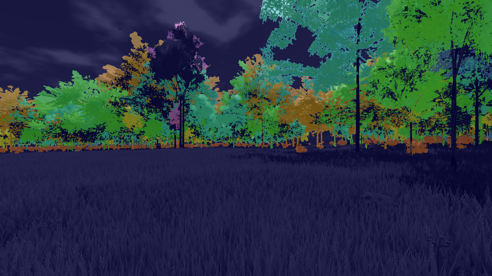
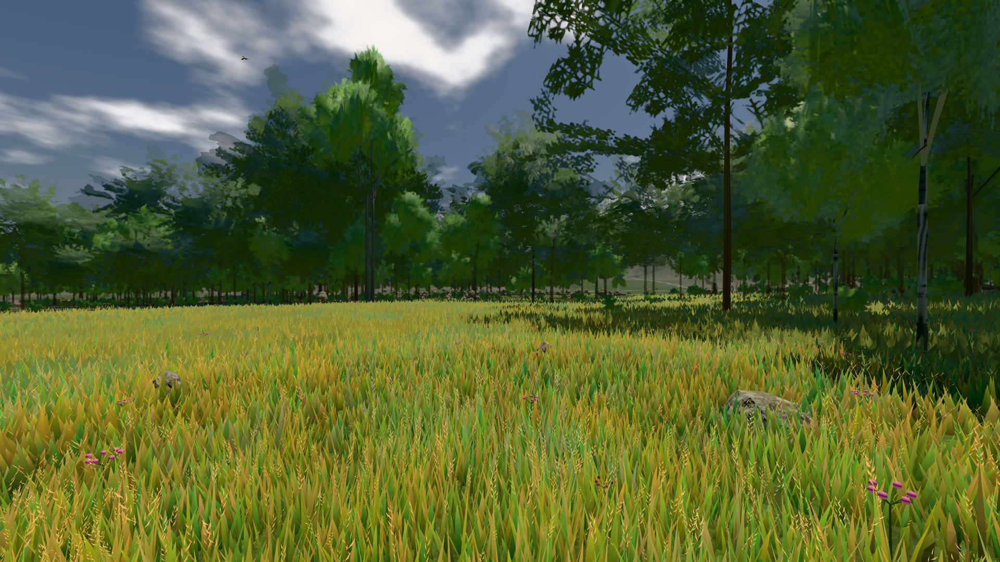
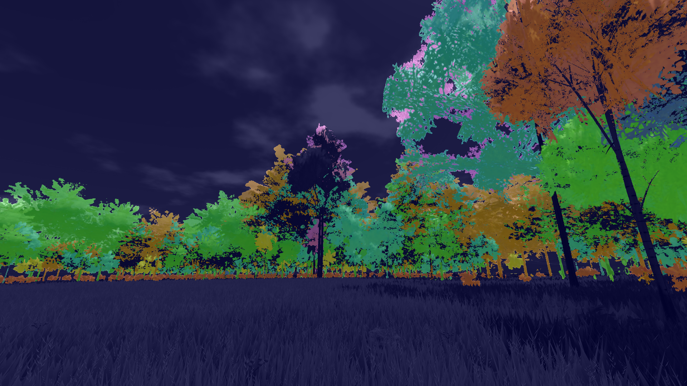
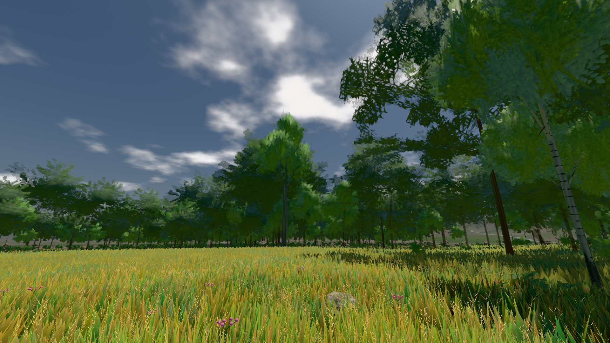
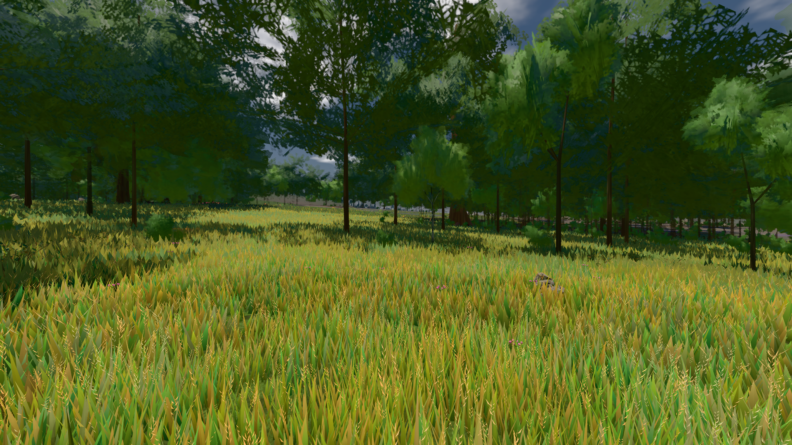

# GPU-PROBE f719658b — NACHGEGEBEN

Zweig `w28-strauch-gestalt` · Kopf f719658bdbf48bbab2dc32f8d5b061466ce2e84b · Läufer omen-gtx1060 · 12.11. 13:47 · Wanduhr ab Push 384 s · Lauf https://github.com/MiguellD/AnazhRealm/actions/runs/43220183895

Ruf: `gate:laub-kante bild:wiese@0.5 bild:dorf@0.5`

## Läufer omen-gtx1060 — NACHGEGEBEN

GPU NVIDIA GeForce GTX 1060 · npm ci 37 s (package-lock c9c8a14d)
Schloss /c/Users/micha/AppData/Local/Temp/claude/gpu-schloss hält „ci-runner 43220183895/1 probe“
- Hook 2026-11-12 13:41:33 start ci-runner 43220183895/1 probe: wartet auf Schloss von 'omen-punkte-gtx-sitzung'
- Hook 2026-11-12 13:41:48 start ci-runner 43220183895/1 probe: Schloss genommen (refs/heads/w28-strauch-gestalt f719658bdbf48bbab2dc32f8d5b061466ce2e84b ws=C:\actions-runner\_work\AnazhRealm\AnazhRealm)

### gate:laub-kante — BEKANNT · 141 s · Läufer omen-gtx1060

Adapter: ungenannt (die Probe nannte keinen Browser-Adapter) · ROT wie an main (bekannt): lod.K1#1 (main gtx: ungemessen)

```text
lod.K1#1 Tafel-Pose ROT [["f:birke:L0",0.1952,140105,0,0,0],["f:birke:L1",0.2088,80907,0,0,0],["f:fichte:L0",0.1442,15866,0,0.0001,1],["f:fichte:L1",0.1827,137264,0,0,0],["f:tanne:L1",0.2122,16740,0,0,0],["fimp:birke:L2",0.193,12830,0,0,0],["fimp:buche:L2",0.2187,5813,0,0.0002,1],["fimp:eiche:L2",0.1815,59750,0,0,0],["fimp:fichte:L2",0.1873,99390,0,0.0001,2],["fimp:strauch:L2",0.2852,20157,0,0,0],["fimp:tanne:L2",0.1852,140292,0,0.0003,10]]
lod.K1#1 Spielgang ROT [["f:birke:L1",0.1748,125434,0,0,0],["f:fichte:L1",0.1799,153251,0,0,1],["f:tanne:L1",0.1849,8190,0,0,0],["fimp:birke:L2",0.2068,23010,0,0,0],["fimp:buche:L2",0.1978,6245,0,0.0006,2],["fimp:eiche:L2",0.172,58672,0,0,0],["fimp:fichte:L2",0.1867,100758,0,0.0004,4],["fimp:strauch:L2",0.266,24256,0,0,0],["fimp:tanne:L2",0.1858,131676,0,0.0002,3]]
 "abnahme": "ABNAHME GRÜN · beweis · Sicht 0.0 % · Ziel Blickziel im Bild frei 12 m · Luma 91.8 σ 45.3 schwarz 0.0 % weiß 0.0 % · Stand 18.546.264 · Bühne summer sunny 0.50 Tiere gehalten · Gerät WebGPU nvidia pascal",
 "fehler": "lod.K1#1 ROT: Tafel-Pose fimp:strauch:L2 0.2852 · Spielgang fimp:strauch:L2 0.266 (Soll ≤ 0,22, zweiton 0)"
```









### bild:wiese@0.5 — GRÜN · 49 s · Läufer omen-gtx1060

Adapter: [linse-gpu] nvidia/pascal

```text
Kamera des Spiels → Blick (10.0 m): -280.40 29.71 -1045.60 -289.61 29.71 -1049.50
 "abnahme": "ABNAHME GRÜN · beweis · Sicht 0.0 % · Ziel Blickziel im Bild frei 10 m · Luma 82.6 σ 42.8 schwarz 0.0 % weiß 0.0 % · Stand 18.546.264 · Bühne summer sunny 0.50 Tiere gehalten · Gerät WebGPU nvidia pascal · Inhalt nahWiese 48.4 % (≥ 15.0 %) h 107° Luma 120",
```



### bild:dorf@0.5 — NACHGEGEBEN · 37 s · Läufer omen-gtx1060

Adapter: [linse-gpu] nvidia/pascal · NACHGEGEBEN: Karten-Job „echt omen (GPU-Wände auf der Karte)“ (Lauf 43220573283) wartet auf diesen Läufer (omen-gpu)

```text
[linse-gpu] nvidia/pascal
```
