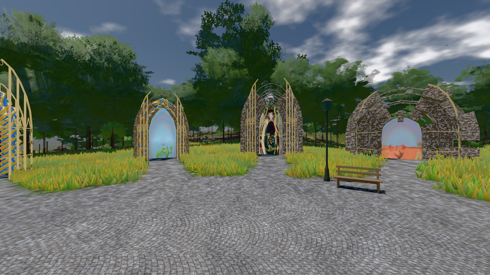
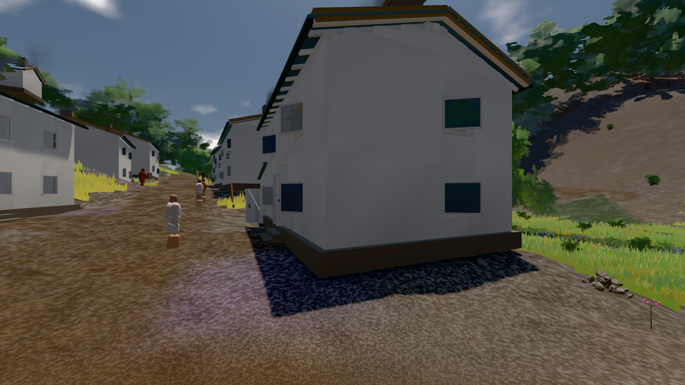

# GPU-PROBE a965cd36 — GRÜN

Zweig `w28-tafel-ganz` · Kopf a965cd36a8581b25a5622ced9fd0220f57ea8aff · Läufer radeon-890m · 14.11. 02:24 · Wanduhr ab Push 391 s · Lauf https://github.com/MiguellD/AnazhRealm/actions/runs/43539736882

Ruf: `bild:genesis@0.5 bild:dorf@0.5`

## Läufer radeon-890m — GRÜN

GPU AMD Radeon(TM) 890M Graphics · node_modules bleiben (package-lock 95130897)
Schloss /c/Users/micha/AppData/Local/Temp/claude/gpu-schloss hält „ci-runner 43539736882/1 probe“
- Hook 2026-11-14 02:18:32 start ci-runner 43539736882/1 probe: wartet auf Schloss von 'takt-frist 2026-11-14T02:15:53+01:00 pid=29324'
- Hook 2026-11-14 02:20:43 start ci-runner 43539736882/1 probe: verwaistes Schloss 'takt-frist 2026-11-14T02:15:53+01:00 pid=29324' geloest - Halter pid=29324 lebt nicht
- Hook 2026-11-14 02:20:47 start ci-runner 43539736882/1 probe: Schloss genommen (refs/heads/w28-tafel-ganz a965cd36a8581b25a5622ced9fd0220f57ea8aff ws=C:\actions-runner\_work\AnazhRealm\AnazhRealm)

### bild:genesis@0.5 — GRÜN · 63 s · Läufer radeon-890m

Adapter: [linse-gpu] amd/rdna-3

```text
Kamera des Spiels → Blick (10.0 m): 0.00 92.40 0.00 -10.00 92.40 0.00
 "abnahme": "ABNAHME GRÜN · beweis · Sicht 0.0 % · Ziel Blickziel im Bild frei 10 m · Luma 105.8 σ 41.3 schwarz 0.0 % weiß 0.0 % · Stand 18.546.276 · Bühne summer sunny 0.50 Tiere gehalten · Gerät WebGPU amd rdna-3 · Inhalt bodenSatz 35.4 % (≥ 15.0 %) Luma 129, portal-membran 2.8 % (≥ 0.3 %) Luma 139",
```



### bild:dorf@0.5 — GRÜN · 94 s · Läufer radeon-890m

Adapter: [linse-gpu] amd/rdna-3

```text
Kamera des Spiels → Blick (5.2 m): -704.22 39.69 -880.02 -703.03 39.69 -874.96
 "abnahme": "ABNAHME GRÜN · beweis · Sicht 0.0 % · Ziel Blickziel im Bild frei 5.2 m · Luma 79.4 σ 30.8 schwarz 0.4 % weiß 0.0 % · Stand 18.546.276 · Bühne summer sunny 0.50 Tiere gehalten · Gerät WebGPU amd rdna-3 · Inhalt bauSatz 30.1 % (≥ 2.0 %) Luma 78",
```


