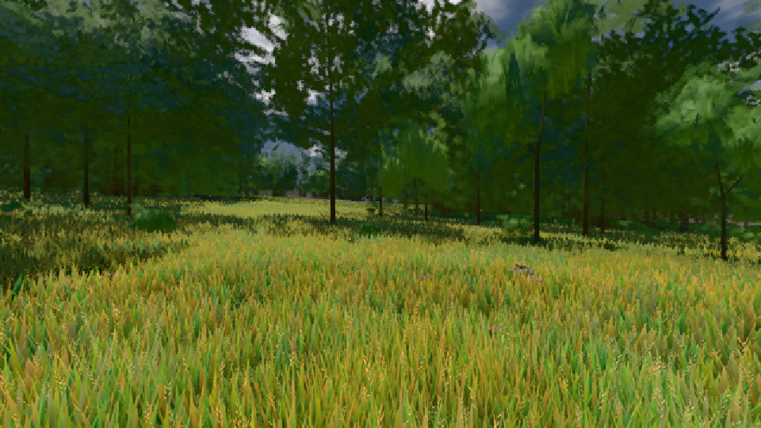
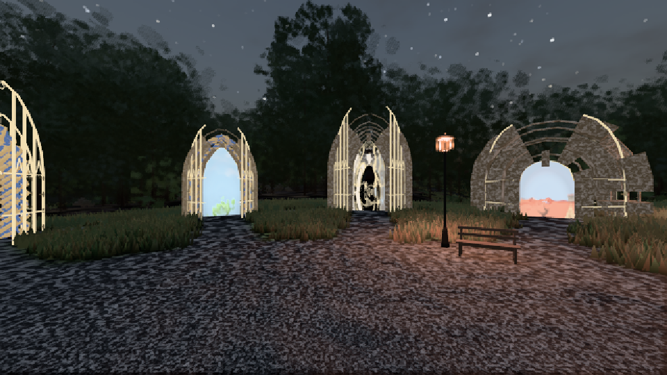

# GPU-PROBE 5620a53f — ROT

Zweig `w28-tag-kurve` · Kopf 5620a53f761a0e7cdb0ff1dfe8abe638609d0523 · Läufer gtx1050-desktop · 11.11. 08:43 · Wanduhr ab Push 812 s · Lauf https://github.com/MiguellD/AnazhRealm/actions/runs/42979965912

Ruf: `gate:tag-achse:bahn bild:wiese@0.5 bild:genesis@0.05`

## Läufer gtx1050-desktop — ROT

GPU NVIDIA GeForce GTX 1050 · node_modules bleiben (package-lock df29564e)
Schloss /c/Users/User/AppData/Local/Temp/claude/gpu-schloss hält „ci-runner 42979965912/1 probe“
- Hook 2026-11-11 08:30:40 start ci-runner 42979965912/1 probe: Schloss genommen (refs/heads/w28-tag-kurve 5620a53f761a0e7cdb0ff1dfe8abe638609d0523 ws=C:\actions-runner\_work\AnazhRealm\AnazhRealm)

### gate:tag-achse:bahn — ROT · 584 s · Läufer gtx1050-desktop

Adapter: ungenannt (die Probe nannte keinen Browser-Adapter)

```text
TAG genesis ROT: Karte 126.6 · Sprung -0.55 (Uhr 0.34) · Buckel 0.53 (Uhr 0.68) · Sonne 10° -0.59 EV R/B ×0.90 | -0.48 EV R/B ×0.94 · Nacht -1.69 EV Luma 58 · REF 1.25 (Uhr 0.758)
TAG wiese ROT: Karte 126.6 · Sprung -0.27 (Uhr 0.64) · Buckel 0.09 (Uhr 0.44) · Sonne 10° -0.98 EV R/B ×0.97 | -1.24 EV R/B ×0.76 · Nacht -3.32 EV Luma 34.7 · REF -0.49 (Uhr 0.66)
TAG genesis:third ROT: Karte 124.2 · Sprung -0.69 (Uhr 0.35) · Buckel 0.42 (Uhr 0.34) · Sonne 10° -1.09 EV R/B ×0.72 | -0.91 EV R/B ×0.81 · Nacht -2.41 EV Luma 49.4 · REF 0.87 (Uhr 0.76)
TAG wiese:third ROT: Karte 124.4 · Sprung -0.55 (Uhr 0.32) · Buckel 0.02 (Uhr 0.47) · Sonne 10° -1.21 EV R/B ×1.03 | -1.41 EV R/B ×0.89 · Nacht -3.54 EV Luma 31.1 · REF -0.72 (Uhr 0.62)
TAG-ACHSE ROT: REF genesis: Uhr 0 (Sonne -74.21°) 0.85 Stufen neben der REF | REF genesis: Uhr 0.01 (Sonne -74.28°) 0.86 Stufen neben der REF | REF genesis: Uhr 0.02 (Sonne -73.56°) 0.86 Stufen neben der REF | REF genesis: Uhr 0.03 (Sonne -72.14°) 0.86 Stufen neben der REF | REF genesis: Uhr 0.04 (Sonne -70.17°) 0.86 Stufen neben der REF | REF genesis: Uhr 0.05 (Sonne -67.79°) 0.88 Stufen neben der REF | REF genesis: Uhr 0.06 (Sonne -65.11°) 0.88 Stufen neben der REF | REF genesis: Uhr 0.07 (Sonne -62.22°) 0.88 Stufen neben der REF | REF genesis: Uhr 0.08 (Sonne -59.17°) 0.88 Stufen n
```

### bild:wiese@0.5 — GRÜN · 95 s · Läufer gtx1050-desktop

Adapter: [linse-gpu] nvidia/pascal

```text
Kamera des Spiels → Blick (10.0 m): -280.40 29.71 -1045.60 -289.61 29.71 -1049.50
 "abnahme": "ABNAHME GRÜN · beweis · Sicht 0.0 % · Ziel Blickziel im Bild frei 10 m · Luma 83.7 σ 40.3 schwarz 0.0 % weiß 0.0 % · Stand 18.546.249 · Bühne summer sunny 0.50 · Gerät WebGPU nvidia pascal",
```



### bild:genesis@0.05 — GRÜN · 89 s · Läufer gtx1050-desktop

Adapter: [linse-gpu] nvidia/pascal

```text
Kamera des Spiels → Blick (10.0 m): 0.00 92.40 0.00 -10.00 92.40 0.00
 "abnahme": "ABNAHME GRÜN · beweis · Sicht 0.0 % · Ziel Blickziel im Bild frei 10 m · Luma 60.3 σ 43.8 schwarz 0.1 % weiß 0.0 % · Stand 18.546.249 · Bühne summer sunny 0.05 · Gerät WebGPU nvidia pascal",
```


