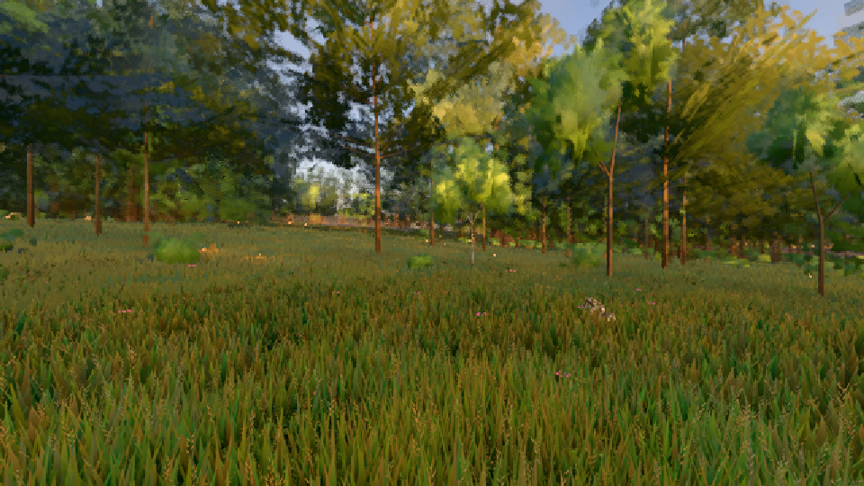
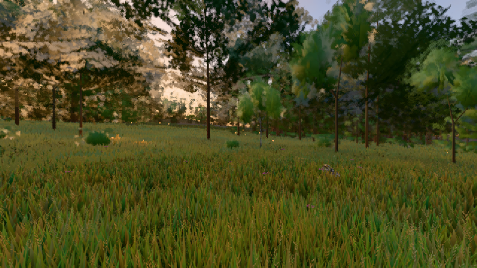

# GPU-PROBE b8ac76c3 — GRÜN

Zweig `w28-tag-kurve` · Kopf b8ac76c3827ca061aae7deb4cbcf3391e3a1a0fc · Läufer omen-gtx1060 · 11.11. 08:48 · Wanduhr ab Push 234 s · Lauf https://github.com/MiguellD/AnazhRealm/actions/runs/42981715547

Ruf: `gate:tag-achse:echt bild:wiese@0.27 bild:wiese@0.73`

## Läufer omen-gtx1060 — GRÜN

GPU NVIDIA GeForce GTX 1060 · node_modules bleiben (package-lock df29564e)
Schloss /c/Users/micha/AppData/Local/Temp/claude/gpu-schloss hält „ci-runner 42981715547/1 probe“
- Hook 2026-11-11 08:44:53 start ci-runner 42981715547/1 probe: wartet auf Schloss von 'omen-hg-pw-abab-b1'
- Hook 2026-11-11 08:45:09 start ci-runner 42981715547/1 probe: Schloss genommen (refs/heads/w28-tag-kurve b8ac76c3827ca061aae7deb4cbcf3391e3a1a0fc ws=C:\actions-runner\_work\AnazhRealm\AnazhRealm)

### gate:tag-achse:echt — GRÜN · 87 s · Läufer omen-gtx1060

Adapter: ungenannt (die Probe nannte keinen Browser-Adapter)

```text
TAG genesis GRUEN: Karte 126.6 · Sprung -0.04 (Uhr 0.746) · Buckel 0.47 (Uhr 0.33) · Sonne 10° -0.59 EV R/B ×0.90 | -0.48 EV R/B ×0.94 · Nacht -1.69 EV Luma 58 · REF 0.85 (Uhr 0) · nur die Wand (--kurz)
TAG wiese GRUEN: Karte 126.6 · Sprung 0.09 (Uhr 0.256) · Buckel 0.00 (Uhr 0) · Sonne 10° -0.98 EV R/B ×0.97 | -1.24 EV R/B ×0.76 · Nacht -3.32 EV Luma 34.7 · REF 0.10 (Uhr 0.278) · nur die Wand (--kurz)
TAG-ACHSE GRUEN
```

### bild:wiese@0.27 — GRÜN · 43 s · Läufer omen-gtx1060

Adapter: [linse-gpu] nvidia/pascal

```text
Kamera des Spiels → Blick (10.0 m): -280.40 29.71 -1045.60 -289.61 29.71 -1049.50
 "abnahme": "ABNAHME GRÜN · beweis · Sicht 0.0 % · Ziel Blickziel im Bild frei 10 m · Luma 78.6 σ 29.1 schwarz 0.0 % weiß 0.0 % · Stand 18.546.249 · Bühne summer sunny 0.27 · Gerät WebGPU nvidia pascal",
```



### bild:wiese@0.73 — GRÜN · 46 s · Läufer omen-gtx1060

Adapter: [linse-gpu] nvidia/pascal

```text
Kamera des Spiels → Blick (10.0 m): -280.40 29.71 -1045.60 -289.61 29.71 -1049.50
 "abnahme": "ABNAHME GRÜN · beweis · Sicht 0.0 % · Ziel Blickziel im Bild frei 10 m · Luma 72.9 σ 34.1 schwarz 0.0 % weiß 0.0 % · Stand 18.546.249 · Bühne summer sunny 0.73 · Gerät WebGPU nvidia pascal",
```


