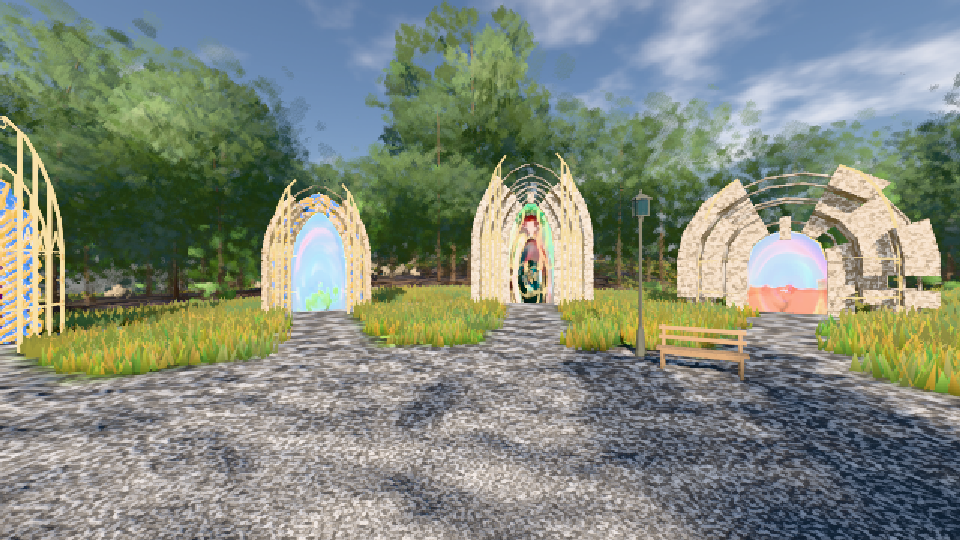
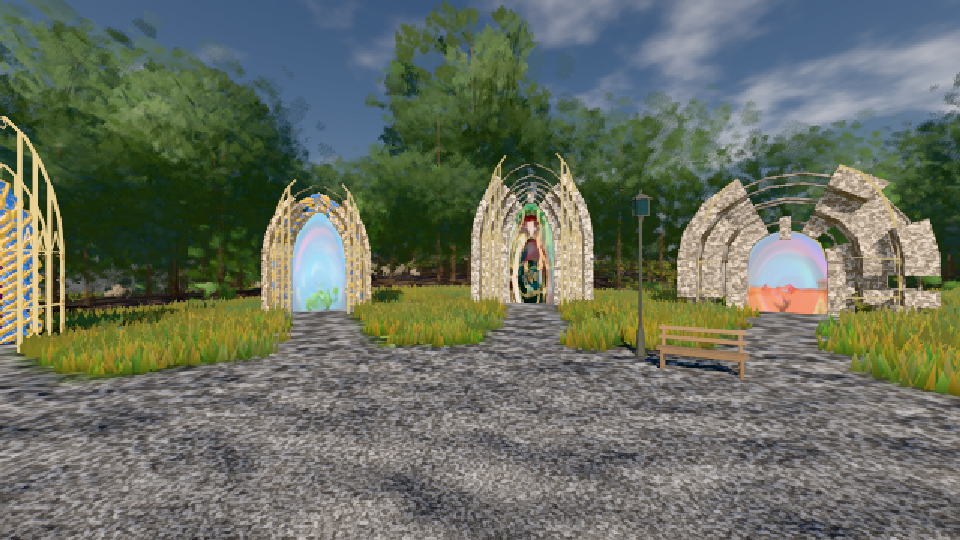

# GPU-PROBE ceb6cc18 — ROT

Zweig `w28-tag-kurve` · Kopf ceb6cc183e4587c656ccdc8e747cb70cfb4a9d53 · Läufer radeon-890m · 11.11. 06:26 · Wanduhr ab Push 448 s · Lauf https://github.com/MiguellD/AnazhRealm/actions/runs/42964918338

Ruf: `gate:tag-achse:echt bild:genesis@0.33 bild:genesis@0.34`

## Läufer radeon-890m — ROT

GPU AMD Radeon(TM) 890M Graphics · node_modules bleiben (package-lock df29564e)
Schloss /c/Users/micha/AppData/Local/Temp/claude/gpu-schloss hält „ci-runner 42964918338/1 probe“
- Hook 2026-11-11 06:19:07 start ci-runner 42964918338/1 probe: Schloss genommen (refs/heads/w28-tag-kurve ceb6cc183e4587c656ccdc8e747cb70cfb4a9d53 ws=C:\actions-runner\_work\AnazhRealm\AnazhRealm)

### gate:tag-achse:echt — ROT · 140 s · Läufer radeon-890m

Adapter: ungenannt (die Probe nannte keinen Browser-Adapter)

```text
TAG-ACHSE ROT: SPRUNG wiese: Uhr 0.254 → 0.256 0.11 EV
```

### bild:genesis@0.33 — GRÜN · 76 s · Läufer radeon-890m

Adapter: [linse-gpu] amd/rdna-3

```text
Kamera des Spiels → Blick (10.0 m): 0.00 92.40 0.00 -10.00 92.40 0.00
 "abnahme": "ABNAHME GRÜN · beweis · Sicht 0.0 % · Ziel Blickziel im Bild frei 10 m · Luma 135.3 σ 47.4 schwarz 0.0 % weiß 0.0 % · Stand 18.546.249 · Bühne summer sunny 0.33 · Gerät WebGPU amd rdna-3",
```



### bild:genesis@0.34 — GRÜN · 97 s · Läufer radeon-890m

Adapter: [linse-gpu] amd/rdna-3

```text
Kamera des Spiels → Blick (10.0 m): 0.00 92.40 0.00 -10.00 92.40 0.00
 "abnahme": "ABNAHME GRÜN · beweis · Sicht 0.0 % · Ziel Blickziel im Bild frei 10 m · Luma 108.5 σ 39.6 schwarz 0.0 % weiß 0.0 % · Stand 18.546.249 · Bühne summer sunny 0.34 · Gerät WebGPU amd rdna-3",
```


