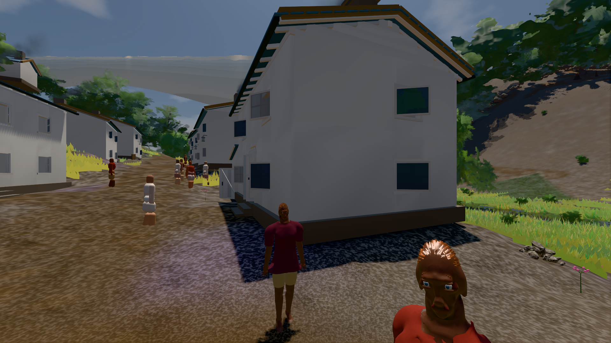

# GPU-PROBE 7d2d3c67 — GRÜN

Zweig `w28-takt-frist` · Kopf 7d2d3c67d70f04c27af9418543a79c9f5b04bc62 · Läufer gtx1050-desktop + omen-gtx1060 (Band-Gerät) · 14.11. 06:24 · Wanduhr ab Push 3846 s · Lauf https://github.com/MiguellD/AnazhRealm/actions/runs/43556157932

Ruf: `bild:dorf@0.5 zeit:gate:takt`

## Läufer gtx1050-desktop — GRÜN

GPU NVIDIA GeForce GTX 1050 · npm ci 41 s (package-lock 2b28e799)
Schloss /c/Users/User/AppData/Local/Temp/claude/gpu-schloss hält „ci-runner 43556157932/2 probe“
- Hook 2026-11-14 06:15:48 start ci-runner 43556157932/2 probe: Schloss genommen (refs/heads/w28-takt-frist 7d2d3c67d70f04c27af9418543a79c9f5b04bc62 ws=C:\actions-runner\_work\AnazhRealm\AnazhRealm)

### bild:dorf@0.5 — GRÜN · 149 s · Läufer gtx1050-desktop

Adapter: [linse-gpu] nvidia/pascal

```text
Kamera des Spiels → Blick (5.2 m): -704.22 39.69 -880.02 -703.03 39.69 -874.96
 "abnahme": "ABNAHME GRÜN · beweis · Sicht 0.0 % · Leib im Vordergrund 2.3 % (Leib bewohner 2.3 %) · Ziel Blickziel im Bild frei 5.2 m · Luma 76.9 σ 31.4 schwarz 0.4 % weiß 0.0 % · Stand 18.546.279 · Bühne summer sunny 0.50 Tiere gehalten · Gerät WebGPU nvidia pascal · Inhalt bauSatz 29.3 % (≥ 2.0 %) Luma 78",
```



## Läufer omen-gtx1060 (Band-Gerät) — GRÜN

GPU NVIDIA GeForce GTX 1060 · npm ci 45 s (package-lock 2b28e799)
Schloss /c/Users/micha/AppData/Local/Temp/claude/gpu-schloss hält „ci-runner 43556157932/1 probe“
- Hook 2026-11-14 05:20:43 start ci-runner 43556157932/1 probe: wartet auf Schloss von 'omen-sg-furcht-diag'
- Hook 2026-11-14 05:20:58 start ci-runner 43556157932/1 probe: Schloss genommen (refs/heads/w28-takt-frist 7d2d3c67d70f04c27af9418543a79c9f5b04bc62 ws=C:\actions-runner\_work\AnazhRealm\AnazhRealm)

### zeit:gate:takt — GRÜN · 24 s · Läufer omen-gtx1060 (Band-Gerät)

Adapter: ungenannt (die Probe nannte keinen Browser-Adapter)

```text
  ✅ T5 Schlange: 12,eiche,nah10,true,12,e10,11,11,10
  ✅ T6 Worker-Schlange nie verhungert: alt,nah0 · frei alt,nah0,nah1
  ✅ T8 Geist im Faden: abgelaufen,offen,true,rw1_2,rw1_4,abgelaufen,offen,true
  ✅ T9 Kappen: _tickPendingVegSpawns,_kappeOffen (Frist),_tickAutoSettlement,tickArchitectureCulling,_tickFoliageGrowth,_tickVoxelChunkStreaming,_tickVoxelChunkStreaming (ms),_ringWaechst,_fernRingRefresh,_ladeFrist, Nah-Gang je 12,100,12,12,12,53,3,54,4,2,2,40,3,4,100,true,true
  ✅ T10 Faden: buch,quelle-port,2,2
  ✅ T11 Verkehr: 30/240 Schritte · Beweger 0 · Stau 0
  ✅ T12 die EINE Frist: _dispatchFrameJobs,_tickVoxelChunkStreaming,_pflanzGang,_pruneDistantVoxelChunks,_tickHuellenNach,_bewohnerWerkTakt,_bewohnerWacheTakt,_tickBauSatz,_satzAltern,tickArchitectureCulling je 0,1,1,1,1,1,1,1,1,1
  ✅ T13 der EINE, reihum: strom 9 Stücke · Hunger 3 · Arbeit nach der Frist: strom 4 ms | waldPlan 9 Stücke · Hunger 3 · Arbeit nach der Frist: waldPlan 4 ms | karte 9 Stücke · Hunger 3 · Arbeit nach der Frist: karte 4 ms | streuLod 9 Stücke · Hunger 3 · Arbeit nach der Frist: streuLod 4 ms
  ✅ T14 Räumung am Ort: 1
✅ GRÜN
```
