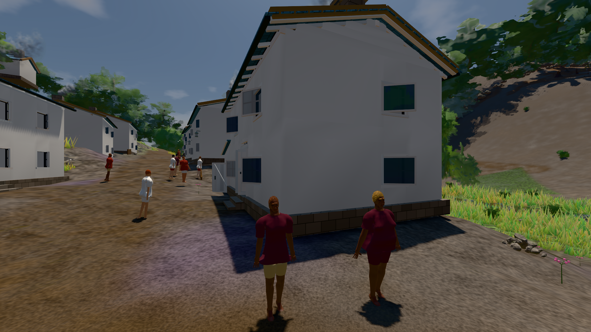

# GPU-PROBE 4717fc65 — NACHGEGEBEN

Zweig `w28-urteil-je-inhalt-2` · Kopf 4717fc6529658a1a0ed92a52dbd8a633bcc712c6 · Läufer radeon-890m · 18.11. 15:39 · Wanduhr ab Push 156 s · Lauf https://github.com/MiguellD/AnazhRealm/actions/runs/44326112850

Ruf: `bild:dorf@0.5`

## Läufer radeon-890m — NACHGEGEBEN

GPU AMD Radeon(TM) 890M Graphics · node_modules bleiben (package-lock 9b0dd62a)
Schloss /c/Users/micha/AppData/Local/Temp/claude/gpu-schloss hält „ci-runner 44326112850/1 probe“
- Hook 2026-11-18 15:36:43 start ci-runner 44326112850/1 probe: Schloss genommen (refs/heads/w28-urteil-je-inhalt-2 4717fc6529658a1a0ed92a52dbd8a633bcc712c6 ws=C:\actions-runner\_work\AnazhRealm\AnazhRealm)

### bild:dorf@0.5 — NACHGEGEBEN · 82 s · Läufer radeon-890m

Adapter: [linse-gpu] amd/rdna-3 · NACHGEGEBEN: Karten-Job „echt radeon (GPU-Wände auf der Karte)“ (Lauf 44326363177) wartet auf diesen Läufer (radeon-gpu)

```text
Kamera des Spiels → Blick (5.2 m): -704.22 39.69 -880.02 -703.03 39.69 -874.96
 "abnahme": "ABNAHME GRÜN · beweis · Sicht 0.0 % · Ziel Blickziel im Bild frei 5.2 m · Luma 77.8 σ 30.9 schwarz 0.2 % weiß 0.0 % · Stand 18.546.336 · Bühne summer sunny 0.50 Tiere gehalten · Gerät WebGPU amd rdna-3 · Inhalt bauSatz 28.7 % (≥ 2.0 %) Luma 80",
```


