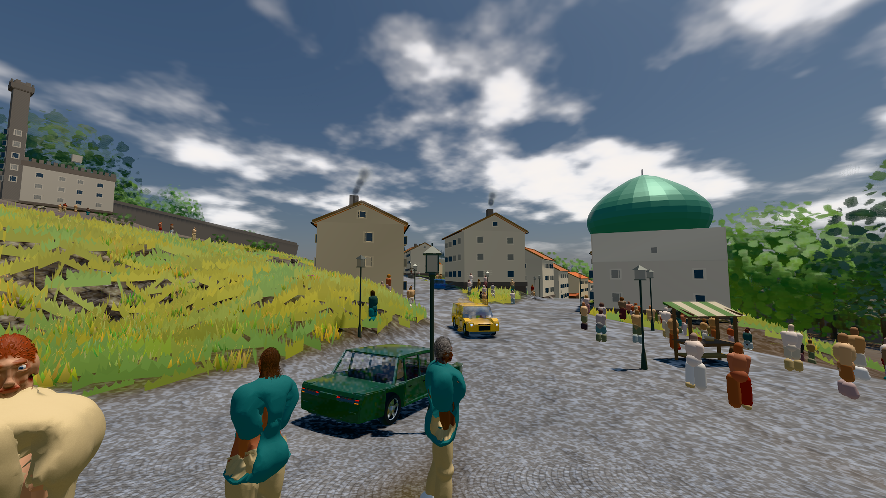
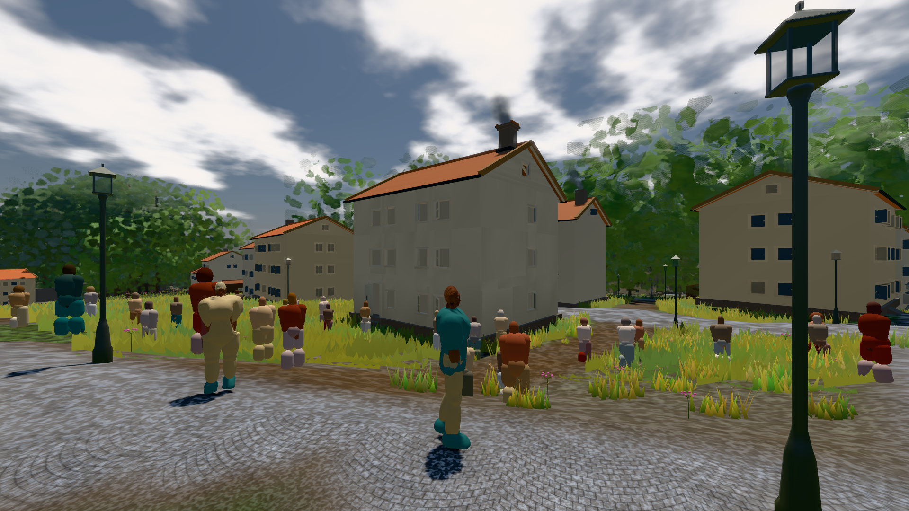

# GPU-PROBE 6e745642 — ROT

Zweig `w28-verkehr-bild` · Kopf 6e745642b19515ecc98cdbb1b5c9e07d3a094b84 · Läufer radeon-890m + radeon-890m (Band-Gerät) · 12.11. 09:59 · Wanduhr ab Push 760 s · Lauf https://github.com/MiguellD/AnazhRealm/actions/runs/43185721122

Ruf: `bild:stadt bild:stadt-voll zeit:gate:verkehr-takt`

## Läufer radeon-890m — ROT

GPU AMD Radeon(TM) 890M Graphics · node_modules bleiben (package-lock be69df15)
Schloss /c/Users/micha/AppData/Local/Temp/claude/gpu-schloss hält „ci-runner 43185721122/1 probe“
- Hook 2026-11-12 09:51:44 start ci-runner 43185721122/1 probe: Schloss genommen (refs/heads/w28-verkehr-bild 6e745642b19515ecc98cdbb1b5c9e07d3a094b84 ws=C:\actions-runner\_work\AnazhRealm\AnazhRealm)
- Hook 2026-11-12 09:54:44 ende  ci-runner 43185721122/1 probe: Schloss geloest
- Hook 2026-11-12 09:54:44 ende  ci-runner 43185721122/1 probe: Arbeitsordner geraeumt (C:\actions-runner\_work\AnazhRealm\AnazhRealm)
- Hook 2026-11-12 09:54:54 start ci-runner 43185721122/1 probe: Schloss genommen (refs/heads/w28-verkehr-bild 6e745642b19515ecc98cdbb1b5c9e07d3a094b84 ws=C:\actions-runner\_work\AnazhRealm\AnazhRealm)

### bild:stadt — ROT · 96 s · Läufer radeon-890m

Adapter: [linse-gpu] amd/rdna-3 · "fehler": "ABNAHME ROT [Sicht verdeckt 5.6 % (Laub · Rinde · Fels · Böschung näher als 2 m, Bau als 1 m): Leib bewohner (≤ 8 m) 5.6 %] · beweis · Sicht 5.6 % (Leib bewohner (≤ 8 m) 5.6 %) · Ziel Blickziel im Bild frei 29 — keine Station beim Namen

```text
Kamera des Spiels → Blick (29.8 m): 642.51 64.79 416.74 672.05 67.17 419.83
 "fehler": "ABNAHME ROT [Sicht verdeckt 5.6 % (Laub · Rinde · Fels · Böschung näher als 2 m, Bau als 1 m): Leib bewohner (≤ 8 m) 5.6 %] · beweis · Sicht 5.6 % (Leib bewohner (≤ 8 m) 5.6 %) · Ziel Blickziel im Bild frei 29.8 m · Luma 115.2 σ 41.7 schwarz 0.0 % weiß 0.0 % · Stand 18.546.262 · Bühne summer sunny 0.50 Tiere gehalten · Gerät WebGPU amd rdna-3 · Inhalt bauSatz 8.9 % (≥ 2.0 %) Luma 100, f:(kompakt_fwd|limousine|suv) 2.2 % (≥ 0.5 %) Luma 71 · ROT-Bild C:\\actions-runner\\_work\\_temp\\probe\\6e745642-stadt-rot.png",
```



### bild:stadt-voll — GRÜN · 138 s · Läufer radeon-890m

Adapter: [linse-gpu] amd/rdna-3

```text
Kamera des Spiels → Blick (14.6 m): 837.84 58.51 445.42 842.31 58.51 459.32
 "abnahme": "ABNAHME GRÜN · bekannt stadt-voll.leib hält jetzt (der Eintrag fällt) · beweis · Sicht 1.6 % (Leib bewohner (≤ 7.3 m) 1.6 %) · Ziel Blickziel im Bild frei 14.6 m, verdeckt nur von Leibern: 1 Punkt, nächster 3.72 m (Leib bewohner) · Luma 113.8 σ 56.7 schwarz 0.0 % weiß 0.0 % · Stand 18.546.262 · Bühne summer sunny 0.50 Tiere gehalten · Gerät WebGPU amd rdna-3 · Inhalt bauSatz 19.5 % (≥ 2.0 %) Luma 78, bewohner 1.7 % (≥ 1.0 %) Luma 77",
```



## Läufer radeon-890m (Band-Gerät) — GRÜN

GPU AMD Radeon(TM) 890M Graphics · npm ci 28 s (package-lock be69df15)
Schloss /c/Users/micha/AppData/Local/Temp/claude/gpu-schloss hält „ci-runner 43185721122/1 probe“
- Hook 2026-11-12 09:51:44 start ci-runner 43185721122/1 probe: Schloss genommen (refs/heads/w28-verkehr-bild 6e745642b19515ecc98cdbb1b5c9e07d3a094b84 ws=C:\actions-runner\_work\AnazhRealm\AnazhRealm)

### zeit:gate:verkehr-takt — GRÜN · 138 s · Läufer radeon-890m (Band-Gerät)

Adapter: ungenannt (die Probe nannte keinen Browser-Adapter)

```text
  ✅ K2 Reibkreis längs: kein Rezept steigt steiler als tan α = μ — gt 40.3°/45.0° · supersport 39.6°/40.4° · limousine 26.1°/45.0° · kompakt_fwd 26.1°/45.0° · suv 26.1°/45.0°
  ✅ K3 Halt: 21°-Hang ohne Eingabe hält (≤ 0,01 m, Gier 0), 50° rutscht — 21°: 0.000 m · 50°: -13.12 m
  ✅ K4 Querhang: Fahrt längs 35° ohne Lenkung driftet talwärts, am Stand hält 30°, 50° rutscht — 35° Fahrt 3.39 m · 30° Stand 0.000 m · 50° Stand 37.24 m
  ✅ K7 die Wand ist ein Sprung des Bodens: sie hält EINEN Schritt, dann steigt der Wagen auf sein Gesetz (je Schritt ≤ eine Stufe) — nie für immer darunter — Boden +0,35 m: Höhe je Schritt 0.000 · 0.170 · 0.340 · 0.350 · 0.350 · 0.350 (Stufe 0.170 m)
  ✅ K6 Verwindung: kein Rad tiefer im Boden als sein Federweg (GT: radHub × radR, starr: 0); im Federweg hebt sie nicht — GT tau 0,45: 0.204 m im Boden (Federweg 0.204) · starr tau 0,45: 0.000 m · GT tau 0,10: Hub 0.000 m
  ✅ K8 Reifen (fahrzeug.K1): Spitze je Achse und Rezept bei 6–10°, bis 30° ≥ 15 % Abfall; Takt ≥ 240 Hz, die Kosten gegen die Eichung (≤ 86 Eichungen je 1000 Schritte) — Takt 240 Hz · 1.18 µs · 2.29 Eichungen je 1000 (Eichung 0.5146 ms) 
  ✅ K9 Fahr-Gefühl: Gas, dann voller Einschlag — Fahrt an der Bug-Achse ≤ 10°, v·ω ≤ 1,8 g·μ, Schwimmwinkel ≤ 40° — {"achse":0,"lenk":0.99,"schwimm":1.8}
  ✅ K10 der Tritt ist analog — 0.50
  ✅ VK-V (mensch.K2) die Stunde ohne Vorgeschichte: dieselbe Saat, dasselbe Bild — {"stunde":10,"bilder":[1200,1200],"erst":-1}
  ✅ VK (PFLICHT-OFFEN C) der Verkehr der Stadt um 10 Uhr
```
