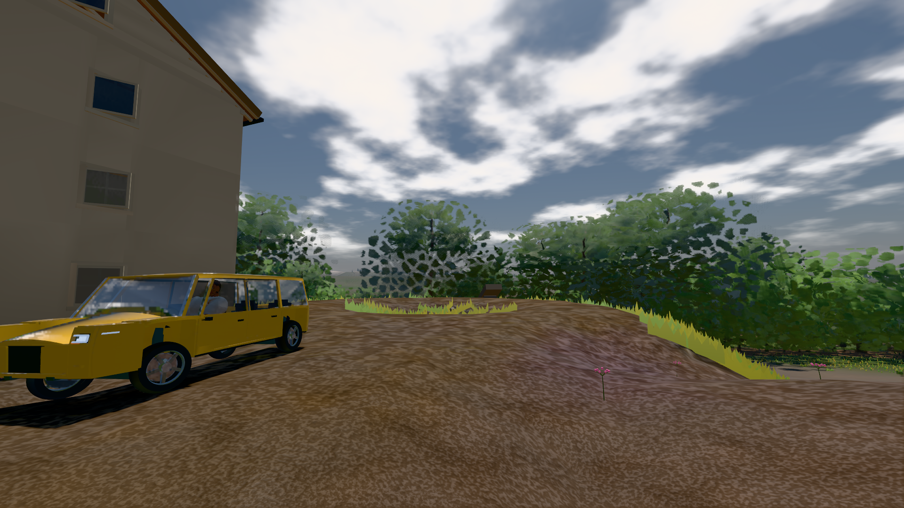
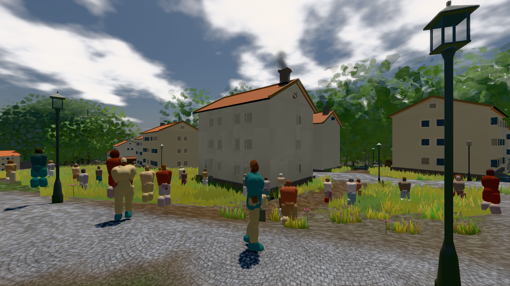

# GPU-PROBE e57d9b19 — GRÜN

Zweig `w28-verkehr-bild` · Kopf e57d9b19b5dac3db8726e8f7949077a217101c5b · Läufer gtx1050-desktop + radeon-890m (Band-Gerät) · 12.11. 10:25 · Wanduhr ab Push 562 s · Lauf https://github.com/MiguellD/AnazhRealm/actions/runs/43189960786

Ruf: `bild:stadt bild:stadt-voll zeit:gate:verkehr-takt`

## Läufer gtx1050-desktop — GRÜN

GPU NVIDIA GeForce GTX 1050 · node_modules bleiben (package-lock be69df15)
Schloss /c/Users/User/AppData/Local/Temp/claude/gpu-schloss hält „ci-runner 43189960786/1 probe“
- Hook 2026-11-12 10:16:26 start ci-runner 43189960786/1 probe: Schloss genommen (refs/heads/w28-verkehr-bild e57d9b19b5dac3db8726e8f7949077a217101c5b ws=C:\actions-runner\_work\AnazhRealm\AnazhRealm)

### bild:stadt — GRÜN · 235 s · Läufer gtx1050-desktop

Adapter: [linse-gpu] nvidia/pascal

```text
Kamera des Spiels → Blick (27.3 m): 542.67 61.83 407.71 547.60 64.01 434.47
 "abnahme": "ABNAHME GRÜN · beweis · Sicht 0.0 % · Ziel Blickziel im Bild frei 27.3 m · Luma 104.6 σ 59.5 schwarz 0.7 % weiß 0.0 % · Stand 18.546.262 · Bühne summer sunny 0.50 Tiere gehalten · Gerät WebGPU nvidia pascal · Inhalt bauSatz 14.6 % (≥ 2.0 %) Luma 69, f:(kompakt_fwd|limousine|suv) 6.0 % (≥ 0.5 %) Luma 75",
```



### bild:stadt-voll — GRÜN · 278 s · Läufer gtx1050-desktop

Adapter: [linse-gpu] nvidia/pascal

```text
Kamera des Spiels → Blick (14.6 m): 837.84 58.51 445.42 842.31 58.51 459.32
 "abnahme": "ABNAHME GRÜN · bekannt stadt-voll.leib hält jetzt (der Eintrag fällt) · beweis · Sicht 1.6 % (Leib bewohner (≤ 7.3 m) 1.6 %) · Ziel Blickziel im Bild frei 14.6 m, verdeckt nur von Leibern: 1 Punkt, nächster 3.72 m (Leib bewohner) · Luma 113.9 σ 56.5 schwarz 0.0 % weiß 0.0 % · Stand 18.546.262 · Bühne summer sunny 0.50 Tiere gehalten · Gerät WebGPU nvidia pascal · Inhalt bauSatz 19.5 % (≥ 2.0 %) Luma 79, bewohner 1.7 % (≥ 1.0 %) Luma 78",
```



## Läufer radeon-890m (Band-Gerät) — GRÜN

GPU AMD Radeon(TM) 890M Graphics · node_modules bleiben (package-lock be69df15)
Schloss /c/Users/micha/AppData/Local/Temp/claude/gpu-schloss hält „ci-runner 43189960786/1 probe“
- Hook 2026-11-12 10:16:29 start ci-runner 43189960786/1 probe: wartet auf Schloss von 'punkte-radeon-sitzungpid=53988'
- Hook 2026-11-12 10:16:44 start ci-runner 43189960786/1 probe: Schloss genommen (refs/heads/w28-verkehr-bild e57d9b19b5dac3db8726e8f7949077a217101c5b ws=C:\actions-runner\_work\AnazhRealm\AnazhRealm)

### zeit:gate:verkehr-takt — GRÜN · 157 s · Läufer radeon-890m (Band-Gerät)

Adapter: ungenannt (die Probe nannte keinen Browser-Adapter)

```text
  ✅ K2 Reibkreis längs: kein Rezept steigt steiler als tan α = μ — gt 40.3°/45.0° · supersport 39.6°/40.4° · limousine 26.1°/45.0° · kompakt_fwd 26.1°/45.0° · suv 26.1°/45.0°
  ✅ K3 Halt: 21°-Hang ohne Eingabe hält (≤ 0,01 m, Gier 0), 50° rutscht — 21°: 0.000 m · 50°: -13.12 m
  ✅ K4 Querhang: Fahrt längs 35° ohne Lenkung driftet talwärts, am Stand hält 30°, 50° rutscht — 35° Fahrt 3.39 m · 30° Stand 0.000 m · 50° Stand 37.24 m
  ✅ K7 die Wand ist ein Sprung des Bodens: sie hält EINEN Schritt, dann steigt der Wagen auf sein Gesetz (je Schritt ≤ eine Stufe) — nie für immer darunter — Boden +0,35 m: Höhe je Schritt 0.000 · 0.170 · 0.340 · 0.350 · 0.350 · 0.350 (Stufe 0.170 m)
  ✅ K6 Verwindung: kein Rad tiefer im Boden als sein Federweg (GT: radHub × radR, starr: 0); im Federweg hebt sie nicht — GT tau 0,45: 0.204 m im Boden (Federweg 0.204) · starr tau 0,45: 0.000 m · GT tau 0,10: Hub 0.000 m
  ✅ K8 Reifen (fahrzeug.K1): Spitze je Achse und Rezept bei 6–10°, bis 30° ≥ 15 % Abfall; Takt ≥ 240 Hz, die Kosten gegen die Eichung (≤ 86 Eichungen je 1000 Schritte) — Takt 240 Hz · 1.57 µs · 1.95 Eichungen je 1000 (Eichung 0.8073 ms) 
  ✅ K9 Fahr-Gefühl: Gas, dann voller Einschlag — Fahrt an der Bug-Achse ≤ 10°, v·ω ≤ 1,8 g·μ, Schwimmwinkel ≤ 40° — {"achse":0,"lenk":0.99,"schwimm":1.8}
  ✅ K10 der Tritt ist analog — 0.50
  ✅ VK-V (mensch.K2) die Stunde ohne Vorgeschichte: dieselbe Saat, dasselbe Bild — {"stunde":10,"bilder":[1200,1200],"erst":-1}
  ✅ VK (PFLICHT-OFFEN C) der Verkehr der Stadt um 10 Uhr
```
