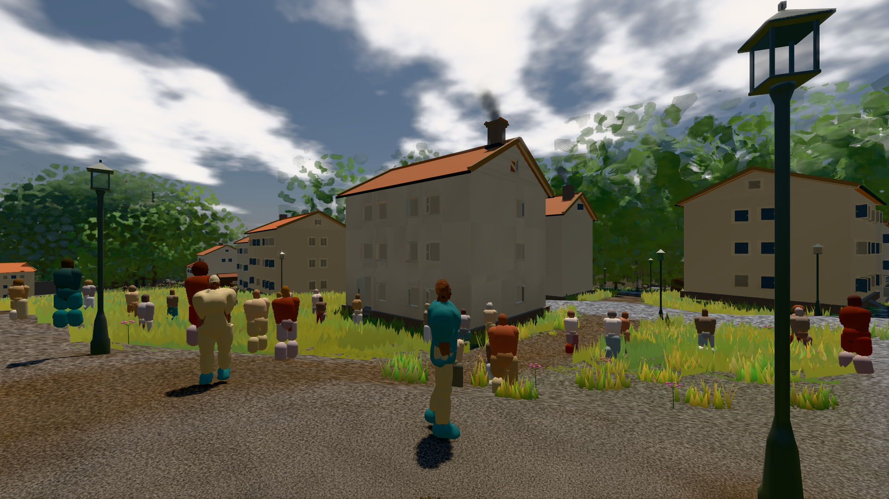

# GPU-PROBE 9e064266 — GRÜN

Zweig `w28-verkehr-graph` · Kopf 9e064266c58045594c6532b6f7f89c4fb6b287f5 · Läufer omen-gtx1060 + radeon-890m (Band-Gerät) · 12.11. 06:45 · Wanduhr ab Push 337 s · Lauf https://github.com/MiguellD/AnazhRealm/actions/runs/43162852531

Ruf: `bild:stadt-voll zeit:gate:verkehr-takt`

## Läufer omen-gtx1060 — GRÜN

GPU NVIDIA GeForce GTX 1060 · npm ci 33 s (package-lock 657462dc)
Schloss /c/Users/micha/AppData/Local/Temp/claude/gpu-schloss hält „ci-runner 43162852531/1 probe“
- Hook 2026-11-12 06:39:55 start ci-runner 43162852531/1 probe: Schloss genommen (refs/heads/w28-verkehr-graph 9e064266c58045594c6532b6f7f89c4fb6b287f5 ws=C:\actions-runner\_work\AnazhRealm\AnazhRealm)

### bild:stadt-voll — GRÜN · 147 s · Läufer omen-gtx1060

Adapter: [linse-gpu] nvidia/pascal

```text
Kamera des Spiels → Blick (14.6 m): 837.84 58.51 445.42 842.31 58.51 459.32
 "abnahme": "ABNAHME GRÜN · beweis · Sicht 0.0 % · Ziel Blickziel im Bild frei 14.6 m, verdeckt nur von Leibern: 1 Punkt, nächster 3.69 m (Leib bewohner) · Luma 105.6 σ 58.9 schwarz 0.1 % weiß 0.0 % · Stand 18.546.259 · Bühne summer sunny 0.50 · Gerät WebGPU nvidia pascal",
```



## Läufer radeon-890m (Band-Gerät) — GRÜN

GPU AMD Radeon(TM) 890M Graphics · npm ci 47 s (package-lock 657462dc)
Schloss /c/Users/micha/AppData/Local/Temp/claude/gpu-schloss hält „ci-runner 43162852531/1 probe“
- Hook 2026-11-12 06:39:58 start ci-runner 43162852531/1 probe: wartet auf Schloss von 'licht 2026-11-12T06:38:21+01:00 pid=47932'
- Hook 2026-11-12 06:41:24 start ci-runner 43162852531/1 probe: Schloss genommen (refs/heads/w28-verkehr-graph 9e064266c58045594c6532b6f7f89c4fb6b287f5 ws=C:\actions-runner\_work\AnazhRealm\AnazhRealm)

### zeit:gate:verkehr-takt — GRÜN · 155 s · Läufer radeon-890m (Band-Gerät)

Adapter: ungenannt (die Probe nannte keinen Browser-Adapter)

```text
  ✅ K2 Reibkreis längs: kein Rezept steigt steiler als tan α = μ — gt 40.3°/45.0° · supersport 39.6°/40.4° · limousine 26.1°/45.0° · kompakt_fwd 26.1°/45.0° · suv 26.1°/45.0°
  ✅ K3 Halt: 21°-Hang ohne Eingabe hält (≤ 0,01 m, Gier 0), 50° rutscht — 21°: 0.000 m · 50°: -13.12 m
  ✅ K4 Querhang: Fahrt längs 35° ohne Lenkung driftet talwärts, am Stand hält 30°, 50° rutscht — 35° Fahrt 3.39 m · 30° Stand 0.000 m · 50° Stand 37.24 m
  ✅ K7 die Wand ist ein Sprung des Bodens: sie hält EINEN Schritt, dann steigt der Wagen auf sein Gesetz (je Schritt ≤ eine Stufe) — nie für immer darunter — Boden +0,35 m: Höhe je Schritt 0.000 · 0.170 · 0.340 · 0.350 · 0.350 · 0.350 (Stufe 0.170 m)
  ✅ K6 Verwindung: kein Rad tiefer im Boden als sein Federweg (GT: radHub × radR, starr: 0); im Federweg hebt sie nicht — GT tau 0,45: 0.204 m im Boden (Federweg 0.204) · starr tau 0,45: 0.000 m · GT tau 0,10: Hub 0.000 m
  ✅ K8 Reifen (fahrzeug.K1): Spitze je Achse und Rezept bei 6–10°, bis 30° ≥ 15 % Abfall; Takt ≥ 240 Hz, die Kosten gegen die Eichung (≤ 86 Eichungen je 1000 Schritte) — Takt 240 Hz · 2.3 µs · 2.39 Eichungen je 1000 (Eichung 0.963 ms) 
  ✅ K9 Fahr-Gefühl: Gas, dann voller Einschlag — Fahrt an der Bug-Achse ≤ 10°, v·ω ≤ 1,8 g·μ, Schwimmwinkel ≤ 40° — {"achse":0,"lenk":0.99,"schwimm":1.8}
  ✅ K10 der Tritt ist analog — 0.50
  ✅ VK-V (mensch.K2) die Stunde ohne Vorgeschichte: dieselbe Saat, dasselbe Bild — {"stunde":10,"bilder":[1200,1200],"erst":-1}
  ✅ VK (PFLICHT-OFFEN C) der Verkehr der Stadt um 10 Uhr
```
