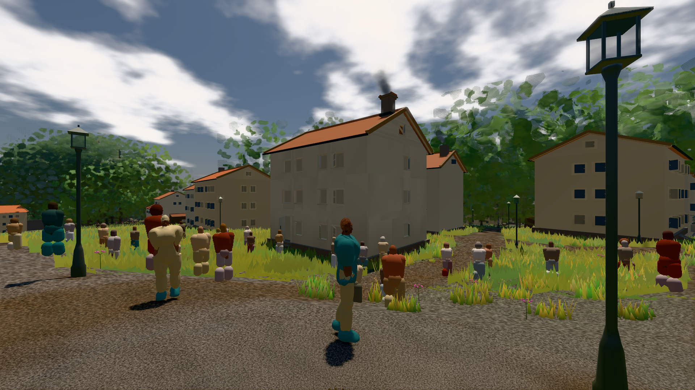

# GPU-PROBE dc26ea3f — GRÜN

Zweig `w28-verkehr-takt` · Kopf dc26ea3fdf0cddc56276cf0297550f77c0786ca3 · Läufer gtx1050-desktop · 11.11. 20:22 · Wanduhr ab Push 454 s · Lauf https://github.com/MiguellD/AnazhRealm/actions/runs/43085464216

Ruf: `bild:stadt-voll`

## Läufer gtx1050-desktop — GRÜN

GPU NVIDIA GeForce GTX 1050 · npm ci 39 s (package-lock 84def1b8)
Schloss /c/Users/User/AppData/Local/Temp/claude/gpu-schloss hält „ci-runner 43085464216/1 probe“
- Hook 2026-11-11 20:15:47 start ci-runner 43085464216/1 probe: wartet auf Schloss von 'hand zweit paar3 (Claude)'
- Hook 2026-11-11 20:16:47 start ci-runner 43085464216/1 probe: Schloss genommen (refs/heads/w28-verkehr-takt dc26ea3fdf0cddc56276cf0297550f77c0786ca3 ws=C:\actions-runner\_work\AnazhRealm\AnazhRealm)

### bild:stadt-voll — GRÜN · 280 s · Läufer gtx1050-desktop

Adapter: [linse-gpu] nvidia/pascal

```text
Kamera des Spiels → Blick (14.6 m): 837.84 58.51 445.42 842.31 58.51 459.32
 "abnahme": "ABNAHME GRÜN · beweis · Sicht 0.0 % · Ziel Blickziel im Bild frei 14.6 m, verdeckt nur von Leibern: 1 Punkt, nächster 3.75 m (Leib bewohner) · Luma 105.4 σ 58.8 schwarz 0.1 % weiß 0.0 % · Stand 18.546.255 · Bühne summer sunny 0.50 · Gerät WebGPU nvidia pascal",
```


