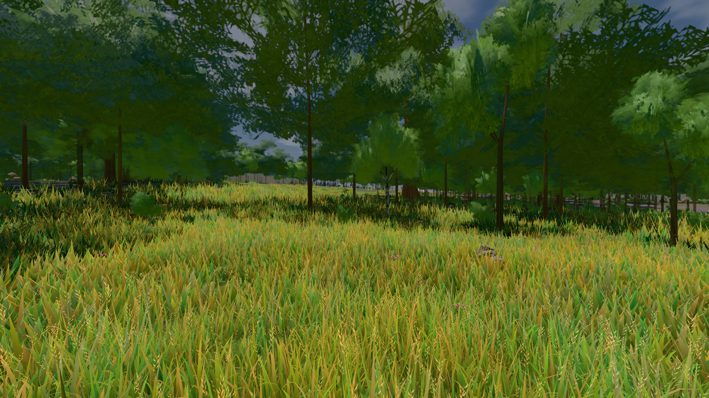
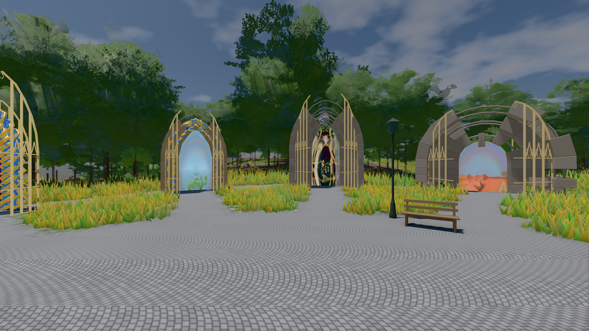

# GPU-PROBE b249949b — GRÜN

Zweig `w28-wald-rang` · Kopf b249949b225e66bf419864b7f2d429f6a3770f37 · Läufer gtx1050-desktop · 15.11. 21:10 · Wanduhr ab Push 253 s · Lauf https://github.com/MiguellD/AnazhRealm/actions/runs/43756167709

Ruf: `gate:boot-stage bild:wiese@0.5 bild:genesis@0.5`

## Läufer gtx1050-desktop — GRÜN

GPU NVIDIA GeForce GTX 1050 · node_modules bleiben (package-lock 604b0b39)
Schloss /c/Users/User/AppData/Local/Temp/claude/gpu-schloss hält „ci-runner 43756167709/1 probe“
- Hook 2026-11-15 21:06:49 start ci-runner 43756167709/1 probe: Schloss genommen (refs/heads/w28-wald-rang b249949b225e66bf419864b7f2d429f6a3770f37 ws=C:\actions-runner\_work\AnazhRealm\AnazhRealm)

### gate:boot-stage — GRÜN · 34 s · Läufer gtx1050-desktop

Adapter: ungenannt (die Probe nannte keinen Browser-Adapter)

```text
  ✅ SELBST-TEST: das Buch, das sich noch öffnet, hält die Welt offen (`_weltOffen`) — ohne Rezepte ein Offenes mehr, mit ihnen wie zuvor
  ✅ SELBST-TEST: die verschluckte Lieferung ist ROT — LIEFERUNG kalt: 0 von 131 von der Platte (0.0 %) · Werk 115 · Haupt-Faden 6 · leer 10 · verschluckt 1
  ✅ SELBST-TEST: der Kern-Wechsel urteilt (fremder Neubau, alter Leser ROT)
  ✅ SELBST-TEST: synchron nach dem Bild ROT
  ✅ SELBST-TEST: der Abdruck urteilt — ein Körper der Platte mit den Bytes des alten Gesetzes ist GEFANGEN beim Namen (ALT UNTER NEUEM GESETZ), ein Treffer mit anderen Bytes, der den gewechselten Kern nie las, heißt NICHT BYTE-STABIL, ohne Messung fällt die Zeile
  ✅ SELBST-TEST: die Programm-Zeile urteilt (gleiche Bytes GRÜN, eine fremde Pipeline ROT beim Namen, ohne Messung ROT)
  ✅ SELBST-TEST: die Lücke je Kachel — der fehlende Busch reißt Kachel 0/0 (18.75 %), das Bildmittel (main, 0.39 %) hielte ihn
  ✅ SELBST-TEST: am Bild gezeichnet — ein wartender Bürger ist ROT beim Namen (Hauptbild und Wurf), ohne Messung ROT
  ✅ SELBST-TEST: die Ankunft bricht nicht — jeder Eintrag des Bruch-Buchs vor dem Bild ist ROT beim Wort, ohne Messung ROT, der EINE Sammler sah ihn
✅ „Volle Bühne" ist ein Prädikat — Kriterium 2 ist messbar.
```

### bild:wiese@0.5 — GRÜN · 86 s · Läufer gtx1050-desktop

Adapter: [linse-gpu] nvidia/pascal

```text
Kamera des Spiels → Blick (10.0 m): -280.40 29.71 -1045.60 -289.61 29.71 -1049.50
 "abnahme": "ABNAHME GRÜN · beweis · Sicht 0.0 % · Ziel Blickziel im Bild frei 10 m · Luma 81.9 σ 39 schwarz 0.0 % weiß 0.0 % · Stand 18.546.294 · Bühne summer sunny 0.50 Tiere gehalten · Gerät WebGPU nvidia pascal · Inhalt nahWiese 48.2 % (≥ 15.0 %) h 107° Luma 117",
```



### bild:genesis@0.5 — GRÜN · 78 s · Läufer gtx1050-desktop

Adapter: [linse-gpu] nvidia/pascal

```text
Kamera des Spiels → Blick (10.0 m): 0.00 92.40 0.00 -10.00 92.40 0.00
 "abnahme": "ABNAHME GRÜN · beweis · Sicht 0.0 % · Ziel Blickziel im Bild frei 10 m · Luma 108 σ 39 schwarz 0.0 % weiß 0.0 % · Stand 18.546.294 · Bühne summer sunny 0.50 Tiere gehalten · Gerät WebGPU nvidia pascal · Inhalt bodenSatz 36.4 % (≥ 15.0 %) Luma 140, portal-membran 2.7 % (≥ 0.3 %) Luma 140",
```


