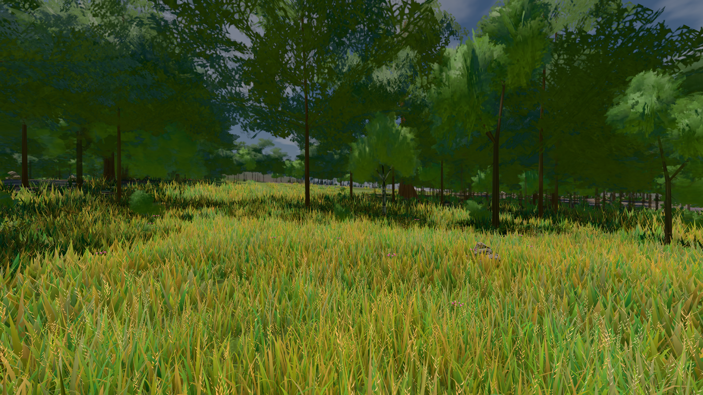

# GPU-PROBE f78073c5 — ROT

Zweig `w28-wald-rang` · Kopf f78073c534a105705be44147fba44dc4d85345e9 · Läufer radeon-890m · 15.11. 20:09 · Wanduhr ab Push 752 s · Lauf https://github.com/MiguellD/AnazhRealm/actions/runs/43749586060

Ruf: `gate:boot-stage bild:wiese@0.5 gate:pop`

## Läufer radeon-890m — ROT

GPU AMD Radeon(TM) 890M Graphics · node_modules bleiben (package-lock 604b0b39)
Schloss /c/Users/micha/AppData/Local/Temp/claude/gpu-schloss hält „ci-runner 43749586060/1 probe“
- Hook 2026-11-15 19:58:54 start ci-runner 43749586060/1 probe: wartet auf Schloss von 'w28-reise-raeumt-zaehl4 2026-11-15T19:58:16+01:00 pid=7900'
- Hook 2026-11-15 20:02:55 start ci-runner 43749586060/1 probe: Schloss genommen (refs/heads/w28-wald-rang f78073c534a105705be44147fba44dc4d85345e9 ws=C:\actions-runner\_work\AnazhRealm\AnazhRealm)

### gate:boot-stage — GRÜN · 35 s · Läufer radeon-890m

Adapter: ungenannt (die Probe nannte keinen Browser-Adapter)

```text
  ✅ SELBST-TEST: das Buch, das sich noch öffnet, hält die Welt offen (`_weltOffen`) — ohne Rezepte ein Offenes mehr, mit ihnen wie zuvor
  ✅ SELBST-TEST: die verschluckte Lieferung ist ROT — LIEFERUNG kalt: 0 von 132 von der Platte (0.0 %) · Werk 115 · Haupt-Faden 7 · leer 10 · verschluckt 1
  ✅ SELBST-TEST: der Kern-Wechsel urteilt (fremder Neubau, alter Leser ROT)
  ✅ SELBST-TEST: synchron nach dem Bild ROT
  ✅ SELBST-TEST: der Abdruck urteilt — ein Körper der Platte mit den Bytes des alten Gesetzes ist GEFANGEN beim Namen (ALT UNTER NEUEM GESETZ), ein Treffer mit anderen Bytes, der den gewechselten Kern nie las, heißt NICHT BYTE-STABIL, ohne Messung fällt die Zeile
  ✅ SELBST-TEST: die Programm-Zeile urteilt (gleiche Bytes GRÜN, eine fremde Pipeline ROT beim Namen, ohne Messung ROT)
  ✅ SELBST-TEST: die Lücke je Kachel — der fehlende Busch reißt Kachel 0/0 (18.75 %), das Bildmittel (main, 0.39 %) hielte ihn
  ✅ SELBST-TEST: am Bild gezeichnet — ein wartender Bürger ist ROT beim Namen (Hauptbild und Wurf), ohne Messung ROT
  ✅ SELBST-TEST: die Ankunft bricht nicht — jeder Eintrag des Bruch-Buchs vor dem Bild ist ROT beim Wort, ohne Messung ROT, der EINE Sammler sah ihn
✅ „Volle Bühne" ist ein Prädikat — Kriterium 2 ist messbar.
```

### bild:wiese@0.5 — GRÜN · 53 s · Läufer radeon-890m

Adapter: [linse-gpu] amd/rdna-3

```text
Kamera des Spiels → Blick (10.0 m): -280.40 29.71 -1045.60 -289.61 29.71 -1049.50
 "abnahme": "ABNAHME GRÜN · beweis · Sicht 0.0 % · Ziel Blickziel im Bild frei 10 m · Luma 81.5 σ 39.3 schwarz 0.0 % weiß 0.0 % · Stand 18.546.294 · Bühne summer sunny 0.50 Tiere gehalten · Gerät WebGPU amd rdna-3 · Inhalt nahWiese 48.2 % (≥ 15.0 %) h 107° Luma 117",
```



### gate:pop — ROT · 97 s · Läufer radeon-890m

Adapter: ungenannt (die Probe nannte keinen Browser-Adapter) · lod.K2#1 ROT 1.7132 % Pop-Pixel/s (35525 px) · 38+95@103/546*+96@117/5162*+66@131/5548*+94@136/5926*+87@144/17045*+85@158/589*+77@164/671*+59@154 · Laub 216 · dc, Dreiecke 99,379165 · GPU 47.63 ms, CPU 5.73 ms je Bild — lod.K2#1 ist an main GRÜN (radeon)

```text
lod.K2#1 ROT 1.7132 % Pop-Pixel/s (35525 px) · 38+95@103/546*+96@117/5162*+66@131/5548*+94@136/5926*+87@144/17045*+85@158/589*+77@164/671*+59@154 · Laub 216 · dc, Dreiecke 99,379165 · GPU 47.63 ms, CPU 5.73 ms je Bild
BLOCK-TREUE GRÜN 231 Blöcke treu · Selbsttest nennt MeshStandardNodeMaterial · nahWiese:L1:0:0 · instanzFarbe: 1/880 Instanzen fremd
 "fehler": "lod.K2#1 ROT 1.7132 % Pop-Pixel/s > 0,05"
```
