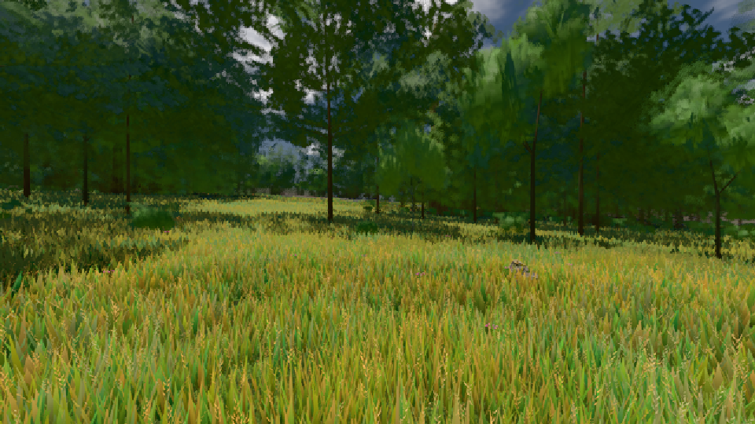

# GPU-PROBE 7aa4802d — GRÜN

Zweig `w28-wald-saum` · Kopf 7aa4802d4f3eb849c348e6aa2bf1fbea2be7d3f3 · Läufer radeon-890m · 11.11. 03:18 · Wanduhr ab Push 111 s · Lauf https://github.com/MiguellD/AnazhRealm/actions/runs/42944868360

Ruf: `bild:wiese@0.5`

## Läufer radeon-890m — GRÜN

GPU AMD Radeon(TM) 890M Graphics · node_modules bleiben (package-lock df29564e)
Schloss /c/Users/micha/AppData/Local/Temp/claude/gpu-schloss hält „ci-runner 42944868360/1 probe“
- Hook 2026-11-11 03:16:40 start ci-runner 42944868360/1 probe: Schloss genommen (refs/heads/w28-wald-saum 7aa4802d4f3eb849c348e6aa2bf1fbea2be7d3f3 ws=C:\actions-runner\_work\AnazhRealm\AnazhRealm)

### bild:wiese@0.5 — GRÜN · 53 s · Läufer radeon-890m

Adapter: [linse-gpu] amd/rdna-3

```text
Kamera des Spiels → Blick (10.0 m): -280.40 29.71 -1045.60 -289.61 29.71 -1049.50
 "abnahme": "ABNAHME GRÜN · beweis · Sicht 0.0 % · Ziel Blickziel im Bild frei 10 m · Luma 83.8 σ 40.2 schwarz 0.0 % weiß 0.0 % · Stand 18.546.249 · Bühne summer sunny 0.50 · Gerät WebGPU amd rdna-3",
```


