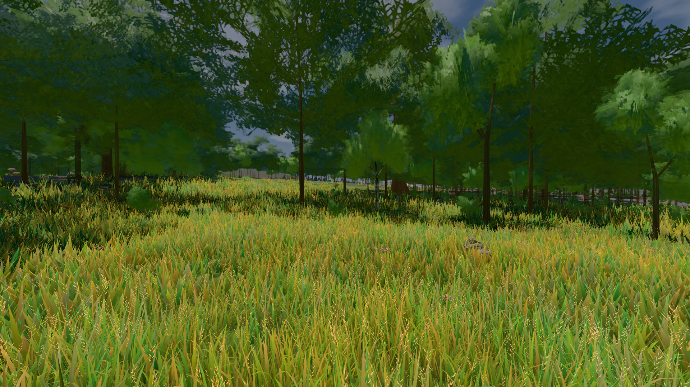

# GPU-PROBE b8700e9e — GRÜN

Zweig `w28-wand-acht` · Kopf b8700e9e5996f727cc1d1e507dd5e646d5f1dd8d · Läufer omen-gtx1060 · 15.11. 20:08 · Wanduhr ab Push 283 s · Lauf https://github.com/MiguellD/AnazhRealm/actions/runs/43750286722

Ruf: `bild:wiese@0.5`

## Läufer omen-gtx1060 — GRÜN

GPU NVIDIA GeForce GTX 1060 · npm ci 44 s (package-lock 29b97e51)
Schloss /c/Users/micha/AppData/Local/Temp/claude/gpu-schloss hält „ci-runner 43750286722/1 probe“
- Hook 2026-11-15 20:05:32 start ci-runner 43750286722/1 probe: Schloss genommen (refs/heads/w28-wand-acht b8700e9e5996f727cc1d1e507dd5e646d5f1dd8d ws=C:\actions-runner\_work\AnazhRealm\AnazhRealm)

### bild:wiese@0.5 — GRÜN · 53 s · Läufer omen-gtx1060

Adapter: [linse-gpu] nvidia/pascal

```text
Kamera des Spiels → Blick (10.0 m): -280.40 29.71 -1045.60 -289.61 29.71 -1049.50
 "abnahme": "ABNAHME GRÜN · beweis · Sicht 0.0 % · Ziel Blickziel im Bild frei 10 m · Luma 81.9 σ 39 schwarz 0.0 % weiß 0.0 % · Stand 18.546.295 · Bühne summer sunny 0.50 Tiere gehalten · Gerät WebGPU nvidia pascal · Inhalt nahWiese 48.2 % (≥ 15.0 %) h 107° Luma 117",
```


