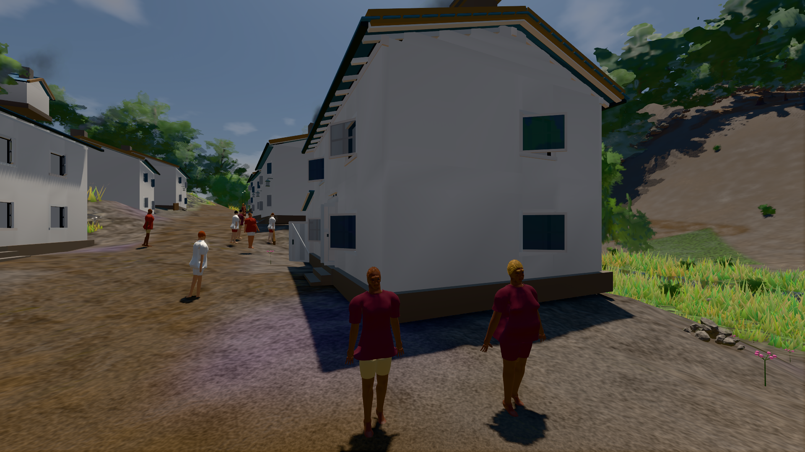
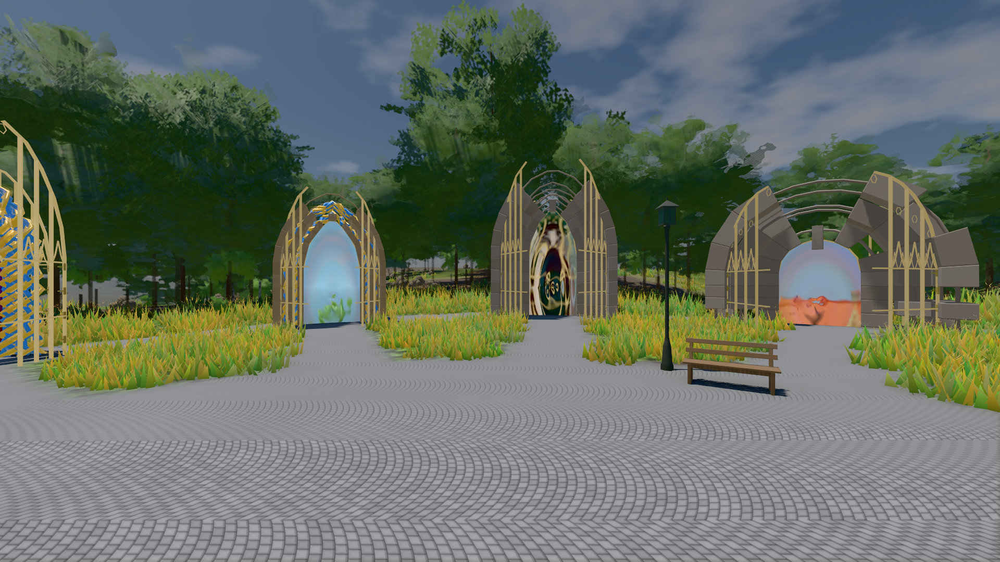

# GPU-PROBE 5a3b5388 — GRÜN

Zweig `w28-wander-revier` · Kopf 5a3b5388a33def5feebacc2ebe4f4eeba7b11bdd · Läufer omen-gtx1060 · 17.11. 10:32 · Wanduhr ab Push 2048 s · Lauf https://github.com/MiguellD/AnazhRealm/actions/runs/44051284388

Ruf: `bild:dorf@0.5 bild:genesis@0.5`

## Läufer omen-gtx1060 — GRÜN

GPU NVIDIA GeForce GTX 1060 · node_modules bleiben (package-lock d306dc02)
Schloss /c/Users/micha/AppData/Local/Temp/claude/gpu-schloss hält „ci-runner 44051284388/2 probe“
- Hook 2026-11-17 10:24:54 start ci-runner 44051284388/2 probe: wartet auf Schloss von 'omen-sg-playtest'
- Hook 2026-11-17 10:29:56 start ci-runner 44051284388/2 probe: Schloss genommen (refs/heads/w28-wander-revier 5a3b5388a33def5feebacc2ebe4f4eeba7b11bdd ws=C:\actions-runner\_work\AnazhRealm\AnazhRealm)

### bild:dorf@0.5 — GRÜN · 73 s · Läufer omen-gtx1060

Adapter: [linse-gpu] nvidia/pascal

```text
Kamera des Spiels → Blick (5.2 m): -704.22 39.69 -880.02 -703.03 39.69 -874.96
 "abnahme": "ABNAHME GRÜN · beweis · Sicht 0.0 % · Ziel Blickziel im Bild frei 5.2 m · Luma 77.6 σ 30.9 schwarz 0.2 % weiß 0.0 % · Stand 18.546.319 · Bühne summer sunny 0.50 Tiere gehalten · Gerät WebGPU nvidia pascal · Inhalt bauSatz 28.7 % (≥ 2.0 %) Luma 79",
```



### bild:genesis@0.5 — GRÜN · 45 s · Läufer omen-gtx1060

Adapter: [linse-gpu] nvidia/pascal

```text
Kamera des Spiels → Blick (10.0 m): 0.00 92.40 0.00 -10.00 92.40 0.00
 "abnahme": "ABNAHME GRÜN · beweis · Sicht 0.0 % · Ziel Blickziel im Bild frei 10 m · Luma 108.5 σ 38.5 schwarz 0.0 % weiß 0.0 % · Stand 18.546.319 · Bühne summer sunny 0.50 Tiere gehalten · Gerät WebGPU nvidia pascal · Inhalt bodenSatz 36.4 % (≥ 15.0 %) Luma 140, portal-membran 2.7 % (≥ 0.3 %) Luma 140",
```


