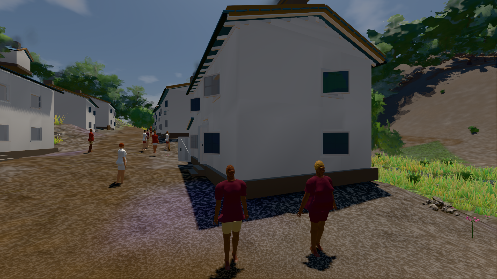
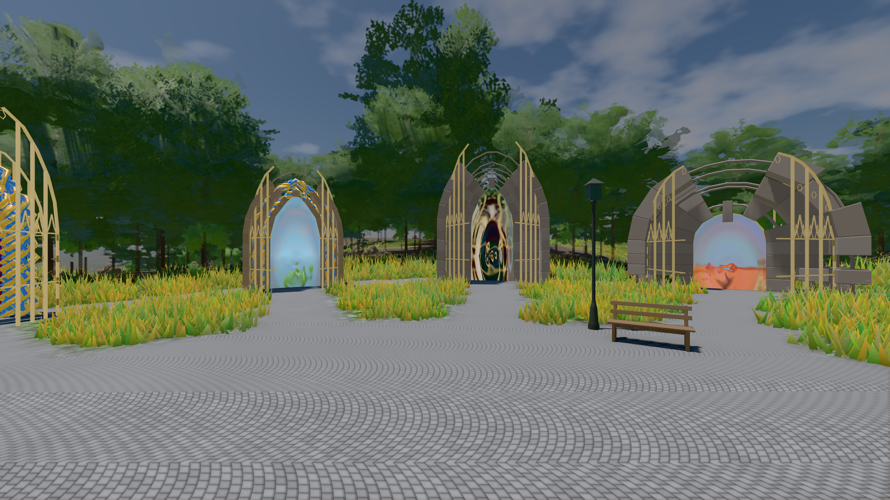

# GPU-PROBE 073b6d17 — ROT

Zweig `w28-wange` · Kopf 073b6d17c5d6ec8ca6a7387d805dc8569be5e64b · Läufer gtx1050-desktop · 15.11. 10:57 · Wanduhr ab Push 614 s · Lauf https://github.com/MiguellD/AnazhRealm/actions/runs/43700885159

Ruf: `bild:dorf@0.5 bild:genesis@0.5 gate:kamera-leib:echt`

## Läufer gtx1050-desktop — ROT

GPU NVIDIA GeForce GTX 1050 · npm ci 68 s (package-lock 5ba7a8f5)
Schloss /c/Users/User/AppData/Local/Temp/claude/gpu-schloss hält „ci-runner 43700885159/1 probe“
- Hook 2026-11-15 10:47:16 start ci-runner 43700885159/1 probe: Schloss genommen (refs/heads/w28-wange 073b6d17c5d6ec8ca6a7387d805dc8569be5e64b ws=C:\actions-runner\_work\AnazhRealm\AnazhRealm)

### bild:dorf@0.5 — GRÜN · 151 s · Läufer gtx1050-desktop

Adapter: [linse-gpu] nvidia/pascal

```text
Kamera des Spiels → Blick (5.2 m): -704.22 39.69 -880.02 -703.03 39.69 -874.96
 "abnahme": "ABNAHME GRÜN · beweis · Sicht 0.0 % · Ziel Blickziel im Bild frei 5.2 m · Luma 77.8 σ 31 schwarz 0.3 % weiß 0.0 % · Stand 18.546.292 · Bühne summer sunny 0.50 Tiere gehalten · Gerät WebGPU nvidia pascal · Inhalt bauSatz 28.7 % (≥ 2.0 %) Luma 80",
```



### bild:genesis@0.5 — GRÜN · 89 s · Läufer gtx1050-desktop

Adapter: [linse-gpu] nvidia/pascal

```text
Kamera des Spiels → Blick (10.0 m): 0.00 92.40 0.00 -10.00 92.40 0.00
 "abnahme": "ABNAHME GRÜN · beweis · Sicht 0.0 % · Ziel Blickziel im Bild frei 10 m · Luma 108 σ 39 schwarz 0.0 % weiß 0.0 % · Stand 18.546.292 · Bühne summer sunny 0.50 Tiere gehalten · Gerät WebGPU nvidia pascal · Inhalt bodenSatz 36.4 % (≥ 15.0 %) Luma 140, portal-membran 2.7 % (≥ 0.3 %) Luma 140",
```



### gate:kamera-leib:echt — ROT · 241 s · Läufer gtx1050-desktop

Adapter: [linse-gpu] nvidia/pascal · ❌ K6 Strafe am Prüfplatz —  · Rückstrahl — — Strafe: Error: DIE WELT STEHT NICHT nach 5072 Takten: Ruhe 0, zuletzt brach sie: Tore offen 10 (das Fenster wartet auf sein Ziel) (DIE WELT HÄNGT: die Welt nach 5072 Takten —  — keine Station beim Namen

```text
  ❌ K6 Strafe am Prüfplatz —  · Rückstrahl — — Strafe: Error: DIE WELT STEHT NICHT nach 5072 Takten: Ruhe 0, zuletzt brach sie: Tore offen 10 (das Fenster wartet auf sein Ziel) (DIE WELT HÄNGT: die Welt nach 5072 Takten — offen {"foundry":0,"chunks":0,"wald":0,"karten":0,"spiegel":0,"felder":0,"leiber":0,"dorf":0,"leib":0,"ankunft":0,"stau":0,"horizont":0,"blende":0,"huellen":0,"zeichnung":0,"tore":10,"alter":0,"wesen":0,"bau":0,"leute":0} ohne Bau-Ereignis · Wald: Saat 0 [] · Plan 0 · Pflanz-Warten 0 · Würfe 0 (außer Blick 0) · Nachwuchs 0 · Karten:  · halbe - · Wesen 
❌ ROT — 1 Verletzung(en): K6 Strafe am Prüfplatz —  · Rückstrahl —
```
