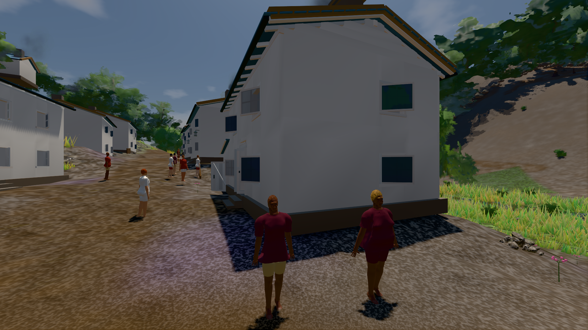
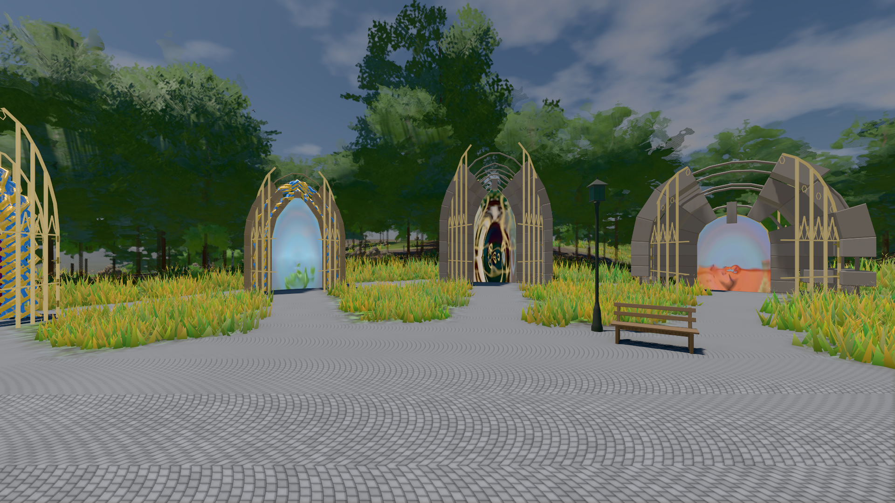

# GPU-PROBE 5fe1dace — GRÜN

Zweig `w28-wange` · Kopf 5fe1daced4e2b57b932fe837fdbef2240069deec · Läufer omen-gtx1060 · 15.11. 12:37 · Wanduhr ab Push 335 s · Lauf https://github.com/MiguellD/AnazhRealm/actions/runs/43709374725

Ruf: `bild:dorf@0.5 bild:genesis@0.5 gate:kamera-leib:echt`

## Läufer omen-gtx1060 — GRÜN

GPU NVIDIA GeForce GTX 1060 · npm ci 73 s (package-lock 5ba7a8f5)
Schloss /c/Users/micha/AppData/Local/Temp/claude/gpu-schloss hält „ci-runner 43709374725/1 probe“
- Hook 2026-11-15 12:32:17 start ci-runner 43709374725/1 probe: Schloss genommen (refs/heads/w28-wange 5fe1daced4e2b57b932fe837fdbef2240069deec ws=C:\actions-runner\_work\AnazhRealm\AnazhRealm)

### bild:dorf@0.5 — GRÜN · 110 s · Läufer omen-gtx1060

Adapter: [linse-gpu] nvidia/pascal

```text
Kamera des Spiels → Blick (5.2 m): -704.22 39.69 -880.02 -703.03 39.69 -874.96
 "abnahme": "ABNAHME GRÜN · beweis · Sicht 0.0 % · Ziel Blickziel im Bild frei 5.2 m · Luma 77.7 σ 31 schwarz 0.3 % weiß 0.0 % · Stand 18.546.292 · Bühne summer sunny 0.50 Tiere gehalten · Gerät WebGPU nvidia pascal · Inhalt bauSatz 28.7 % (≥ 2.0 %) Luma 80",
```



### bild:genesis@0.5 — GRÜN · 37 s · Läufer omen-gtx1060

Adapter: [linse-gpu] nvidia/pascal

```text
Kamera des Spiels → Blick (10.0 m): 0.00 92.40 0.00 -10.00 92.40 0.00
 "abnahme": "ABNAHME GRÜN · beweis · Sicht 0.0 % · Ziel Blickziel im Bild frei 10 m · Luma 108 σ 39 schwarz 0.0 % weiß 0.0 % · Stand 18.546.292 · Bühne summer sunny 0.50 Tiere gehalten · Gerät WebGPU nvidia pascal · Inhalt bodenSatz 36.4 % (≥ 15.0 %) Luma 140, portal-membran 2.7 % (≥ 0.3 %) Luma 140",
```



### gate:kamera-leib:echt — GRÜN · 59 s · Läufer omen-gtx1060

Adapter: [linse-gpu] nvidia/pascal

```text
  ✅ K6 Strafe am Prüfplatz — A0 Kopf 0.0 % Leib 1.3 % (2456 px),A1 Kopf 0.0 % Leib 1.3 % (2465 px),A2 Kopf 0.0 % Leib 1.5 % (2483 px),A3 Kopf 0.0 % Leib 0.8 % (2517 px),D0 Kopf 0.0 % Leib 2.7 % (2488 px),D1 Kopf 0.0 % Leib 1.1 % (2460 px),D2 Kopf 0.0 % Leib 1.2 % (2499 px),D3 Kopf 0.0 % Leib 1.3 % (2565 px) · Rückstrahl 0.1 %
✅ GRÜN — die Kamera steckt nie in Laub, Strauch, Fels oder Boden.
```
