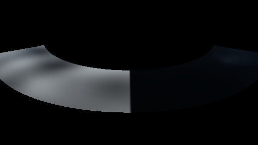
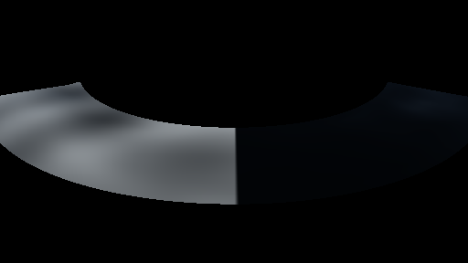

# GPU-PROBE 880ba6ab — ROT

Zweig `w28-wasser-sicht-vorher` · Kopf 880ba6abd86c101b25aeb36010b320fb7f7287f6 · Läufer omen-gtx1060 · 12.11. 07:05 · Wanduhr ab Push 246 s · Lauf https://github.com/MiguellD/AnazhRealm/actions/runs/43165269454

Ruf: `gate:wasser-leben:bild`

## Läufer omen-gtx1060 — ROT

GPU NVIDIA GeForce GTX 1060 · npm ci 33 s (package-lock db0dbb29)
Schloss /c/Users/micha/AppData/Local/Temp/claude/gpu-schloss hält „ci-runner 43165269454/1 probe“
- Hook 2026-11-12 07:04:31 start ci-runner 43165269454/1 probe: Schloss genommen (refs/heads/w28-wasser-sicht-vorher 880ba6abd86c101b25aeb36010b320fb7f7287f6 ws=C:\actions-runner\_work\AnazhRealm\AnazhRealm)

### gate:wasser-leben:bild — ROT · 27 s · Läufer omen-gtx1060

Adapter: [linse-gpu] nvidia/pascal · ❌ B8 Weißkappe: Flaute 2.70 % · Wind 0,8 28.49 % der See · B9 Glanz der Zenit-Sonne: frei 40.53 · hinter dem Grat 40.53 (Luma-Mittel der Mitte) — keine Station beim Namen

```text
  ❌ B8 Weißkappe: Flaute 2.70 % · Wind 0,8 28.49 % der See · B9 Glanz der Zenit-Sonne: frei 40.53 · hinter dem Grat 40.53 (Luma-Mittel der Mitte)
WASSER-LEBEN ROT (3):
  ❌ B8 FLAUTE: {"hellAnteil":0.027,"pixel":147456}
  ❌ B8 STURM: {"hellAnteil":0.2849,"pixel":147456}
  ❌ B9 SCHATTEN: {"frei":40.53,"grat":40.53}
```






