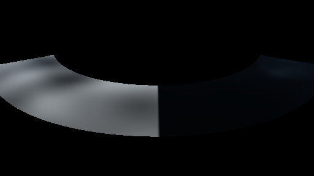

# GPU-PROBE 08000dc2 — GRÜN

Zweig `w28-wasser-sicht` · Kopf 08000dc22e61b148505c79462fc90dc6bfd8513b · Läufer gtx1050-desktop · 12.11. 06:42 · Wanduhr ab Push 147 s · Lauf https://github.com/MiguellD/AnazhRealm/actions/runs/43162844695

Ruf: `gate:wasser-leben:bild`

## Läufer gtx1050-desktop — GRÜN

GPU NVIDIA GeForce GTX 1050 · node_modules bleiben (package-lock f5d79618)
Schloss /c/Users/User/AppData/Local/Temp/claude/gpu-schloss hält „ci-runner 43162844695/1 probe“
- Hook 2026-11-12 06:39:55 start ci-runner 43162844695/1 probe: wartet auf Schloss von 'hand bank mainG4 (Claude)'
- Hook 2026-11-12 06:40:41 start ci-runner 43162844695/1 probe: Schloss genommen (refs/heads/w28-wasser-sicht 08000dc22e61b148505c79462fc90dc6bfd8513b ws=C:\actions-runner\_work\AnazhRealm\AnazhRealm)

### gate:wasser-leben:bild — GRÜN · 51 s · Läufer gtx1050-desktop

Adapter: [linse-gpu] nvidia/pascal

```text
WASSER-LEBEN GRÜN
```




