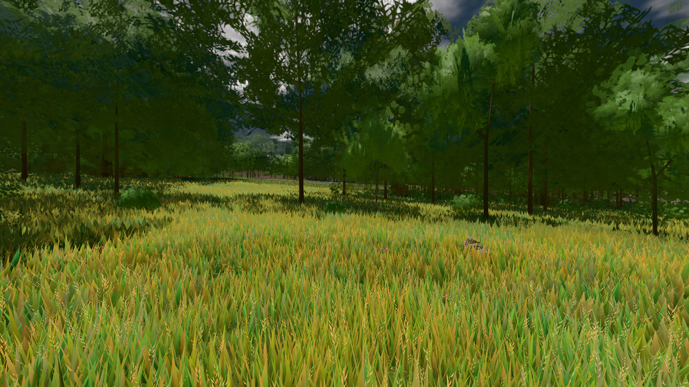

# GPU-PROBE 2eb38504 — ROT

Zweig `w28-wasser-sicht` · Kopf 2eb385044a2ef1edb555ef2930d05b6e7bc6ec7e · Läufer radeon-890m · 12.11. 06:25 · Wanduhr ab Push 333 s · Lauf https://github.com/MiguellD/AnazhRealm/actions/runs/43160626976

Ruf: `gate:wasser-leben:bild bild:wiese`

## Läufer radeon-890m — ROT

GPU AMD Radeon(TM) 890M Graphics · npm ci 74 s (package-lock f5d79618)
Schloss /c/Users/micha/AppData/Local/Temp/claude/gpu-schloss hält „ci-runner 43160626976/1 probe“
- Hook 2026-11-12 06:19:54 start ci-runner 43160626976/1 probe: wartet auf Schloss von 'licht 2026-11-12T06:19:16+01:00 pid=37488'
- Hook 2026-11-12 06:20:27 start ci-runner 43160626976/1 probe: Schloss genommen (refs/heads/w28-wasser-sicht 2eb385044a2ef1edb555ef2930d05b6e7bc6ec7e ws=C:\actions-runner\_work\AnazhRealm\AnazhRealm)

### gate:wasser-leben:bild — ROT · 43 s · Läufer radeon-890m

Adapter: [linse-gpu] amd/rdna-3 · WASSER-LEBEN ROT (1): — keine Station beim Namen

```text
WASSER-LEBEN ROT (1):
  ❌ B8 STURM: {"hellAnteil":0,"pixel":147456}
```


### bild:wiese — GRÜN · 60 s · Läufer radeon-890m

Adapter: [linse-gpu] amd/rdna-3

```text
Kamera des Spiels → Blick (10.0 m): -280.40 29.71 -1045.60 -289.61 29.71 -1049.50
 "abnahme": "ABNAHME GRÜN · beweis · Sicht 0.0 % · Ziel Blickziel im Bild frei 10 m · Luma 81.3 σ 43 schwarz 0.0 % weiß 0.0 % · Stand 18.546.260 · Bühne summer sunny 0.50 Tiere gehalten · Gerät WebGPU amd rdna-3 · Inhalt nahWiese 47.9 % (≥ 15.0 %) h 106° Luma 121",
```


