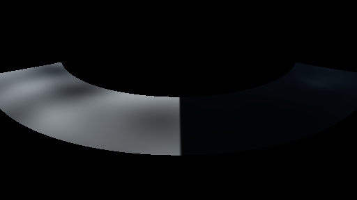
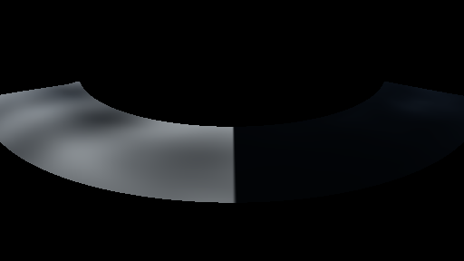
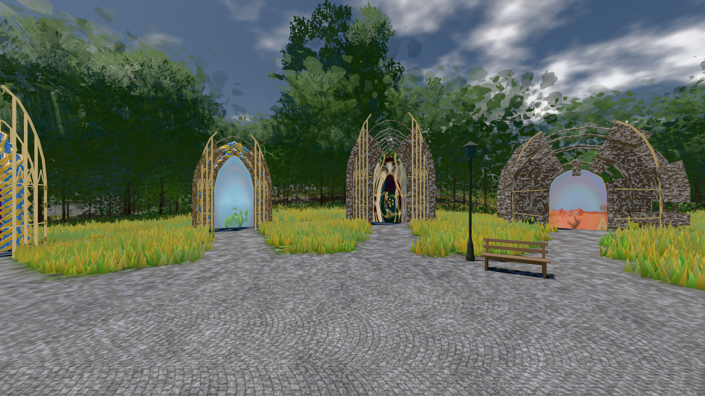
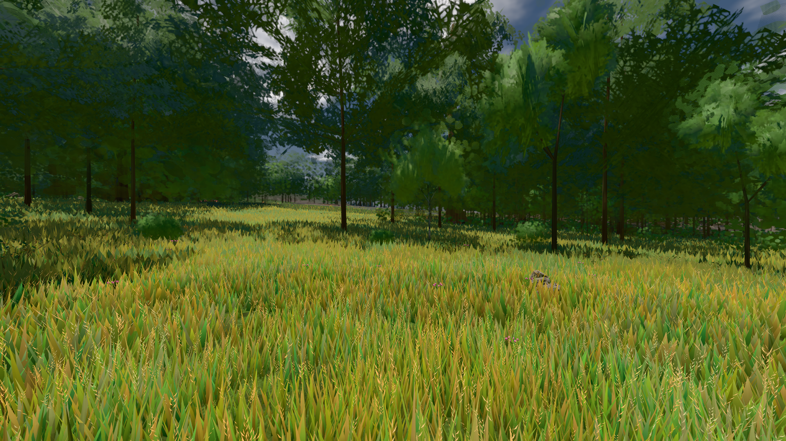

# GPU-PROBE 6fd33f42 — GRÜN

Zweig `w28-wasser-sicht` · Kopf 6fd33f42643fef6e94483741f7d706173897aa41 · Läufer omen-gtx1060 · 12.11. 07:10 · Wanduhr ab Push 165 s · Lauf https://github.com/MiguellD/AnazhRealm/actions/runs/43165907948

Ruf: `gate:wasser-leben:bild bild:genesis bild:wiese`

## Läufer omen-gtx1060 — GRÜN

GPU NVIDIA GeForce GTX 1060 · node_modules bleiben (package-lock db0dbb29)
Schloss /c/Users/micha/AppData/Local/Temp/claude/gpu-schloss hält „ci-runner 43165907948/1 probe“
- Hook 2026-11-12 07:07:35 start ci-runner 43165907948/1 probe: Schloss genommen (refs/heads/w28-wasser-sicht 6fd33f42643fef6e94483741f7d706173897aa41 ws=C:\actions-runner\_work\AnazhRealm\AnazhRealm)

### gate:wasser-leben:bild — GRÜN · 28 s · Läufer omen-gtx1060

Adapter: [linse-gpu] nvidia/pascal

```text
  ✅ B8 Weißkappe: Flaute 0.00 % · Wind 0,8 4.21 % der See · B9 Glanz der Zenit-Sonne: frei 37.36 · hinter dem Grat 5.65 (Luma-Mittel der Mitte)
WASSER-LEBEN GRÜN
```






### bild:genesis — GRÜN · 44 s · Läufer omen-gtx1060

Adapter: [linse-gpu] nvidia/pascal

```text
Kamera des Spiels → Blick (10.0 m): 0.00 92.40 0.00 -10.00 92.40 0.00
 "abnahme": "ABNAHME GRÜN · beweis · Sicht 0.0 % · Ziel Blickziel im Bild frei 10 m · Luma 105.7 σ 40.3 schwarz 0.0 % weiß 0.0 % · Stand 18.546.261 · Bühne summer sunny 0.50 Tiere gehalten · Gerät WebGPU nvidia pascal · Inhalt bodenSatz 35.3 % (≥ 15.0 %) Luma 130, portal-membran 2.8 % (≥ 0.3 %) Luma 139",
```



### bild:wiese — GRÜN · 46 s · Läufer omen-gtx1060

Adapter: [linse-gpu] nvidia/pascal

```text
Kamera des Spiels → Blick (10.0 m): -280.40 29.71 -1045.60 -289.61 29.71 -1049.50
 "abnahme": "ABNAHME GRÜN · beweis · Sicht 0.0 % · Ziel Blickziel im Bild frei 10 m · Luma 82.2 σ 42.6 schwarz 0.0 % weiß 0.0 % · Stand 18.546.261 · Bühne summer sunny 0.50 Tiere gehalten · Gerät WebGPU nvidia pascal · Inhalt nahWiese 48.2 % (≥ 15.0 %) h 107° Luma 120",
```


