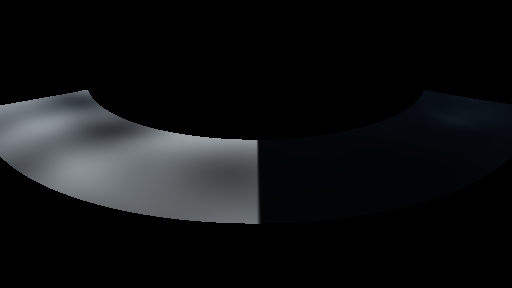
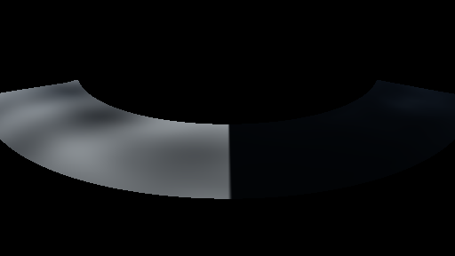

# GPU-PROBE b3d4f1bc — GRÜN

Zweig `w28-wasser-sicht` · Kopf b3d4f1bccd45c584d2266197b3ae79510e2a5c7c · Läufer gtx1050-desktop · 12.11. 06:45 · Wanduhr ab Push 167 s · Lauf https://github.com/MiguellD/AnazhRealm/actions/runs/43163207247

Ruf: `gate:wasser-leben:bild`

## Läufer gtx1050-desktop — GRÜN

GPU NVIDIA GeForce GTX 1050 · node_modules bleiben (package-lock f5d79618)
Schloss /c/Users/User/AppData/Local/Temp/claude/gpu-schloss hält „ci-runner 43163207247/1 probe“
- Hook 2026-11-12 06:43:21 start ci-runner 43163207247/1 probe: wartet auf Schloss von 'hand bank kopfG4 (Claude)'
- Hook 2026-11-12 06:44:21 start ci-runner 43163207247/1 probe: Schloss genommen (refs/heads/w28-wasser-sicht b3d4f1bccd45c584d2266197b3ae79510e2a5c7c ws=C:\actions-runner\_work\AnazhRealm\AnazhRealm)

### gate:wasser-leben:bild — GRÜN · 50 s · Läufer gtx1050-desktop

Adapter: [linse-gpu] nvidia/pascal

```text
  ✅ B8 Weißkappe: Flaute 0.00 % · Wind 0,8 4.21 % der See · B9 Glanz der Zenit-Sonne: frei 37.36 · hinter dem Grat 5.65 (Luma-Mittel der Mitte)
WASSER-LEBEN GRÜN
```






