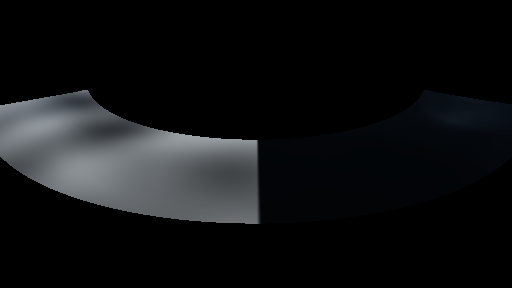
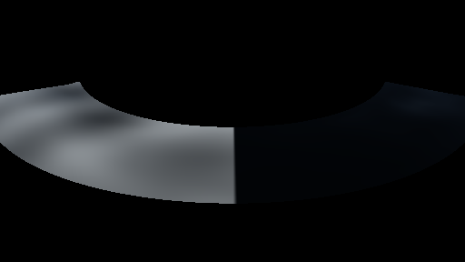

# GPU-PROBE d56cbdc1 — GRÜN

Zweig `w28-wasser-sicht` · Kopf d56cbdc1af56e35f3be4f6545d8f36b32442ea3c · Läufer gtx1050-desktop · 12.11. 06:38 · Wanduhr ab Push 88 s · Lauf https://github.com/MiguellD/AnazhRealm/actions/runs/43162550912

Ruf: `gate:wasser-leben:bild`

## Läufer gtx1050-desktop — GRÜN

GPU NVIDIA GeForce GTX 1050 · node_modules bleiben (package-lock f5d79618)
Schloss /c/Users/User/AppData/Local/Temp/claude/gpu-schloss hält „ci-runner 43162550912/1 probe“
- Hook 2026-11-12 06:37:08 start ci-runner 43162550912/1 probe: Schloss genommen (refs/heads/w28-wasser-sicht d56cbdc1af56e35f3be4f6545d8f36b32442ea3c ws=C:\actions-runner\_work\AnazhRealm\AnazhRealm)

### gate:wasser-leben:bild — GRÜN · 44 s · Läufer gtx1050-desktop

Adapter: [linse-gpu] nvidia/pascal

```text
WASSER-LEBEN GRÜN
```






