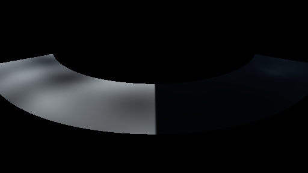

# GPU-PROBE e20a5a18 — GRÜN

Zweig `w28-wasser-sicht` · Kopf e20a5a186e38541ea61d5c281d57cb1874bd6461 · Läufer gtx1050-desktop · 12.11. 06:34 · Wanduhr ab Push 483 s · Lauf https://github.com/MiguellD/AnazhRealm/actions/runs/43161414212

Ruf: `gate:wasser-leben:bild`

## Läufer gtx1050-desktop — GRÜN

GPU NVIDIA GeForce GTX 1050 · node_modules bleiben (package-lock f5d79618)
Schloss /c/Users/User/AppData/Local/Temp/claude/gpu-schloss hält „ci-runner 43161414212/1 probe“
- Hook 2026-11-12 06:32:59 start ci-runner 43161414212/1 probe: Schloss genommen (refs/heads/w28-wasser-sicht e20a5a186e38541ea61d5c281d57cb1874bd6461 ws=C:\actions-runner\_work\AnazhRealm\AnazhRealm)

### gate:wasser-leben:bild — GRÜN · 68 s · Läufer gtx1050-desktop

Adapter: [linse-gpu] nvidia/pascal

```text
WASSER-LEBEN GRÜN
```




