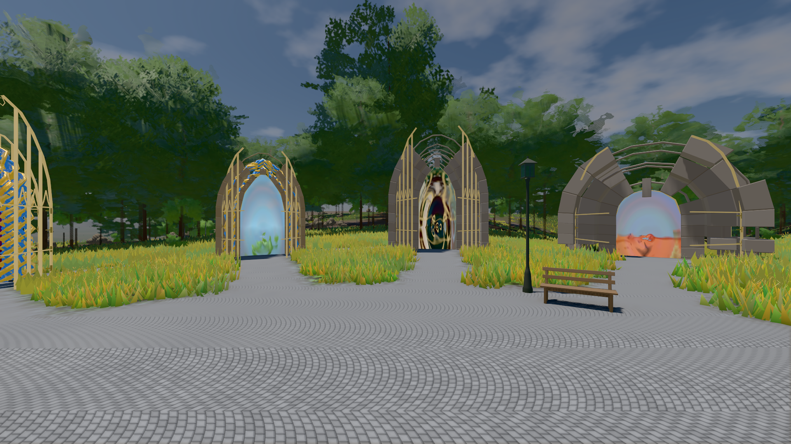

# GPU-PROBE 7b6751c6 — GRÜN

Zweig `w28-welt-steht` · Kopf 7b6751c6c815a0e70048ca20144cce11445372bb · Läufer gtx1050-desktop + radeon-890m (Band-Gerät) · 14.11. 08:24 · Wanduhr ab Push 348 s · Lauf https://github.com/MiguellD/AnazhRealm/actions/runs/43570510115

Ruf: `bild:genesis@0.5 zeit:gate:ankunft`

## Läufer gtx1050-desktop — GRÜN

GPU NVIDIA GeForce GTX 1050 · node_modules bleiben (package-lock 5f3fc96f)
Schloss /c/Users/User/AppData/Local/Temp/claude/gpu-schloss hält „ci-runner 43570510115/1 probe“
- Hook 2026-11-14 08:19:10 start ci-runner 43570510115/1 probe: Schloss genommen (refs/heads/w28-welt-steht 7b6751c6c815a0e70048ca20144cce11445372bb ws=C:\actions-runner\_work\AnazhRealm\AnazhRealm)

### bild:genesis@0.5 — GRÜN · 77 s · Läufer gtx1050-desktop

Adapter: [linse-gpu] nvidia/pascal

```text
Kamera des Spiels → Blick (10.0 m): 0.00 92.40 0.00 -10.00 92.40 0.00
 "abnahme": "ABNAHME GRÜN · beweis · Sicht 0.0 % · Ziel Blickziel im Bild frei 10 m · Luma 107.4 σ 39 schwarz 0.0 % weiß 0.0 % · Stand 18.546.281 · Bühne summer sunny 0.50 Tiere gehalten · Gerät WebGPU nvidia pascal · Inhalt bodenSatz 36.1 % (≥ 15.0 %) Luma 140, portal-membran 2.7 % (≥ 0.3 %) Luma 140",
```



## Läufer radeon-890m (Band-Gerät) — GRÜN

GPU AMD Radeon(TM) 890M Graphics · node_modules bleiben (package-lock 5f3fc96f)
Schloss /c/Users/micha/AppData/Local/Temp/claude/gpu-schloss hält „ci-runner 43570510115/1 probe“
- Hook 2026-11-14 08:19:21 start ci-runner 43570510115/1 probe: wartet auf Schloss von 'wiese-schale 2026-11-14T08:18:37+01:00 pid=74876'
- Hook 2026-11-14 08:22:03 start ci-runner 43570510115/1 probe: Schloss genommen (refs/heads/w28-welt-steht 7b6751c6c815a0e70048ca20144cce11445372bb ws=C:\actions-runner\_work\AnazhRealm\AnazhRealm)

### zeit:gate:ankunft — GRÜN · 110 s · Läufer radeon-890m (Band-Gerät)

Adapter: ungenannt (die Probe nannte keinen Browser-Adapter)

```text
  ✅ LH was das Bild nicht liest, hält es nicht: die Hülle am Leib, der Ring außer Bild im Leerlauf — Hülle 0,0,0,1,0 · Ring [hinten ohne Leerlauf, vorn, Ruf, hinten mit] false,true,true,true · Kacheln {"_tickNahWiese":[0,1],"_nahWieseFernTakt":[0,3],"_tickNahStreu":[0,3]} · Krone vor der Kachel [gebaut, stehend, unter der kommenden, unter der gelandeten] {"_tickNahWiese":[24,24,0,10],"_nahWieseFernTakt":[852,852,0,4],"_tickNahStreu":[148,148,0,36]} · Mutante {"_tickNahWiese":[34,24,10,10],"_nahWieseFernTakt":[856,852,4,4],"_tickNahStreu":[184,148,36,36]} · Chunk [offen, gepflanzt]
  ✅ L1 das Fadenkreuz steht in der Bildmitte und weicht der Schublade — da true · Mitte 0/0 px · mit Werkstatt false · danach true
  ✅ L2b „hilfe" nennt die EINEN Tafeln und die Tasten — „hilfe": 0 fehlen · „help": 0 fehlen · „?": 0 fehlen
  ✅ L3 Enter öffnet das Gespräch, Enter sendet und gibt die Welt zurück, Enter auf einem Knopf gehört dem Knopf — Enter → chat-input · gesendet true · danach BODY · W true · Esc → BODY · Enter auf dem Knopf → knopf
  ✅ L7 der Start-Gurt liest den Katalog (je Studio-Art ein Werk) — baum_eiche · fahrzeug_gt · tor_drachentor · haus_alemannisch · bank_sitzbank · leiter_podestleiter · bruecke_jochfeld · schaukel_doppelschaukel (Arten im Katalog: tree, vehicle, ort:tor, haus, ort:platz, ort:wand, ort:weg, ort:spielplatz)
  ✅ LK die 3rd-Kamera rückt nur vor Boden und Bau ein, gleitet hinaus, jeder Pflanzen-Stoff trägt die Durchsicht — baum_kiefer · Stamm × 3.977 (Welt × 3.977) · fuss: 496 Proben, Pflanze hält 0, Arm 6.11/6.11 m (Ist/Soll), < 3 m 0, Sprünge 0 (Soll 0, hinaus 0) · ritt: 496 Proben, Pflanze hält 0, Arm 9.38/9.38 m (Ist/Soll), < 3 m 0, Sprünge 0 (Soll 0, hinaus 0) · Pflanzen-Stoffe 16, ohne Durchsicht 0, Ziel 0.6 m neben der Brust, Fadenkreuz 0.6 m neben der Brust · Fadenkreuz-Strahl: 96 Stellungen, hinter dem Spieler {}, Ziel neben dem Blick 0 m · Durchsicht: 1st 0/8 Anläufe mit
  ✅ D8 der Spieler-Chat trägt Worte, das Log die Zahlen — 6 Zeilen · Log true
  ✅ D6 die KI nennt die Ursache (Dienst · Schlüssel · Proxy) — Status „Fehler (Ollama (lokal oder gehostet)): Keine Antwort von 127" · ohne Schlüssel „(Grok schweigt: für Claude (Anthropic, kostet) fehlt der Sch" · Proxy http://127.0.0.1:4601/api/proxy/llm
  ✅ D9 das Dorf steht vor dir, ein gesperrter Slot fällt an seinem Ort — 25 Häuser (Log: 25 platziert, 0 übersprungen) · hinten 0 · außer Bild 0 · gesperrter Slot steht false, laut true · „„Villaalto" steht vor dir: 25 Häuser." · baue dorf hier: 44.4–120.9 m, beim Mitspieler 0 m daneben (Häuser 14 / 14)
✅ GRÜN — die Ankunft trägt ihre benannten Schnitte.
```
