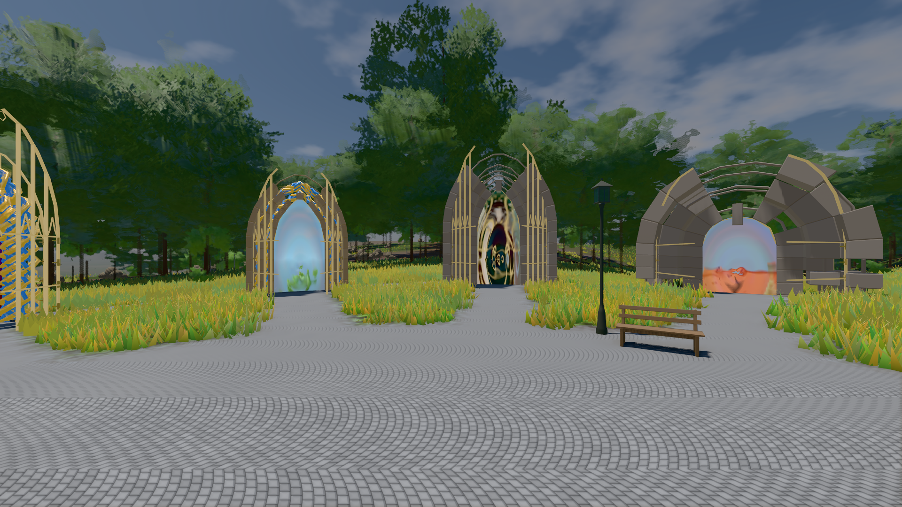
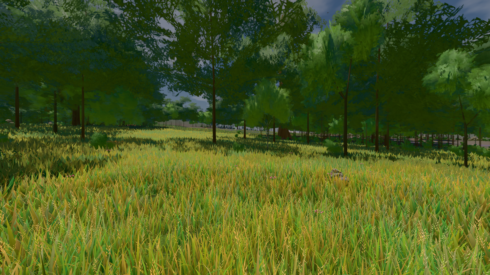

# GPU-PROBE 24b050d0 — GRÜN

Zweig `w28-welt-uhr` · Kopf 24b050d08b9bfd1aae199024e05b3259f37aabfc · Läufer gtx1050-desktop · 14.11. 13:08 · Wanduhr ab Push 601 s · Lauf https://github.com/MiguellD/AnazhRealm/actions/runs/43592484770

Ruf: `bild:genesis@0.5 bild:wiese@0.5`

## Läufer gtx1050-desktop — GRÜN

GPU NVIDIA GeForce GTX 1050 · node_modules bleiben (package-lock 57539f97)
Schloss /c/Users/User/AppData/Local/Temp/claude/gpu-schloss hält „ci-runner 43592484770/1 probe“
- Hook 2026-11-14 12:59:35 start ci-runner 43592484770/1 probe: wartet auf Schloss von 'hand werkbank zensus-1 (Claude)'
- Hook 2026-11-14 13:00:50 start ci-runner 43592484770/1 probe: Schloss genommen (refs/heads/w28-welt-uhr 24b050d08b9bfd1aae199024e05b3259f37aabfc ws=C:\actions-runner\_work\AnazhRealm\AnazhRealm)

### bild:genesis@0.5 — GRÜN · 81 s · Läufer gtx1050-desktop

Adapter: [linse-gpu] nvidia/pascal

```text
Kamera des Spiels → Blick (10.0 m): 0.00 92.40 0.00 -10.00 92.40 0.00
 "abnahme": "ABNAHME GRÜN · beweis · Sicht 0.0 % · Ziel Blickziel im Bild frei 10 m · Luma 107.4 σ 39 schwarz 0.0 % weiß 0.0 % · Stand 18.546.283 · Bühne summer sunny 0.50 Tiere gehalten · Gerät WebGPU nvidia pascal · Inhalt bodenSatz 36.1 % (≥ 15.0 %) Luma 140, portal-membran 2.7 % (≥ 0.3 %) Luma 140",
```



### bild:wiese@0.5 — GRÜN · 84 s · Läufer gtx1050-desktop

Adapter: [linse-gpu] nvidia/pascal

```text
Kamera des Spiels → Blick (10.0 m): -280.40 29.71 -1045.60 -289.61 29.71 -1049.50
 "abnahme": "ABNAHME GRÜN · beweis · Sicht 0.0 % · Ziel Blickziel im Bild frei 10 m · Luma 82.6 σ 38.8 schwarz 0.0 % weiß 0.0 % · Stand 18.546.283 · Bühne summer sunny 0.50 Tiere gehalten · Gerät WebGPU nvidia pascal · Inhalt nahWiese 48.4 % (≥ 15.0 %) h 107° Luma 118",
```


