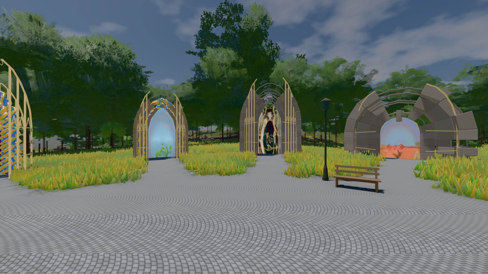
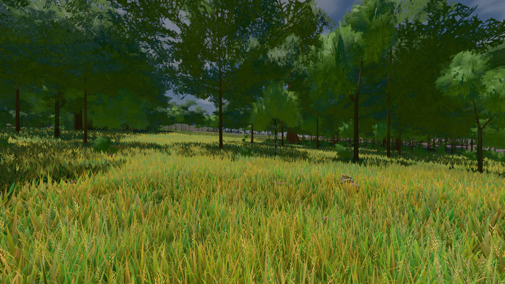

# GPU-PROBE ff7ad524 — GRÜN

Zweig `w28-welt-uhr` · Kopf ff7ad52486a5ccc15f9b8a90e95a0d4057a44fa9 · Läufer radeon-890m · 14.11. 15:07 · Wanduhr ab Push 520 s · Lauf https://github.com/MiguellD/AnazhRealm/actions/runs/43602420315

Ruf: `bild:genesis@0.5 bild:wiese@0.5`

## Läufer radeon-890m — GRÜN

GPU AMD Radeon(TM) 890M Graphics · npm ci 40 s (package-lock 2fb635b1)
Schloss /c/Users/micha/AppData/Local/Temp/claude/gpu-schloss hält „ci-runner 43602420315/1 probe“
- Hook 2026-11-14 14:58:55 start ci-runner 43602420315/1 probe: wartet auf Schloss von 'wiese-schale 2026-11-14T14:57:57+01:00 pid=100664'
- Hook 2026-11-14 15:00:03 start ci-runner 43602420315/1 probe: Schloss genommen (refs/heads/w28-welt-uhr ff7ad52486a5ccc15f9b8a90e95a0d4057a44fa9 ws=C:\actions-runner\_work\AnazhRealm\AnazhRealm)

### bild:genesis@0.5 — GRÜN · 52 s · Läufer radeon-890m

Adapter: [linse-gpu] amd/rdna-3

```text
Kamera des Spiels → Blick (10.0 m): 0.00 92.40 0.00 -10.00 92.40 0.00
 "abnahme": "ABNAHME GRÜN · beweis · Sicht 0.0 % · Ziel Blickziel im Bild frei 10 m · Luma 107.4 σ 39 schwarz 0.0 % weiß 0.0 % · Stand 18.546.284 · Bühne summer sunny 0.50 Tiere gehalten · Gerät WebGPU amd rdna-3 · Inhalt bodenSatz 36.1 % (≥ 15.0 %) Luma 140, portal-membran 2.7 % (≥ 0.3 %) Luma 140",
```



### bild:wiese@0.5 — GRÜN · 67 s · Läufer radeon-890m

Adapter: [linse-gpu] amd/rdna-3

```text
Kamera des Spiels → Blick (10.0 m): -280.40 29.71 -1045.60 -289.61 29.71 -1049.50
 "abnahme": "ABNAHME GRÜN · beweis · Sicht 0.0 % · Ziel Blickziel im Bild frei 10 m · Luma 82.2 σ 39.2 schwarz 0.0 % weiß 0.0 % · Stand 18.546.284 · Bühne summer sunny 0.50 Tiere gehalten · Gerät WebGPU amd rdna-3 · Inhalt nahWiese 48.3 % (≥ 15.0 %) h 107° Luma 118",
```


