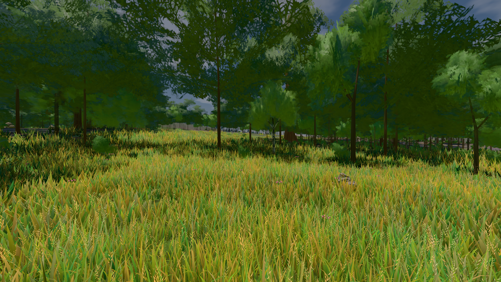

# GPU-PROBE 0b303b08 — GRÜN

Zweig `w28-wiese-schale` · Kopf 0b303b08000a20f193c6490afe8f2b7e3636d79f · Läufer omen-gtx1060 · 14.11. 15:38 · Wanduhr ab Push 578 s · Lauf https://github.com/MiguellD/AnazhRealm/actions/runs/43605043184

Ruf: `bild:wiese@0.5 gate:pop gate:nah-fern`

## Läufer omen-gtx1060 — GRÜN

GPU NVIDIA GeForce GTX 1060 · npm ci 46 s (package-lock 09faa9be)
Schloss /c/Users/micha/AppData/Local/Temp/claude/gpu-schloss hält „ci-runner 43605043184/1 probe“
- Hook 2026-11-14 15:28:58 start ci-runner 43605043184/1 probe: wartet auf Schloss von 'omen-punkte-gtx-sitzung'
- Hook 2026-11-14 15:34:16 start ci-runner 43605043184/1 probe: Schloss genommen (refs/heads/w28-wiese-schale 0b303b08000a20f193c6490afe8f2b7e3636d79f ws=C:\actions-runner\_work\AnazhRealm\AnazhRealm)

### bild:wiese@0.5 — GRÜN · 48 s · Läufer omen-gtx1060

Adapter: [linse-gpu] nvidia/pascal

```text
Kamera des Spiels → Blick (10.0 m): -280.40 29.71 -1045.60 -289.61 29.71 -1049.50
 "abnahme": "ABNAHME GRÜN · beweis · Sicht 0.0 % · Ziel Blickziel im Bild frei 10 m · Luma 81.9 σ 39 schwarz 0.0 % weiß 0.0 % · Stand 18.546.285 · Bühne summer sunny 0.50 Tiere gehalten · Gerät WebGPU nvidia pascal · Inhalt nahWiese 48.2 % (≥ 15.0 %) h 107° Luma 117",
```



### gate:pop — GRÜN · 61 s · Läufer omen-gtx1060

Adapter: ungenannt (die Probe nannte keinen Browser-Adapter)

```text
lod.K2#1 GRÜN 0.0483 % Pop-Pixel/s (1002 px) · 11*+1@189/26*/377*+2@154/293*/61*/57*+3@155/84*/93*+1@189 · Laub 216 · dc, Dreiecke 98,374707 · GPU 25.33 ms, CPU 2.59 ms je Bild
BLOCK-TREUE GRÜN 231 Blöcke treu · Selbsttest nennt MeshStandardNodeMaterial · nahWiese:L1:0:0 · instanzFarbe: 1/880 Instanzen fremd
```

### gate:nah-fern — GRÜN · 43 s · Läufer omen-gtx1060

Adapter: ungenannt (die Probe nannte keinen Browser-Adapter)

```text
✅ SELBSTTEST GRÜN — das Nah-Fern-Urteil nennt die zwei Farben derselben Stelle beim Namen
✅ NAH-FERN GRÜN — EINE Boden-Farbe je Ort
```
