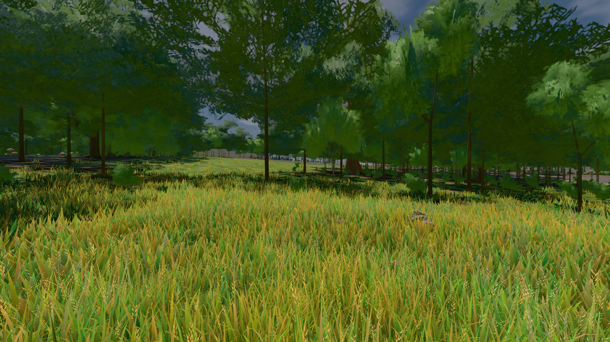
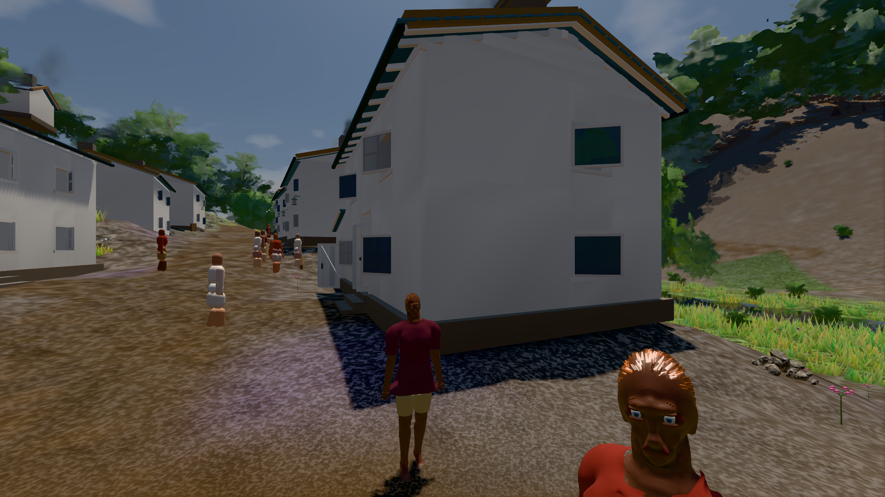

# GPU-PROBE 4e7bd419 — GRÜN

Zweig `w28-wiese-schale` · Kopf 4e7bd4193a0e1a8549ad0b51030f71cc4656f0c9 · Läufer gtx1050-desktop · 14.11. 13:46 · Wanduhr ab Push 578 s · Lauf https://github.com/MiguellD/AnazhRealm/actions/runs/43595713526

Ruf: `bild:wiese@0.5 bild:dorf@0.5`

## Läufer gtx1050-desktop — GRÜN

GPU NVIDIA GeForce GTX 1050 · node_modules bleiben (package-lock 57539f97)
Schloss /c/Users/User/AppData/Local/Temp/claude/gpu-schloss hält „ci-runner 43595713526/1 probe“
- Hook 2026-11-14 13:42:27 start ci-runner 43595713526/1 probe: Schloss genommen (refs/heads/w28-wiese-schale 4e7bd4193a0e1a8549ad0b51030f71cc4656f0c9 ws=C:\actions-runner\_work\AnazhRealm\AnazhRealm)

### bild:wiese@0.5 — GRÜN · 89 s · Läufer gtx1050-desktop

Adapter: [linse-gpu] nvidia/pascal

```text
Kamera des Spiels → Blick (10.0 m): -280.40 29.71 -1045.60 -289.61 29.71 -1049.50
 "abnahme": "ABNAHME GRÜN · beweis · Sicht 0.0 % · Ziel Blickziel im Bild frei 10 m · Luma 81.4 σ 39 schwarz 0.0 % weiß 0.0 % · Stand 18.546.283 · Bühne summer sunny 0.50 Tiere gehalten · Gerät WebGPU nvidia pascal · Inhalt nahWiese 45.5 % (≥ 15.0 %) h 107° Luma 118",
```



### bild:dorf@0.5 — GRÜN · 136 s · Läufer gtx1050-desktop

Adapter: [linse-gpu] nvidia/pascal

```text
Kamera des Spiels → Blick (5.2 m): -704.22 39.69 -880.02 -703.03 39.69 -874.96
 "abnahme": "ABNAHME GRÜN · beweis · Sicht 0.0 % · Leib im Vordergrund 2.9 % (Leib bewohner 2.9 %) · Ziel Blickziel im Bild frei 5.2 m · Luma 76.5 σ 31.2 schwarz 0.4 % weiß 0.0 % · Stand 18.546.283 · Bühne summer sunny 0.50 Tiere gehalten · Gerät WebGPU nvidia pascal · Inhalt bauSatz 29.1 % (≥ 2.0 %) Luma 79",
```


