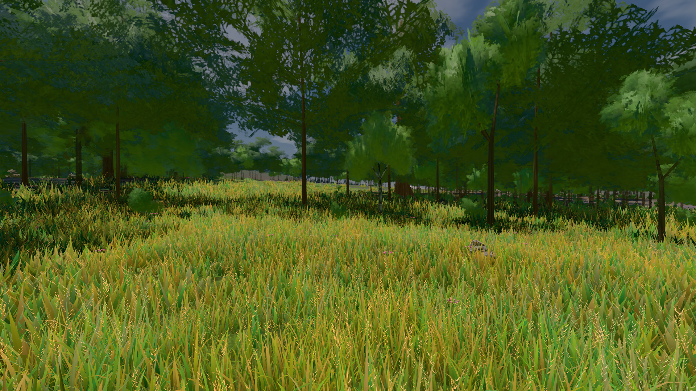

# GPU-PROBE 7ccf6200 — GRÜN · ROT wie an main (bekannt): gate:pop: lod.K2#1 (main gtx: ungemessen) auf gtx1050-desktop

Zweig `w28-wiese-schale` · Kopf 7ccf62000c4d1f9e78b849a5b5c0b052209665b0 · Läufer gtx1050-desktop · 14.11. 16:41 · Wanduhr ab Push 400 s · Lauf https://github.com/MiguellD/AnazhRealm/actions/runs/43610944440

Ruf: `bild:wiese@0.5 gate:pop gate:nah-fern`

## Läufer gtx1050-desktop — GRÜN

GPU NVIDIA GeForce GTX 1050 · npm ci 44 s (package-lock fe999c81)
Schloss /c/Users/User/AppData/Local/Temp/claude/gpu-schloss hält „ci-runner 43610944440/1 probe“
- Hook 2026-11-14 16:35:09 start ci-runner 43610944440/1 probe: Schloss genommen (refs/heads/w28-wiese-schale 7ccf62000c4d1f9e78b849a5b5c0b052209665b0 ws=C:\actions-runner\_work\AnazhRealm\AnazhRealm)

### bild:wiese@0.5 — GRÜN · 84 s · Läufer gtx1050-desktop

Adapter: [linse-gpu] nvidia/pascal

```text
Kamera des Spiels → Blick (10.0 m): -280.40 29.71 -1045.60 -289.61 29.71 -1049.50
 "abnahme": "ABNAHME GRÜN · beweis · Sicht 0.0 % · Ziel Blickziel im Bild frei 10 m · Luma 81.9 σ 39 schwarz 0.0 % weiß 0.0 % · Stand 18.546.286 · Bühne summer sunny 0.50 Tiere gehalten · Gerät WebGPU nvidia pascal · Inhalt nahWiese 48.2 % (≥ 15.0 %) h 107° Luma 117",
```



### gate:pop — BEKANNT · 117 s · Läufer gtx1050-desktop

Adapter: ungenannt (die Probe nannte keinen Browser-Adapter) · ROT wie an main (bekannt): lod.K2#1 (main gtx: ungemessen)

```text
lod.K2#1 ROT 0.051 % Pop-Pixel/s (1057 px) · 26*+1@189/23*/40*+1@207/376*+1@154/375*/68*+2@192/73*+1@155/76*+1@189 · Laub 216 · dc, Dreiecke 99,382932 · GPU 43.29 ms, CPU 5.47 ms je Bild
BLOCK-TREUE GRÜN 231 Blöcke treu · Selbsttest nennt MeshStandardNodeMaterial · nahWiese:L1:0:0 · instanzFarbe: 1/880 Instanzen fremd
 "fehler": "lod.K2#1 ROT 0.051 % Pop-Pixel/s > 0,05"
```

### gate:nah-fern — GRÜN · 102 s · Läufer gtx1050-desktop

Adapter: ungenannt (die Probe nannte keinen Browser-Adapter)

```text
✅ SELBSTTEST GRÜN — das Nah-Fern-Urteil nennt die zwei Farben derselben Stelle beim Namen
✅ NAH-FERN GRÜN — EINE Boden-Farbe je Ort
```
