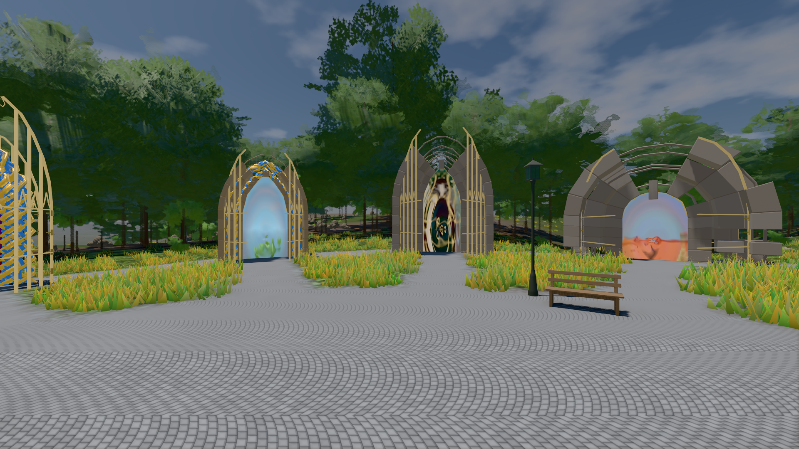
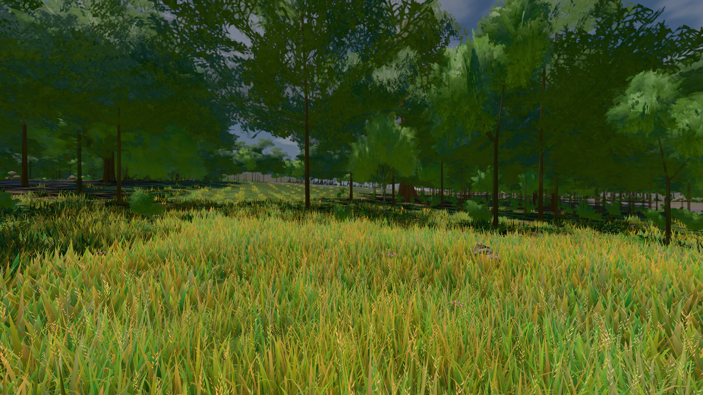
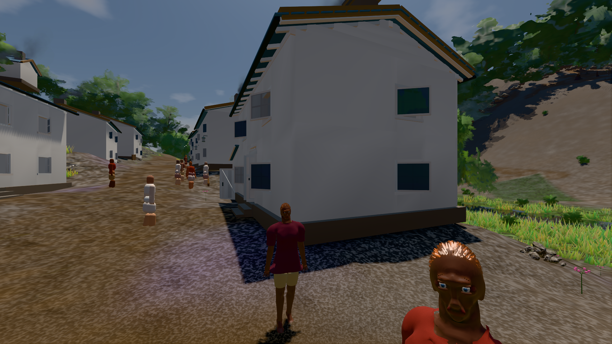

# GPU-PROBE 97df3853 — GRÜN

Zweig `w28-wiese-schale` · Kopf 97df385367d7b7129b59615ca90ec85b1ff37ce6 · Läufer gtx1050-desktop · 14.11. 10:43 · Wanduhr ab Push 1332 s · Lauf https://github.com/MiguellD/AnazhRealm/actions/runs/43580140362

Ruf: `bild:genesis@0.5 bild:wiese@0.5 bild:dorf@0.5`

## Läufer gtx1050-desktop — GRÜN

GPU NVIDIA GeForce GTX 1050 · npm ci 50 s (package-lock 57539f97)
Schloss /c/Users/User/AppData/Local/Temp/claude/gpu-schloss hält „ci-runner 43580140362/1 probe“
- Hook 2026-11-14 10:25:31 start ci-runner 43580140362/1 probe: wartet auf Schloss von 'hand werkbank gesicht-main (Claude)'
- Hook 2026-11-14 10:36:19 start ci-runner 43580140362/1 probe: Schloss genommen (refs/heads/w28-wiese-schale 97df385367d7b7129b59615ca90ec85b1ff37ce6 ws=C:\actions-runner\_work\AnazhRealm\AnazhRealm)

### bild:genesis@0.5 — GRÜN · 78 s · Läufer gtx1050-desktop

Adapter: [linse-gpu] nvidia/pascal

```text
Kamera des Spiels → Blick (10.0 m): 0.00 92.40 0.00 -10.00 92.40 0.00
 "abnahme": "ABNAHME GRÜN · beweis · Sicht 0.0 % · Ziel Blickziel im Bild frei 10 m · Luma 106.7 σ 39.4 schwarz 0.0 % weiß 0.0 % · Stand 18.546.283 · Bühne summer sunny 0.50 Tiere gehalten · Gerät WebGPU nvidia pascal · Inhalt bodenSatz 37.4 % (≥ 15.0 %) Luma 139, portal-membran 2.7 % (≥ 0.3 %) Luma 140",
```



### bild:wiese@0.5 — GRÜN · 88 s · Läufer gtx1050-desktop

Adapter: [linse-gpu] nvidia/pascal

```text
Kamera des Spiels → Blick (10.0 m): -280.40 29.71 -1045.60 -289.61 29.71 -1049.50
 "abnahme": "ABNAHME GRÜN · beweis · Sicht 0.0 % · Ziel Blickziel im Bild frei 10 m · Luma 80.9 σ 39 schwarz 0.0 % weiß 0.0 % · Stand 18.546.283 · Bühne summer sunny 0.50 Tiere gehalten · Gerät WebGPU nvidia pascal · Inhalt nahWiese 45.5 % (≥ 15.0 %) h 107° Luma 118",
```



### bild:dorf@0.5 — GRÜN · 166 s · Läufer gtx1050-desktop

Adapter: [linse-gpu] nvidia/pascal

```text
Kamera des Spiels → Blick (5.2 m): -704.22 39.69 -880.02 -703.03 39.69 -874.96
 "abnahme": "ABNAHME GRÜN · beweis · Sicht 0.0 % · Leib im Vordergrund 2.8 % (Leib bewohner 2.8 %) · Ziel Blickziel im Bild frei 5.2 m · Luma 76.3 σ 31 schwarz 0.4 % weiß 0.0 % · Stand 18.546.283 · Bühne summer sunny 0.50 Tiere gehalten · Gerät WebGPU nvidia pascal · Inhalt bauSatz 29.1 % (≥ 2.0 %) Luma 79",
```


