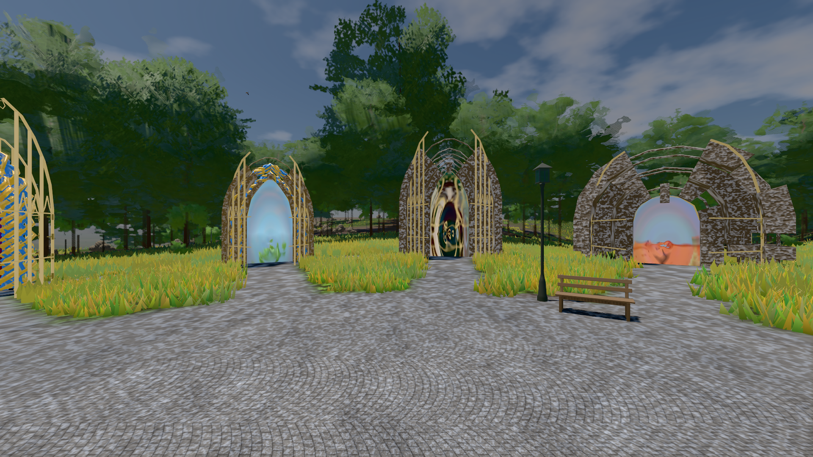
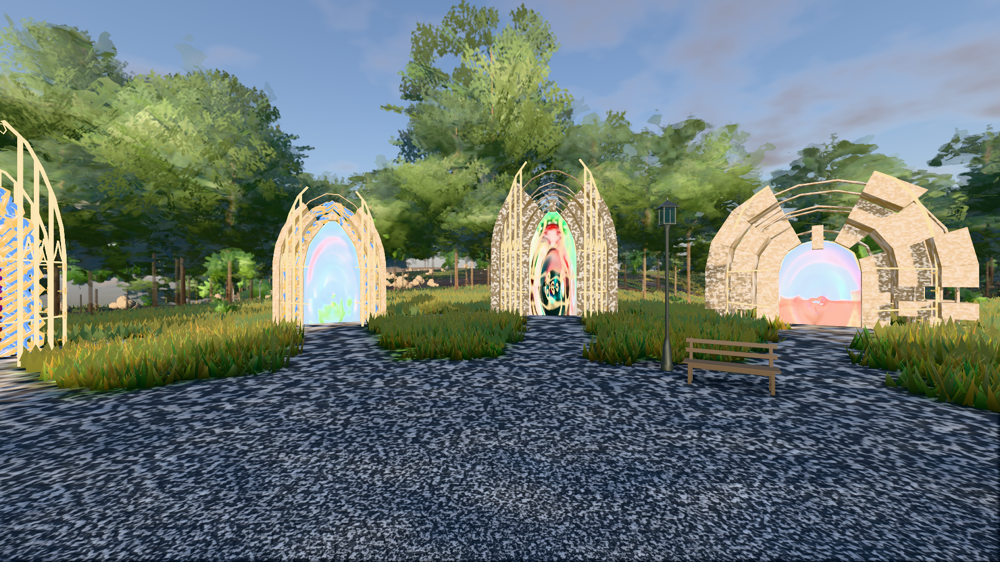
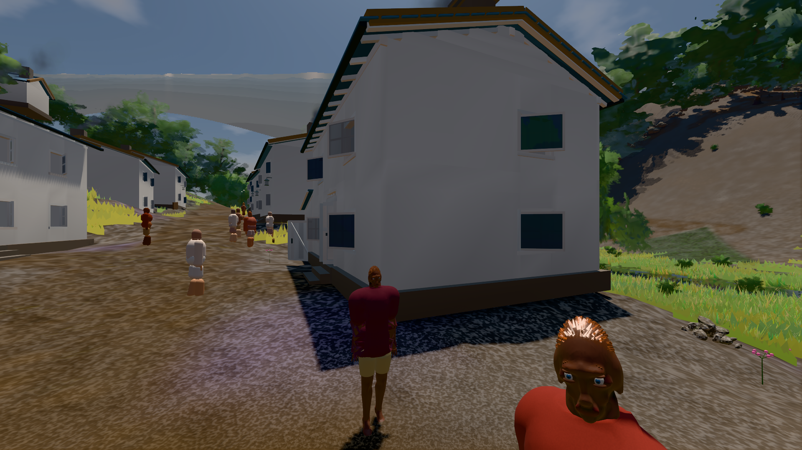

# GPU-PROBE 61eb11d0 — GRÜN

Zweig `w28-wolke-licht` · Kopf 61eb11d0aa3d53ae5dc59814aa8da284e0080a4e · Läufer gtx1050-desktop · 14.11. 03:58 · Wanduhr ab Push 855 s · Lauf https://github.com/MiguellD/AnazhRealm/actions/runs/43547923656

Ruf: `bild:genesis@0.5 bild:genesis@0.3 bild:dorf@0.5`

## Läufer gtx1050-desktop — GRÜN

GPU NVIDIA GeForce GTX 1050 · npm ci 39 s (package-lock 0868fe23)
Schloss /c/Users/User/AppData/Local/Temp/claude/gpu-schloss hält „ci-runner 43547923656/1 probe“
- Hook 2026-11-14 03:52:07 start ci-runner 43547923656/1 probe: Schloss genommen (refs/heads/w28-wolke-licht 61eb11d0aa3d53ae5dc59814aa8da284e0080a4e ws=C:\actions-runner\_work\AnazhRealm\AnazhRealm)

### bild:genesis@0.5 — GRÜN · 80 s · Läufer gtx1050-desktop

Adapter: [linse-gpu] nvidia/pascal

```text
Kamera des Spiels → Blick (10.0 m): 0.00 92.40 0.00 -10.00 92.40 0.00
 "abnahme": "ABNAHME GRÜN · beweis · Sicht 0.0 % · Ziel Blickziel im Bild frei 10 m · Luma 102.6 σ 37.4 schwarz 0.0 % weiß 0.0 % · Stand 18.546.277 · Bühne summer sunny 0.50 Tiere gehalten · Gerät WebGPU nvidia pascal · Inhalt bodenSatz 35.4 % (≥ 15.0 %) Luma 129, portal-membran 2.8 % (≥ 0.3 %) Luma 139",
```



### bild:genesis@0.3 — GRÜN · 75 s · Läufer gtx1050-desktop

Adapter: [linse-gpu] nvidia/pascal

```text
Kamera des Spiels → Blick (10.0 m): 0.00 92.40 0.00 -10.00 92.40 0.00
 "abnahme": "ABNAHME GRÜN · beweis · Sicht 0.0 % · Ziel Blickziel im Bild frei 10 m · Luma 114.5 σ 56.8 schwarz 0.0 % weiß 0.0 % · Stand 18.546.277 · Bühne summer sunny 0.30 Tiere gehalten · Gerät WebGPU nvidia pascal · Inhalt bodenSatz 36.3 % (≥ 15.0 %) Luma 86, portal-membran 2.8 % (≥ 0.3 %) Luma 218",
```



### bild:dorf@0.5 — GRÜN · 152 s · Läufer gtx1050-desktop

Adapter: [linse-gpu] nvidia/pascal

```text
Kamera des Spiels → Blick (5.2 m): -704.22 39.69 -880.02 -703.03 39.69 -874.96
 "abnahme": "ABNAHME GRÜN · beweis · Sicht 0.0 % · Leib im Vordergrund 2.8 % (Leib bewohner 2.8 %) · Ziel Blickziel im Bild frei 5.2 m · Luma 76.8 σ 31.3 schwarz 0.4 % weiß 0.0 % · Stand 18.546.277 · Bühne summer sunny 0.50 Tiere gehalten · Gerät WebGPU nvidia pascal · Inhalt bauSatz 29.3 % (≥ 2.0 %) Luma 78",
```


