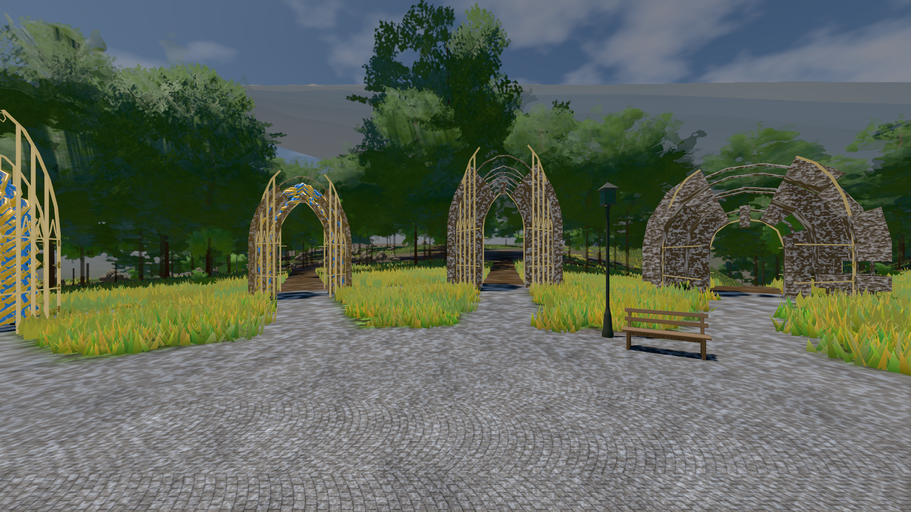
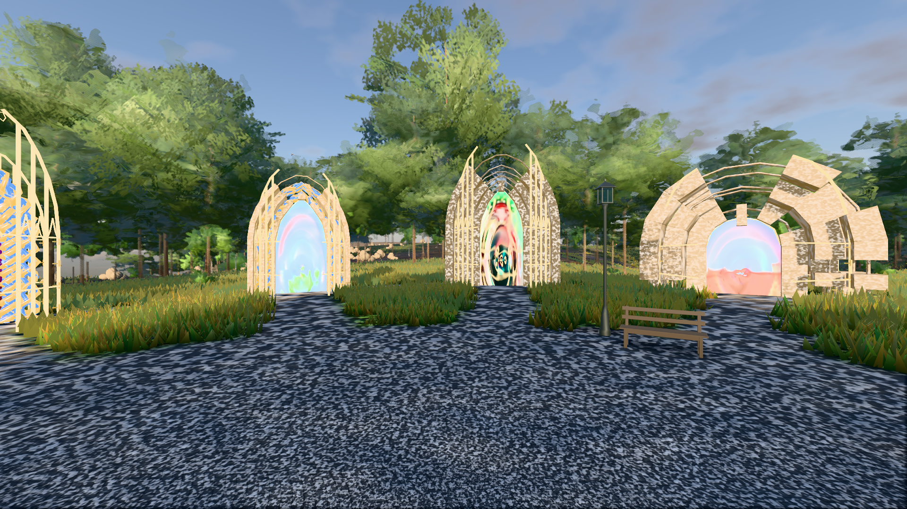
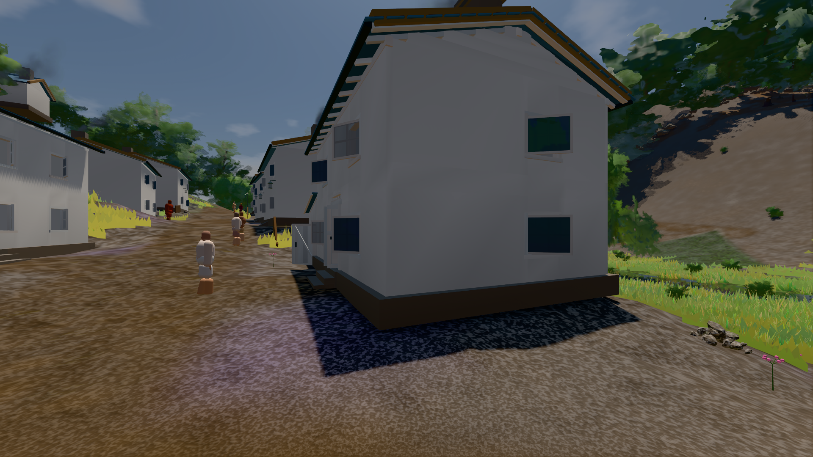

# GPU-PROBE aaf6a4c7 — ROT

Zweig `w28-wolke-licht` · Kopf aaf6a4c77414b3afd10ddf8b96f4e281ce5791c9 · Läufer gtx1050-desktop · 14.11. 02:50 · Wanduhr ab Push 356 s · Lauf https://github.com/MiguellD/AnazhRealm/actions/runs/43542424384

Ruf: `bild:genesis@0.5 bild:genesis@0.3 bild:dorf@0.5`

## Läufer gtx1050-desktop — ROT

GPU NVIDIA GeForce GTX 1050 · node_modules bleiben (package-lock 95130897)
Schloss /c/Users/User/AppData/Local/Temp/claude/gpu-schloss hält „ci-runner 43542424384/1 probe“
- Hook 2026-11-14 02:45:15 start ci-runner 43542424384/1 probe: Schloss genommen (refs/heads/w28-wolke-licht aaf6a4c77414b3afd10ddf8b96f4e281ce5791c9 ws=C:\actions-runner\_work\AnazhRealm\AnazhRealm)

### bild:genesis@0.5 — ROT · 70 s · Läufer gtx1050-desktop

Adapter: [linse-gpu] nvidia/pascal · "fehler": "ABNAHME ROT [kein portal-membran im Bild: 0.0 % < 0.3 %] · beweis · Sicht 0.0 % · Ziel Blickziel im Bild frei 10 m · Luma 99.9 σ 37.3 schwarz 0.0 % weiß 0.0 % · Stand 18.546.276 · Bühne summer sunny 0.50 Tiere — keine Station beim Namen

```text
Kamera des Spiels → Blick (10.0 m): 0.00 92.40 0.00 -10.00 92.40 0.00
 "fehler": "ABNAHME ROT [kein portal-membran im Bild: 0.0 % < 0.3 %] · beweis · Sicht 0.0 % · Ziel Blickziel im Bild frei 10 m · Luma 99.9 σ 37.3 schwarz 0.0 % weiß 0.0 % · Stand 18.546.276 · Bühne summer sunny 0.50 Tiere gehalten · Gerät WebGPU nvidia pascal · Inhalt bodenSatz 36.8 % (≥ 15.0 %) Luma 128, portal-membran 0.0 % (≥ 0.3 %) · ROT-Bild C:\\actions-runner\\_work\\_temp\\probe\\aaf6a4c7-genesis-0.5-rot.png",
```



### bild:genesis@0.3 — GRÜN · 78 s · Läufer gtx1050-desktop

Adapter: [linse-gpu] nvidia/pascal

```text
Kamera des Spiels → Blick (10.0 m): 0.00 92.40 0.00 -10.00 92.40 0.00
 "abnahme": "ABNAHME GRÜN · beweis · Sicht 0.0 % · Ziel Blickziel im Bild frei 10 m · Luma 114.5 σ 56.8 schwarz 0.0 % weiß 0.0 % · Stand 18.546.276 · Bühne summer sunny 0.30 Tiere gehalten · Gerät WebGPU nvidia pascal · Inhalt bodenSatz 36.3 % (≥ 15.0 %) Luma 86, portal-membran 2.8 % (≥ 0.3 %) Luma 218",
```



### bild:dorf@0.5 — GRÜN · 155 s · Läufer gtx1050-desktop

Adapter: [linse-gpu] nvidia/pascal

```text
Kamera des Spiels → Blick (5.2 m): -704.22 39.69 -880.02 -703.03 39.69 -874.96
 "abnahme": "ABNAHME GRÜN · beweis · Sicht 0.0 % · Ziel Blickziel im Bild frei 5.2 m · Luma 79 σ 30.3 schwarz 0.3 % weiß 0.0 % · Stand 18.546.276 · Bühne summer sunny 0.50 Tiere gehalten · Gerät WebGPU nvidia pascal · Inhalt bauSatz 30.0 % (≥ 2.0 %) Luma 78",
```


