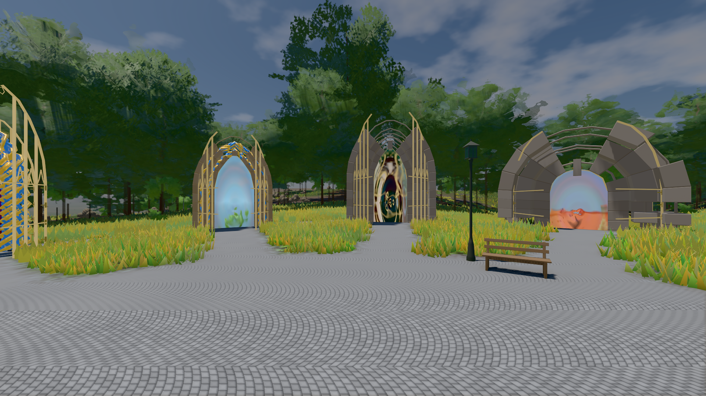

# GPU-PROBE 0a2cd4d7 — GRÜN

Zweig `w28-wolke-zeit` · Kopf 0a2cd4d7079fea04c28b5c2375a274844934c05e · Läufer gtx1050-desktop · 14.11. 08:51 · Wanduhr ab Push 687 s · Lauf https://github.com/MiguellD/AnazhRealm/actions/runs/43572156456

Ruf: `bild:genesis@0.5`

## Läufer gtx1050-desktop — GRÜN

GPU NVIDIA GeForce GTX 1050 · node_modules bleiben (package-lock 5f3fc96f)
Schloss /c/Users/User/AppData/Local/Temp/claude/gpu-schloss hält „ci-runner 43572156456/1 probe“
- Hook 2026-11-14 08:49:07 start ci-runner 43572156456/1 probe: Schloss genommen (refs/heads/w28-wolke-zeit 0a2cd4d7079fea04c28b5c2375a274844934c05e ws=C:\actions-runner\_work\AnazhRealm\AnazhRealm)

### bild:genesis@0.5 — GRÜN · 74 s · Läufer gtx1050-desktop

Adapter: [linse-gpu] nvidia/pascal

```text
Kamera des Spiels → Blick (10.0 m): 0.00 92.40 0.00 -10.00 92.40 0.00
 "abnahme": "ABNAHME GRÜN · beweis · Sicht 0.0 % · Ziel Blickziel im Bild frei 10 m · Luma 107.4 σ 39 schwarz 0.0 % weiß 0.0 % · Stand 18.546.281 · Bühne summer sunny 0.50 Tiere gehalten · Gerät WebGPU nvidia pascal · Inhalt bodenSatz 36.1 % (≥ 15.0 %) Luma 140, portal-membran 2.7 % (≥ 0.3 %) Luma 140",
```


