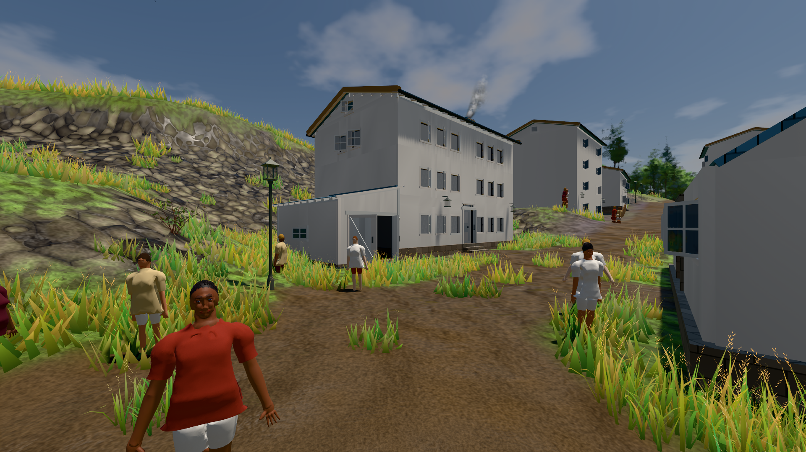

# GPU-PROBE 14e7e530 — GRÜN

Zweig `w28-wurf-nennt-rufer` · Kopf 14e7e530b0af61b29948c2247cf2bbbf288595ea · Läufer radeon-890m · 22.11. 12:08 · Wanduhr ab Push 2010 s · Lauf https://github.com/MiguellD/AnazhRealm/actions/runs/45013133197

Ruf: `bild:dorf@0.5 gate:webgl-probe`

## Läufer radeon-890m — GRÜN

GPU AMD Radeon(TM) 890M Graphics · node_modules bleiben (package-lock 5d306b2b)
Schloss /c/Users/micha/AppData/Local/Temp/claude/gpu-schloss hält „ci-runner 45013133197/2 probe“
- Hook 2026-11-22 12:01:00 start ci-runner 45013133197/2 probe: wartet auf Schloss von 'technik-dorf-nachher 2026-11-22T11:58:22+01:00 pid=40156'
- Hook 2026-11-22 12:02:08 start ci-runner 45013133197/2 probe: Schloss genommen (refs/heads/w28-wurf-nennt-rufer 14e7e530b0af61b29948c2247cf2bbbf288595ea ws=C:\actions-runner\_work\AnazhRealm\AnazhRealm)

### bild:dorf@0.5 — GRÜN · 85 s · Läufer radeon-890m

Adapter: [linse-gpu] amd/rdna-3

```text
Kamera des Spiels → Blick (12.9 m): -715.86 49.01 -932.69 -702.99 49.01 -931.86
 "abnahme": "ABNAHME GRÜN · beweis · Sicht 0.0 % · Leib im Vordergrund 4.9 % (Leib bewohner 4.9 %) · Ziel Blickziel im Bild frei 12.9 m · Luma 93.9 σ 30.9 schwarz 0.1 % weiß 0.0 % · Stand 18.546.366 · Bühne summer sunny 0.50 Tiere gehalten · Gerät WebGPU amd rdna-3 · Inhalt bauSatz 20.3 % (≥ 2.0 %) Luma 93",
```



### gate:webgl-probe — GRÜN · 45 s · Läufer radeon-890m

Adapter: [linse-gpu] webgl2/AMD Radeon(TM) 890M Graphics (0x0000150E) Direct3D11 vs_5_0 ps_5_0

```text
✅ GRÜN — die Kein-WebGPU-Geschichte ist BEWIESEN: der erzwungene WebGL2-Rückfall bootet eine LEBENDE, sichtbare Welt; die WGSL-Konsumenten + Bundles ruhen hinter der EINEN Backend-Wand, der Rückfall ist LAUT benannt, der Fern-Ring trägt auf CPU.
```
