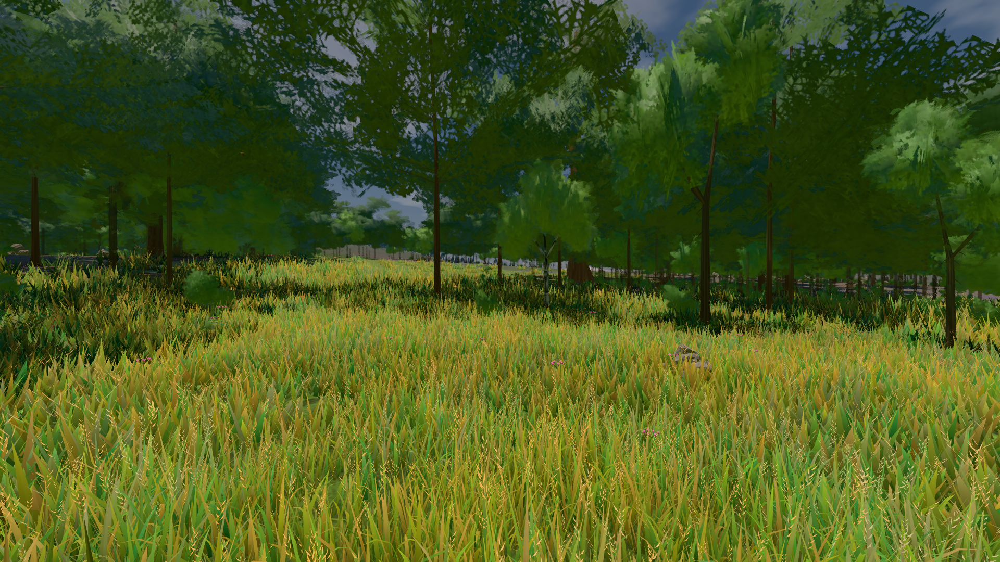

# GPU-PROBE 584c2060 — GRÜN

Zweig `w28-zeit-ein-kalender` · Kopf 584c20601b76cbfdd111ad855f8b7ac2c082ee44 · Läufer gtx1050-desktop · 20.11. 03:08 · Wanduhr ab Push 2774 s · Lauf https://github.com/MiguellD/AnazhRealm/actions/runs/44653163572

Ruf: `gate:weltgrenze bild:wiese@0.5`

## Läufer gtx1050-desktop — GRÜN

GPU NVIDIA GeForce GTX 1050 · npm ci 41 s (package-lock 20e3f8f6)
Schloss /c/Users/User/AppData/Local/Temp/claude/gpu-schloss hält „ci-runner 44653163572/2 probe“
- Hook 2026-11-20 02:58:48 start ci-runner 44653163572/2 probe: Schloss genommen (refs/heads/w28-zeit-ein-kalender 584c20601b76cbfdd111ad855f8b7ac2c082ee44 ws=C:\actions-runner\_work\AnazhRealm\AnazhRealm)

### gate:weltgrenze — GRÜN · 353 s · Läufer gtx1050-desktop

Adapter: ungenannt (die Probe nannte keinen Browser-Adapter)

```text
✅ SELBSTTEST GRÜN: auf keinem Weg trägt B ein Feld von A oder geht eine Welt verloren, jede Saat wächst in jedem Leser — und alle sechs Scheine fallen rot beim Namen
```

### bild:wiese@0.5 — GRÜN · 97 s · Läufer gtx1050-desktop

Adapter: [linse-gpu] nvidia/pascal

```text
Kamera des Spiels → Blick (10.0 m): -280.40 29.71 -1045.60 -289.61 29.71 -1049.50
 "abnahme": "ABNAHME GRÜN · beweis · Sicht 0.0 % · Ziel Blickziel im Bild frei 10 m · Luma 81.9 σ 38.9 schwarz 0.0 % weiß 0.0 % · Stand 18.546.346 · Bühne summer sunny 0.50 Tiere gehalten · Gerät WebGPU nvidia pascal · Inhalt nahWiese 48.2 % (≥ 15.0 %) h 107° Luma 117",
```


