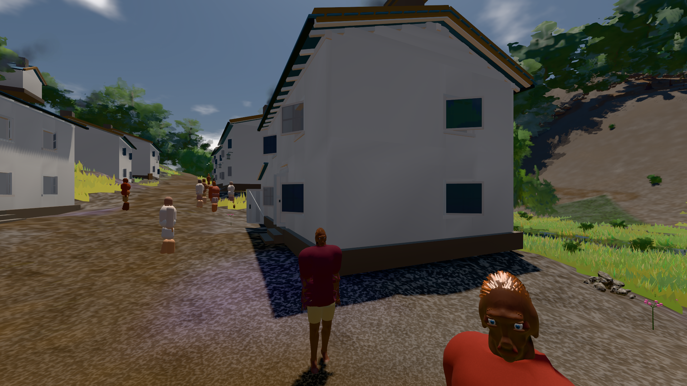

# GPU-PROBE 91ae94fe — GRÜN

Zweig `w28-ziel-plan-wip` · Kopf 91ae94fe08530f7e0d72fb0495a485a86659a962 · Läufer radeon-890m · 14.11. 00:09 · Wanduhr ab Push 426 s · Lauf https://github.com/MiguellD/AnazhRealm/actions/runs/43524102009

Ruf: `bild:dorf@0.5`

## Läufer radeon-890m — GRÜN

GPU AMD Radeon(TM) 890M Graphics · npm ci 78 s (package-lock 95130897)
Schloss /c/Users/micha/AppData/Local/Temp/claude/gpu-schloss hält „ci-runner 43524102009/1 probe“
- Hook 2026-11-14 00:03:15 start ci-runner 43524102009/1 probe: Schloss genommen (refs/heads/w28-ziel-plan-wip 91ae94fe08530f7e0d72fb0495a485a86659a962 ws=C:\actions-runner\_work\AnazhRealm\AnazhRealm)

### bild:dorf@0.5 — GRÜN · 85 s · Läufer radeon-890m

Adapter: [linse-gpu] amd/rdna-3

```text
Kamera des Spiels → Blick (5.2 m): -704.22 39.69 -880.02 -703.03 39.69 -874.96
 "abnahme": "ABNAHME GRÜN · beweis · Sicht 0.0 % · Leib im Vordergrund 2.9 % (Leib bewohner 2.9 %) · Ziel Blickziel im Bild frei 5.2 m · Luma 77.4 σ 32 schwarz 0.4 % weiß 0.0 % · Stand 18.546.276 · Bühne summer sunny 0.50 Tiere gehalten · Gerät WebGPU amd rdna-3 · Inhalt bauSatz 29.4 % (≥ 2.0 %) Luma 79",
```


