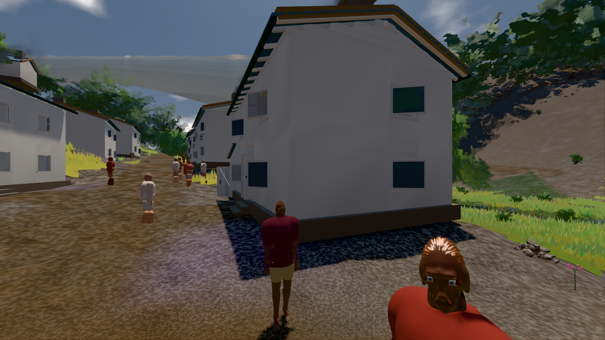

# GPU-PROBE 0146c309 — ROT

Zweig `w28-ziel-plan` · Kopf 0146c309326b1e2d78ffe4d709a610e3529deb74 · Läufer gtx1050-desktop · 13.11. 19:12 · Wanduhr ab Push 1425 s · Lauf https://github.com/MiguellD/AnazhRealm/actions/runs/43476547289

Ruf: `bild:dorf@0.5 gate:kreatur-takt`

## Läufer gtx1050-desktop — ROT

GPU NVIDIA GeForce GTX 1050 · node_modules bleiben (package-lock 3887454d)
Schloss /c/Users/User/AppData/Local/Temp/claude/gpu-schloss hält „ci-runner 43476547289/1 probe“
- Hook 2026-11-13 18:49:30 start ci-runner 43476547289/1 probe: wartet auf Schloss von 'hand werkbank k5 (Claude)'
- Hook 2026-11-13 18:51:31 start ci-runner 43476547289/1 probe: Schloss genommen (refs/heads/w28-ziel-plan 0146c309326b1e2d78ffe4d709a610e3529deb74 ws=C:\actions-runner\_work\AnazhRealm\AnazhRealm)

### bild:dorf@0.5 — ROT · 184 s · Läufer gtx1050-desktop

Adapter: [linse-gpu] nvidia/pascal · "fehler": "ABNAHME ROT [Sicht verdeckt 3.3 % (Laub · Rinde · Fels · Böschung näher als 2 m, Bau als 1 m): Leib bewohner (≤ 2.6 m) 3.3 %] · beweis · Sicht 3.3 % (Leib bewohner (≤ 2.6 m) 3.3 %) · Ziel Blickziel im Bild fre — keine Station beim Namen

```text
Kamera des Spiels → Blick (5.2 m): -704.22 39.69 -880.02 -703.03 39.69 -874.96
 "fehler": "ABNAHME ROT [Sicht verdeckt 3.3 % (Laub · Rinde · Fels · Böschung näher als 2 m, Bau als 1 m): Leib bewohner (≤ 2.6 m) 3.3 %] · beweis · Sicht 3.3 % (Leib bewohner (≤ 2.6 m) 3.3 %) · Ziel Blickziel im Bild frei 5.2 m · Luma 76.9 σ 31.7 schwarz 0.4 % weiß 0.0 % · Stand 18.546.273 · Bühne summer sunny 0.50 Tiere gehalten · Gerät WebGPU nvidia pascal · Inhalt bauSatz 29.3 % (≥ 2.0 %) Luma 78 · ROT-Bild C:\\actions-runner\\_work\\_temp\\probe\\0146c309-dorf-0.5-rot.png",
```



### gate:kreatur-takt — ROT · 1067 s · Läufer gtx1050-desktop

Adapter: ungenannt (die Probe nannte keinen Browser-Adapter) · DECKEL 960 s

```text
  ❌ bewohner  [Täter bewohner-wiederkehr] {"alsLeib":64,"schmiede10":2,"schmiede2":0,"tagTakt":12,"haeuser":18,"sollSumme":81,"leiber":80,"quote":0.988,"leer":["kirche gotisch #613181: 0 von 1"],"leerN":1,"imBlick":{"ego":27,"third":34},"nahLeiber":4,"planGleich":true,"trefferMin":0.167,"unter":["gasthaus/gasthaus #419347: 35 %","gasthaus/gasthaus #419347: 38 %","gasthaus/gasthaus #419347: 35 %","gasthaus/gasthaus #419347: 36 %","gasthaus/gasthaus #419347: 31 %"],"unterN":80,"stationen":2,"satzGang":{"schlupf":1,"wegLeib":2609.9},"blick":{"n":186,"quote":0.516,"sektorMax":1},"ohnePlatz":6,"
       ✅ der Täter macht die Probe ROT und wird beim Namen genannt — die Linse sieht ihn
  ❌ bewohner  [Täter bewohner-stadt-blind] {"alsLeib":64,"schmiede10":2,"schmiede2":0,"tagTakt":12,"haeuser":18,"sollSumme":81,"leiber":80,"quote":0.988,"leer":["kirche gotisch #613181: 0 von 1"],"leerN":1,"imBlick":{"ego":27,"third":34},"nahLeiber":4,"planGleich":true,"trefferMin":0.167,"unter":["gasthaus/gasthaus #419347: 35 %","gasthaus/gasthaus #419347: 38 %","gasthaus/gasthaus #419347: 35 %","gasthaus/gasthaus #419347: 36 %","gasthaus/gasthaus #419347: 31 %"],"unterN":80,"stationen":2,"satzGang":{"schlupf":1,"wegLeib":2609.9},"blick":{"n":186,"quote":0.516,"sektorMax":1},"ohnePlatz":6,
       ✅ der Täter macht die Probe ROT und wird beim Namen genannt — die Linse sieht ihn
  ❌ bewohner  [Täter bewohner-stadt-rempeln] {"alsLeib":64,"schmiede10":2,"schmiede2":0,"tagTakt":12,"haeuser":18,"sollSumme":81,"leiber":80,"quote":0.988,"leer":["kirche gotisch #613181: 0 von 1"],"leerN":1,"imBlick":{"ego":27,"third":34},"nahLeiber":4,"planGleich":true,"trefferMin":0.167,"unter":["gasthaus/gasthaus #419347: 35 %","gasthaus/gasthaus #419347: 38 %","gasthaus/gasthaus #419347: 35 %","gasthaus/gasthaus #419347: 36 %","gasthaus/gasthaus #419347: 31 %"],"unterN":80,"stationen":2,"satzGang":{"schlupf":1,"wegLeib":2609.9},"blick":{"n":186,"quote":0.516,"sektorMax":1},"ohnePlatz":
       ✅ der Täter macht die Probe ROT und wird beim Namen genannt — die Linse sieht ihn
✅ SELBST-TEST GRÜN — jeder Täter macht seine Probe rot und wird beim Namen genannt (12 Täter).
[stall-akte] Stderr [8572:7140:1113/190531.304:ERROR:services\on_device_model\public\cpp\service_client.cc:37] Unexpected on_device_model service disconnect; reason: 1, description: Error loading backend.
  ✅ bewohner  {"alsLeib":4,"schmiede10":2,"schmiede2":0,"tagTakt":0,"haeuser":18,"sollSumme":81,"leiber":81,"quote":1,"leer":[],"leerN":0,"imBlick":{"ego":27,"third":34},"nahLeiber":4,"planGleich":true,"trefferMin":0.983,"unter":[],"unterN":0,"stationen":2,"satzGang":{"schlupf":0.021,"wegLeib":1447.7},"blick":{"n":189,"quote":0.968,"sektorMax":0.164},"ohnePlatz":0,"ohnePlatzWer":[],"stapel":[],"huellen":18,"wege":{"wandN":0,"wand":[],"durch":212,"tuer":212,"falsch":[],"aufWeg":0.894,"sprungN":0,"wegeMin":4,"wegeMax":8,"streckeMin":171,"ausserN":0,"ausser":[],"kurzN":0,"kurz":[],"steckenN":0,
✅ GRÜN — bewohner
```
