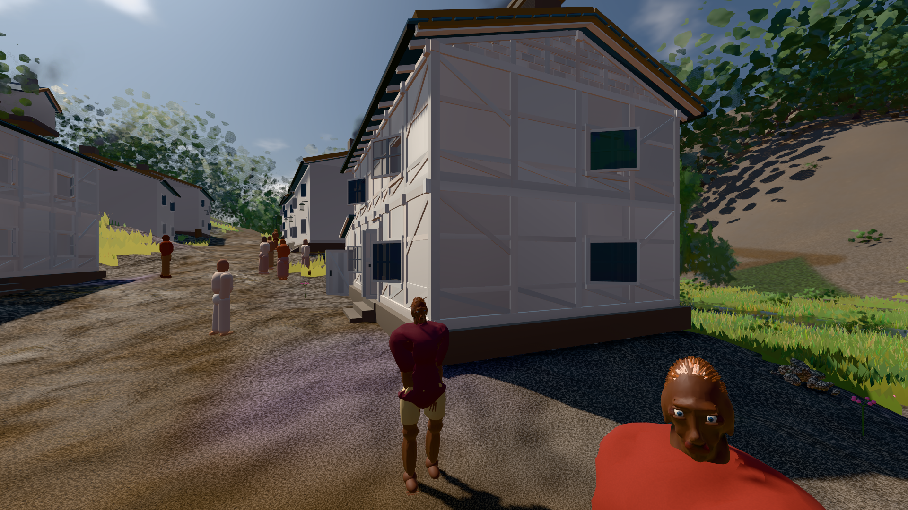
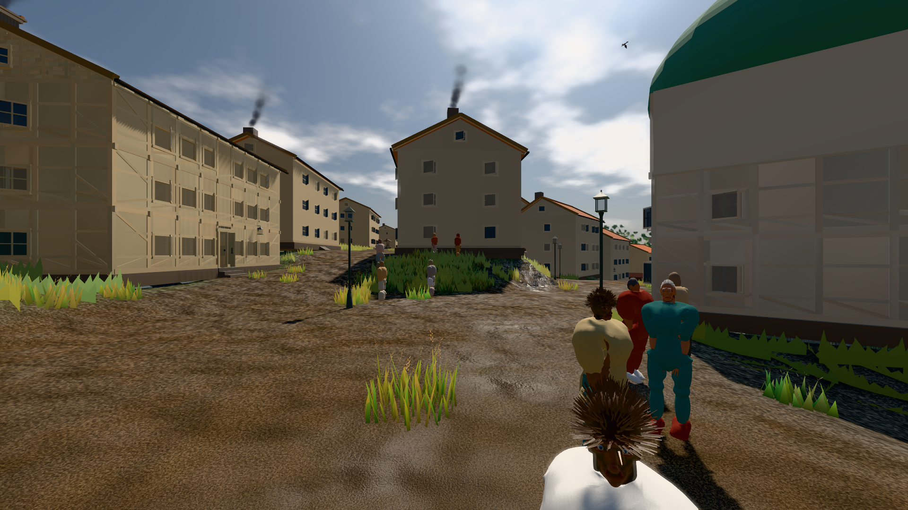

# GPU-PROBE 58acfa5e — GRÜN

Zweig `w28-ziel-plan` · Kopf 58acfa5e6cc75feef9f1906b0664ecb0f5c3c6c3 · Läufer radeon-890m · 11.11. 01:41 · Wanduhr ab Push 261 s · Lauf https://github.com/MiguellD/AnazhRealm/actions/runs/42932710894

Ruf: `bild:dorf@0.4 bild:stadt@0.4`

## Läufer radeon-890m — GRÜN

GPU AMD Radeon(TM) 890M Graphics · node_modules bleiben (package-lock df29564e)
Schloss /c/Users/micha/AppData/Local/Temp/claude/gpu-schloss hält „ci-runner 42932710894/1 probe“
- Hook 2026-11-11 01:37:03 start ci-runner 42932710894/1 probe: Schloss genommen (refs/heads/w28-ziel-plan 58acfa5e6cc75feef9f1906b0664ecb0f5c3c6c3 ws=C:\actions-runner\_work\AnazhRealm\AnazhRealm)

### bild:dorf@0.4 — GRÜN · 80 s · Läufer radeon-890m

Adapter: [linse-gpu] amd/rdna-3

```text
Kamera des Spiels → Blick (5.2 m): -704.22 39.69 -880.02 -703.03 39.69 -874.96
 "abnahme": "ABNAHME GRÜN · beweis · Sicht 0.0 % · Ziel Blickziel im Bild frei 5.2 m · Luma 82.7 σ 44 schwarz 0.3 % weiß 0.0 % · Stand 18.546.249 · Bühne summer sunny 0.40 · Gerät WebGPU amd rdna-3",
```



### bild:stadt@0.4 — GRÜN · 112 s · Läufer radeon-890m

Adapter: [linse-gpu] amd/rdna-3

```text
Kamera des Spiels → Blick (23.9 m): 662.72 63.28 429.48 686.59 63.28 428.39
 "abnahme": "ABNAHME GRÜN · beweis · Sicht 0.0 % · Ziel Blickziel im Bild frei 23.89 m · Luma 91.6 σ 51.6 schwarz 0.2 % weiß 0.0 % · Stand 18.546.249 · Bühne summer sunny 0.40 · Gerät WebGPU amd rdna-3",
```


