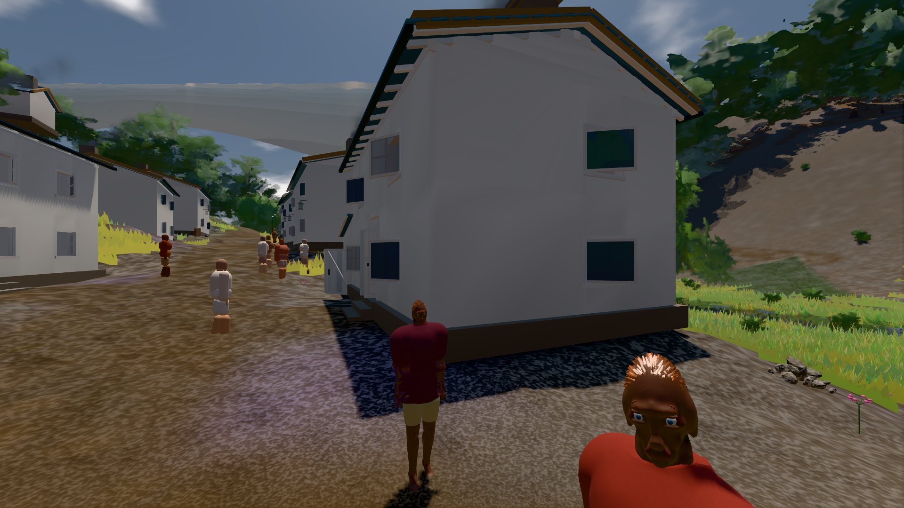

# GPU-PROBE 91ae94fe — GRÜN

Zweig `w28-ziel-plan` · Kopf 91ae94fe08530f7e0d72fb0495a485a86659a962 · Läufer omen-gtx1060 · 14.11. 00:11 · Wanduhr ab Push 541 s · Lauf https://github.com/MiguellD/AnazhRealm/actions/runs/43524083279

Ruf: `bild:dorf@0.5`

## Läufer omen-gtx1060 — GRÜN

GPU NVIDIA GeForce GTX 1060 · npm ci 56 s (package-lock 95130897)
Schloss /c/Users/micha/AppData/Local/Temp/claude/gpu-schloss hält „ci-runner 43524083279/1 probe“
- Hook 2026-11-14 00:03:03 start ci-runner 43524083279/1 probe: Schloss genommen (refs/heads/w28-ziel-plan 91ae94fe08530f7e0d72fb0495a485a86659a962 ws=C:\actions-runner\_work\AnazhRealm\AnazhRealm)

### bild:dorf@0.5 — GRÜN · 82 s · Läufer omen-gtx1060

Adapter: [linse-gpu] nvidia/pascal

```text
Kamera des Spiels → Blick (5.2 m): -704.22 39.69 -880.02 -703.03 39.69 -874.96
 "abnahme": "ABNAHME GRÜN · beweis · Sicht 0.0 % · Leib im Vordergrund 3.1 % (Leib bewohner 3.1 %) · Ziel Blickziel im Bild frei 5.2 m · Luma 77 σ 31.8 schwarz 0.4 % weiß 0.0 % · Stand 18.546.276 · Bühne summer sunny 0.50 Tiere gehalten · Gerät WebGPU nvidia pascal · Inhalt bauSatz 29.3 % (≥ 2.0 %) Luma 78",
```


