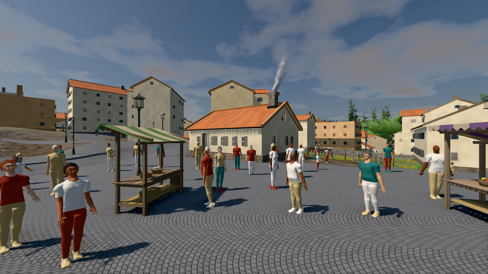

# GPU-PROBE cfa4fc95 — ROT

Zweig `werk-am-ort` · Kopf cfa4fc95a0b4008c0037f903855d949d124e482c · Läufer omen-gtx1060 · 26.11. 11:09 · Wanduhr ab Push 1204 s · Lauf https://github.com/MiguellD/AnazhRealm/actions/runs/45795535984

Ruf: `gate:pruefbuehne-licht gate:weltbild-frost:echt gate:studio-begehen bild:stadt-voll@0.55 gate:webgl-probe`

## Läufer omen-gtx1060 — ROT

GPU NVIDIA GeForce GTX 1060 · npm ci 31 s (package-lock 9d8e5ad9)
Schloss /c/Users/micha/AppData/Local/Temp/claude/gpu-schloss hält „ci-runner 45795535984/1 probe“
- Hook 2026-11-26 10:55:04 start ci-runner 45795535984/1 probe: Schloss genommen (refs/heads/werk-am-ort cfa4fc95a0b4008c0037f903855d949d124e482c ws=C:\actions-runner\_work\AnazhRealm\AnazhRealm)

### gate:pruefbuehne-licht — ROT · 56 s · Läufer omen-gtx1060

Adapter: [linse-gpu] nvidia/pascal · ⛔ S0 Himmel: nach dem Sprung auf Mitternacht trägt die Umgebung die Bestrahlung 3.289e-8, der Himmel des Orts 2.74e-8 — die Himmels-Umgebung (`_ensureSkyEnvironment`) folgt dem Sprung der Uhr nicht: gemalt vor der Luft-F

```text
  S0 BODEN-PROGRAMM 1/1: 108011 Zeichen WGSL (gebuchter Stand 108011, ±0 — Auskunft, kein Urteil) · Pipeline asynchron → GRÜN · kalt 1241 · 1301 · 1090 · 1070 · 1128 · 1182 · 1103 · 1191 · 1070 ms, Median 1128 ms · ÷ K17 derselben Sitzung 0,76 (Auskunft, kein Zeit-Urteil)
    ⛔ S0 Himmel: nach dem Sprung auf Mitternacht trägt die Umgebung die Bestrahlung 3.289e-8, der Himmel des Orts 2.74e-8 — die Himmels-Umgebung (`_ensureSkyEnvironment`) folgt dem Sprung der Uhr nicht: gemalt vor der Luft-Farbe (`_dayNightApplyLuft`) oder vom Sprung in der Raten-Drossel (SKY_ENV_REGEN_MIN_MS) gehalten
    ⛔ S0 Himmel: der Himmel der Nacht fehlt — um Mitternacht trägt die Umgebung 3.289e-8, der Himmel des Orts 2.74e-8, das Gesetz allein im Sternen-Licht π · nachtHimmel = 3.108e-8 (Sonne -22.11°) — die Tafeln tragen Mond und Sterne nicht (`__weltLicht.tafelLicht` aus `_atmoTakt`: `AnazhRealm.MOONLIGHT`, `_atmoSternenLicht`)
  SELBSTTEST S0 NACHT (die Sicht des Mondes): getroffen — ohne Mond-Sicht „S0 Nacht: das Licht der Nacht trifft keinen Boden 1–3 m (Mond-Sicht 0 an jedem Pixel des Rings, Mond 22.08°)“ · schwarz 8 % im Licht → ROT · schwarz 8 % allein im Schatten grün
⛔ S0 BILD ROT · Nacht {"luma":50.2,"schwarz":0,"gesetz":52.37} (44 s, nvidia/pascal · Holz kienspan)
```

### gate:weltbild-frost:echt — ROT · 151 s · Läufer omen-gtx1060

Adapter: [linse-gpu] nvidia/pascal · ❌ dritte-person: B das Bild folgt der Kamera — 0.00 % der Blöcke (Soll ≥ 5 %)

```text
  ✅ die Welt-GPU zeichnet einen Menschen (Mensch-Indizes auf der Welt-GPU) — 9 Mensch-Index-Puffer
  ❌ werkstatt-eiche: B das Bild folgt der Kamera — 0.00 % der Blöcke (Soll ≥ 5 %)
  ✅ werkstatt-eiche: I jeder Index-Puffer der Welt-GPU trägt das gebundene Format
  ✅ werkstatt-eiche: G kein WebGPU-Validierungsfehler
  ✅ werkstatt-eiche: W die Wachen des Spiels stehen und schweigen — {"index":null,"gpu":null}
[welt-boot] FEHLER pageerror: Error: STOFF: die Ich-Bühne (Bühnen-Render) — Cannot set properties of undefined (setting 'depthClearValue') | at _stoffBruch (stamm/stoff-material.js:3731:19) | at _buehneRender (stamm/werkstatt-vorschau.js:1578:24) | at tick (stamm/werkstatt-hof.js:1419:22)
diag-weltbild-frost.cjs ABSTURZ: Error: DER BAU STEHT NICHT: die Bühne nach 574 Takten — die Welt hat nichts mehr offen
[welt-boot] ROT — 2 Fehler der Welt:
  ❌ post-kette: [AnazhRealm V18.546.435] [ERROR] STOFF: die Post-Kette (Render-Lauf: TRAA · Bloom · Grading) — der Schirm zeichnet direkt — Cannot read properties of null (reading 'length')
  ❌ pageerror: Error: STOFF: die Ich-Bühne (Bühnen-Render) — Cannot set properties of undefined (setting 'depthClearValue') | at _stoffBruch (stamm/stoff-material.js:3731:19) | at _buehneRender (stamm/werkstatt-vorschau.js:1578:24) | at tick (stamm/werkstatt-hof.js:1419:22)
```

### gate:studio-begehen — GRÜN · 243 s · Läufer omen-gtx1060

Adapter: [linse-gpu] nvidia/pascal

```text
  ✅ Selbsttest „huelle" macht B1 Hülle nach Promotion + B1 Hülle nach Demotion rot — B1 Hülle nach Promotion: 10 von 10 Häusern zu | B1 Hülle nach Demotion: 0 von 2 Häusern (Geister)
  ✅ Selbsttest „kopf" macht B3 Kopf rot — B3 Kopf: 27 von 120 Treppen-Läufen enden im Solid
  ✅ Selbsttest „kappe" macht B3 Steigen rot — B3 Steigen: 21 von 24 Treppen erreichen ihre Höhe (EG→OG 9/9 · OG→OG 12/12 · Speicher 0/3)
  ✅ Selbsttest „spur" macht B3 Steigen rot — B3 Steigen: 15 von 24 Treppen erreichen ihre Höhe (EG→OG 9/9 · OG→OG 3/12 · Speicher 3/3)
  ✅ Selbsttest „austritt" macht B3 Kopfraum rot — B3 Kopfraum: 14 Austritte unter 1.7 m (min 0.99 m — der Kopf steht im Dach: #0 635014 provenzalisch/kirche sattel speicher 1.69 · #0 635014 provenzalisch/kirche sattel speicher 1.68 · #2 723323 provenzalisch/pfarrhaus sattel speicher 1.2 · #2 723323 provenzalisch/pfarrhaus sattel speicher 1.21 · #3 773412 italienisch/wohnhaus sattel speicher 1 · #3 773412 italienisch/wohnhaus sattel speicher 0.99 · #8 351993 provenzalisch/wohnhaus sattel speicher 1.26 · #8 351993 provenzalisch/wohnhaus sattel speicher 1.15 · #8 351993 provenzali
  ✅ Selbsttest „dachlos" macht B3 Dach rot — B3 Dach: 7 Speicher-Austritte ohne Dach über dem Kopf (der Lauf steigt durch das Dach)
  ✅ Selbsttest „ruecken" macht B3 Speicher rot — B3 Speicher: 2 Häuser mit Dachraum ohne Speicherlauf, obwohl am First Kopfraum steht (#0 635014 provenzalisch/kirche Speicher zu: First 2.68 m, Stufe 0.2 m, Stehraum 3.21 m · #2 723323 provenzalisch/pfarrhaus Speicher zu: First 2.80 m, Stufe 0.2 m, Stehraum 3.54 m)
  ✅ Selbsttest „platte" macht B4 Keller-Decke rot — B4 Keller-Decke = Boden-Platte in 7 von 8
  ✅ Selbsttest „flach" macht B5 Weltgrund rot — B5 Weltgrund: die Häuser stehen eben (Spanne 0 m)
✅ gate:studio-begehen grün
```

### bild:stadt-voll@0.55 — GRÜN · 174 s · Läufer omen-gtx1060

Adapter: [linse-gpu] nvidia/pascal

```text
Kamera des Spiels → Blick (15.0 m): 842.49 57.57 451.79 857.26 57.57 449.21
 "abnahme": "ABNAHME GRÜN · beweis · Sicht 0.0 % · Leib im Vordergrund 4.3 % (Leib bewohner 4.3 %) · Leiber näher als 6 m: 4 von 4 ganz (32 Teile) · Ziel Blickziel im Bild frei 14.99 m · Luma 107.3 σ 35.4 schwarz 0.0 % weiß 0.0 % · Stand 18.546.435 · Bühne summer sunny 0.55 Tiere gehalten · Gerät WebGPU nvidia pascal · Inhalt bauSatz 19.4 % (≥ 2.0 %) Luma 127, bewohner 7.5 % (≥ 1.0 %) Luma 111",
```



### gate:webgl-probe — GRÜN · 57 s · Läufer omen-gtx1060

Adapter: [linse-gpu] webgl2/NVIDIA GeForce GTX 1060 (0x00001C60) Direct3D11 vs_5_0 ps_5_0

```text
✅ GRÜN — die Kein-WebGPU-Geschichte ist BEWIESEN: der erzwungene WebGL2-Rückfall bootet eine LEBENDE, sichtbare Welt; die WGSL-Konsumenten + Bundles ruhen hinter der EINEN Backend-Wand, der Rückfall ist LAUT benannt, der Fern-Ring trägt auf CPU.
```
