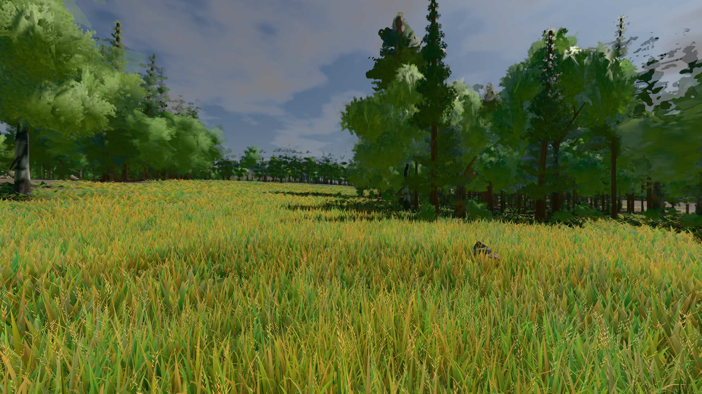

# GPU-PROBE 71c7f166 — GRÜN

Zweig `wetter-lagen-kopf1` · Kopf 71c7f166f7b4a9c4ad964e35f52f8addfc5e16d7 · Läufer omen-gtx1060 · 27.11. 14:37 · Wanduhr ab Push 2308 s · Lauf https://github.com/MiguellD/AnazhRealm/actions/runs/46003217113

Ruf: `gate:wetter-wache gate:tag-achse:echt bild:wiese@0.5 gate:webgl-probe`

## Läufer omen-gtx1060 — GRÜN

GPU NVIDIA GeForce GTX 1060 · node_modules bleiben (package-lock f78f29d9)
Schloss /c/Users/micha/AppData/Local/Temp/claude/gpu-schloss hält „ci-runner 46003217113/1 probe“
- Hook 2026-11-27 14:23:29 start ci-runner 46003217113/1 probe: Schloss genommen (refs/heads/wetter-lagen-kopf1 71c7f166f7b4a9c4ad964e35f52f8addfc5e16d7 ws=C:\actions-runner\_work\AnazhRealm\AnazhRealm)

### gate:wetter-wache — GRÜN · 116 s · Läufer omen-gtx1060

Adapter: ungenannt (die Probe nannte keinen Browser-Adapter)

```text
✅ SELBSTTEST GRÜN — jeder injizierte Täter fällt rot und wird beim Namen genannt.
  Halt · emotion    GRUEN  sunny → sunny, Uhr -1000000000; verweigert {"rule:emotion:sorrow → rainy":1}
  Halt · nexus      GRUEN  sunny → sunny, Uhr -1000000000; verweigert {"nexus → stormy":2}
  Halt · gesetz     GRUEN  sunny → sunny, Uhr -1000000000; verweigert {"rule:human → rainy":1}
  Halt · mensch     GRUEN  sunny → sunny, Uhr -1000000000; verweigert {"human → rainy":1}
  Halt · mitspieler GRUEN  sunny → sunny, Uhr -1000000000; verweigert {"remote:peer-wache → stormy":1}
  Halt · autoZug    GRUEN  sunny → sunny, Uhr -1000000000; verweigert {}
  Gesetz · GRUEN  Uhr 12:00 → 12:57 (Gang 144.0 s in 1440 Takten; 0 fremde Schreiber), Wetter sunny → sunny (0 Schreiber, 0 Züge)
  Band   · GRUEN  Uhr 12:57 → 13:55 (Gang 144.0 s in 1440 Takten; 0 fremde Schreiber), Wetter frei → stormy (1 Schreiber, 1 Züge)
✅ GRÜN — unter der Bühne dreht kein Schreiber das Wetter; frei gehen Uhr und Wetter nach dem Wort des Spielers, die Welt wünscht nur, jeder Schreiber steht beim Namen.
```

### gate:tag-achse:echt — GRÜN · 142 s · Läufer omen-gtx1060

Adapter: ungenannt (die Probe nannte keinen Browser-Adapter)

```text
TAG genesis GRUEN: Karte 126.3 · Sprung 0.08 (Uhr 0.28) · Buckel 0.00 (Uhr 0) · Sonne 10° -0.66 EV R/B ×1.09 | -0.76 EV R/B ×0.86 · Nacht -0.09 EV Luma 91 · REF 1.98 (Uhr 0) · Sicht -0.07 (Uhr 0.5) · ASYNC 0.02 (Uhr 0.268) nach 3 Bildern (Mutant 9) · sofort 0.69 (Uhr 0.33) EV · Geschichte 12 → 0 Bilder (Mutant 13) · nur die Wand (--kurz)
TAG wiese GRUEN: Karte 124.3 · Sprung -0.08 (Uhr 0.732) · Buckel 0.00 (Uhr 0) · Sonne 10° -1.02 EV R/B ×0.86 | -1.24 EV R/B ×0.66 · Nacht -2.68 EV Luma 44.8 · REF 0.34 (Uhr 0) · Sicht -0.02 (Uhr 0.27) · ASYNC 0.00 (Uhr 0.726) nach 3 Bildern (Mutant 10) · sofort -0.67 (Uhr 0.75) EV · Geschichte 12 → 0 Bilder (Mutant 13) · nur die Wand (--kurz)
TAG-ACHSE GRUEN
```

### bild:wiese@0.5 — GRÜN · 57 s · Läufer omen-gtx1060

Adapter: [linse-gpu] nvidia/pascal

```text
Kamera des Spiels → Blick (10.0 m): -280.40 29.71 -1045.60 -289.61 29.71 -1049.50
 "abnahme": "ABNAHME GRÜN · beweis · Sicht 0.0 % · Ziel Blickziel im Bild frei 10 m · Luma 99 σ 37.1 schwarz 0.0 % weiß 0.0 % · Stand 18.546.452 · Bühne summer sunny 0.50 Tiere gehalten · Gerät WebGPU nvidia pascal · Inhalt nahWiese 48.2 % (≥ 15.0 %) h 106° Luma 117",
```



### gate:webgl-probe — GRÜN · 55 s · Läufer omen-gtx1060

Adapter: [linse-gpu] webgl2/NVIDIA GeForce GTX 1060 (0x00001C60) Direct3D11 vs_5_0 ps_5_0

```text
✅ GRÜN — die Kein-WebGPU-Geschichte ist BEWIESEN: der erzwungene WebGL2-Rückfall bootet eine LEBENDE, sichtbare Welt; die WGSL-Konsumenten + Bundles ruhen hinter der EINEN Backend-Wand, der Rückfall ist LAUT benannt, der Fern-Ring trägt auf CPU.
```
