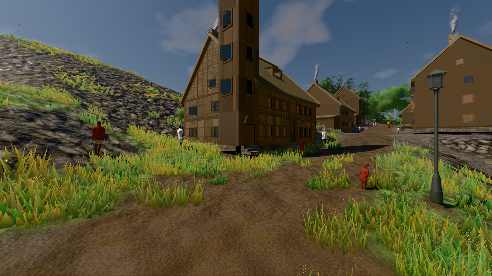

# GPU-PROBE 94d60d9f — GRÜN

Zweig `wurf-mit-luft` · Kopf 94d60d9f62717590901ec979d8969023067758e5 · Läufer gtx1050-desktop · 27.11. 15:19 · Wanduhr ab Push 2772 s · Lauf https://github.com/MiguellD/AnazhRealm/actions/runs/46008123948

Ruf: `gate:webgl-probe gate:stand-takt bild:dorf@0.5`

## Läufer gtx1050-desktop — GRÜN

GPU NVIDIA GeForce GTX 1050 · npm ci 85 s (package-lock a873c59e)
Schloss /c/Users/User/AppData/Local/Temp/claude/gpu-schloss hält „ci-runner 46008123948/1 probe“
- Hook 2026-11-27 14:48:05 start ci-runner 46008123948/1 probe: Schloss genommen (refs/heads/wurf-mit-luft 94d60d9f62717590901ec979d8969023067758e5 ws=C:\actions-runner\_work\AnazhRealm\AnazhRealm)

### gate:webgl-probe — GRÜN · 250 s · Läufer gtx1050-desktop

Adapter: [linse-gpu] webgl2/NVIDIA GeForce GTX 1050 (0x00001C81) Direct3D11 vs_5_0 ps_5_0

```text
✅ GRÜN — die Kein-WebGPU-Geschichte ist BEWIESEN: der erzwungene WebGL2-Rückfall bootet eine LEBENDE, sichtbare Welt; die WGSL-Konsumenten + Bundles ruhen hinter der EINEN Backend-Wand, der Rückfall ist LAUT benannt, der Fern-Ring trägt auf CPU.
```

### gate:stand-takt — GRÜN · 521 s · Läufer gtx1050-desktop

Adapter: ungenannt (die Probe nannte keinen Browser-Adapter)

```text
  ✅ Selbsttest „ein Sprung des Auges (40 m, ohne Takt) lässt die Welt stehen (die Basis)" → rot: FIXPUNKT: die Welt hieß stehend — Sprung: Stufen-Wahl und Streu gingen noch
  ✅ Selbsttest „die Sonde ohne Bestand" → rot: SONDE: Abschnitt der vorigen Kamera, trifft Rinde baum_tanne
  ✅ Selbsttest „Pegel-Stufen" → rot: WASSERNETZ OHNE FIXPUNKT: 37 Wechsel nach dem Stand, zuletzt Chunk -11,-22, Ecke (-462.5, -907.4)
  ✅ Selbsttest „Pendel ungesehen" → rot: BLIND: der Pendel des Pegels wechselt kein Netz
  ✅ Selbsttest „keine Netz-Wache" → rot: LEER: keine Netz-Wache am Bach
✅ SELBSTTEST GRÜN — jeder injizierte Täter fällt rot und wird beim Namen genannt.
✅ SELBSTTEST GRÜN — die Tat-, Nachwuchs-, Brand-, Sukzessions-, Narbe- und Lava-Linse nennen jeden Täter.
  pageErrors: []
✅ GRÜN — STAND-TAKT — im Stand geht kein Fege-Takt und keine langsame Simulation, die gebrochene Wache findet nichts Verschlafenes, ein Bau und jedes Sim-Ereignis wecken, Gehen und Strom arbeiten.
✅ NARBE GRÜN — die Narbe folgt der Front, die Zelle brennt, bis ihre Front sie deckt, das Licht steht bei den Flammen, der Boden liest die Asche-Zeile, die Front ist ein geschlossener Saum, die Zungen pulsen, der Brand leuchtet nachts als Flammen-Fläche, Asche und Rauch tragen die Masse des Holzes; die Lava zündet die Betten um sie auf der Länge ihres Rands, kein Halm steht auf ihrer Decke, sie leuchtet als Flammen-Fläche; die Uhr des Spielers bewegt keinen Prozess, der Sprung der Welt-Uhr ist geschlossen
```

### bild:dorf@0.5 — GRÜN · 202 s · Läufer gtx1050-desktop

Adapter: [linse-gpu] nvidia/pascal

```text
Kamera des Spiels → Blick (11.3 m): -720.31 44.15 -922.46 -709.17 44.15 -920.56
 "abnahme": "ABNAHME GRÜN · beweis · Sicht 0.0 % · Ziel Blickziel im Bild frei 11.3 m · Luma 81.7 σ 29.7 schwarz 0.4 % weiß 0.0 % · Stand 18.546.453 · Bühne summer sunny 0.50 Tiere gehalten · Gerät WebGPU nvidia pascal · Inhalt bauSatz 17.0 % (≥ 2.0 %) Luma 60",
```


