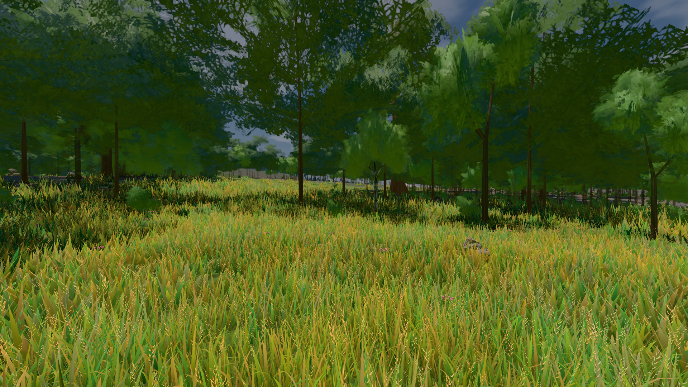

# GPU-PROBE 229e0795 — GRÜN

Zweig `zeit-ein-kalender` · Kopf 229e07951ad541302c2b3724e9bd1c0974a4d47b · Läufer omen-gtx1060 · 20.11. 02:00 · Wanduhr ab Push 431 s · Lauf https://github.com/MiguellD/AnazhRealm/actions/runs/44649347987

Ruf: `gate:weltgrenze bild:wiese@0.5`

## Läufer omen-gtx1060 — GRÜN

GPU NVIDIA GeForce GTX 1060 · node_modules bleiben (package-lock 20e3f8f6)
Schloss /c/Users/micha/AppData/Local/Temp/claude/gpu-schloss hält „ci-runner 44649347987/1 probe“
- Hook 2026-11-20 01:53:19 start ci-runner 44649347987/1 probe: wartet auf Schloss von 'omen-punkte-gtx-sitzung'
- Hook 2026-11-20 01:54:04 start ci-runner 44649347987/1 probe: Schloss genommen (refs/heads/zeit-ein-kalender 229e07951ad541302c2b3724e9bd1c0974a4d47b ws=C:\actions-runner\_work\AnazhRealm\AnazhRealm)

### gate:weltgrenze — GRÜN · 200 s · Läufer omen-gtx1060

Adapter: ungenannt (die Probe nannte keinen Browser-Adapter)

```text
✅ SELBSTTEST GRÜN: auf keinem Weg trägt B ein Feld von A oder geht eine Welt verloren, jede Saat wächst in jedem Leser — und alle sechs Scheine fallen rot beim Namen
```

### bild:wiese@0.5 — GRÜN · 46 s · Läufer omen-gtx1060

Adapter: [linse-gpu] nvidia/pascal

```text
Kamera des Spiels → Blick (10.0 m): -280.40 29.71 -1045.60 -289.61 29.71 -1049.50
 "abnahme": "ABNAHME GRÜN · beweis · Sicht 0.0 % · Ziel Blickziel im Bild frei 10 m · Luma 81.9 σ 38.9 schwarz 0.0 % weiß 0.0 % · Stand 18.546.346 · Bühne summer sunny 0.50 Tiere gehalten · Gerät WebGPU nvidia pascal · Inhalt nahWiese 48.2 % (≥ 15.0 %) h 107° Luma 117",
```


