# SAMEN-BEFUND Klasse FAHRZEUG (die sichtbare Gestalt) — Zwischenstand 12.11.

Wagen: `kompakt_fwd`, Same 5 (= Solargelb, der gelbe Wagen der Stadt). Bühne: Chromium headless, WebGL2 auf swiftshader,
three r184 aus `vendor/`, EIN tiefes Licht (Höhe 14–20°, 70–80° neben der Blick-Achse). „nackt" = ein matter Ton auf allem,
„lack" = die Stoffe des Kerns unter Licht-Bändern (der Spiegel zeigt den Fluss der Fläche). Kein Schnitt im Kern: der Kern wird
nur gelesen; die Gegenprobe (b) ist dieselbe Datei, im Speicher gepatcht. Alles hier ist Wegwerf-Code.

## 1 · Fakten (Datei:Zeile · Zahl)

Kern = `vehicle-core.js`. Gezählt mit `fakten.cjs` / `spike.cjs` (Ergebnis: `fakten.json`, `zahlen.json`).

1. **Form-Vokabular der Haut von heute:** Kästen. `box`/`B` = `BoxGeometry` (:399–417), `Bsub` = unterteilte Box (:1079), `dome` = unterteilte Box mit Parabel-Scheitel (:1057). `buildSkin` (:1379–2188) setzt sie als Platten (halbe Dicke `t` 0,025, :1394) auf die Ebenen z = ±bw, x = Nase/Heck, y = Gürtel/Dach.
2. **Zahl der Teile:** der Wagen 359 Meshes, davon 288 `BoxGeometry`, 19 Stoffe; die Haut allein 235 Meshes, davon 223 Boxen (95 %). Alle fünf Rezepte: 328–359 Meshes, 261–288 Boxen.
3. **Die Form entsteht NACH dem Bau durch Verbiegen:** `taperBody` skaliert jede Ecke in z nach `crossSection` (:1014, :969: Taille, Tumblehome, Coke), `bowEnds` schiebt Bug und Heck in x (:1338, Hub 0,07 + 0,052 m). Kein Teil kennt seinen Nachbarn.
4. **Kanten-Radien:** keiner; jede Kante ist eine Box-Kante. Gemessen an der Haut (Lack + Glas + Licht): 538 m Kante mit Knick > 35° von 2 540 m (21 %).
5. **Dreiecke:** Stufe 0 28 716 = Innen 1 276 · Haut 18 704 · Räder 8 736; Stufe 1 10 056 = 860 · 6 644 · 2 552. Zeile des Budgets: 32 000 (Band 20 000) / 10 600 (:49–50). 19 556 der 28 716 Dreiecke liegen in Box-Geometrien (eine Platte zeigt eine von sechs Seiten nach außen).
6. **Was davon das Auge erreicht:** aus 26 Richtungen gezeichnet tragen 64,2 % der Dreiecke je ein Pixel; die Haut-Stoffe haben 61,1 m² Fläche (die geschlossene Hülle desselben Wagens: 21,8 m², Fall c).
7. **Scheiben:** Windschutz und Heck = `dome`-Box, 10 mm dick (:2052–2079); Seitenglas = `bowedQuad` 6 × 6 (:1283, :2127) oder `quad4`, 2 Dreiecke (:956, :2098, :2166). Sie stehen 15 mm hinter der Flanke (`cwK` = bw − 0,015, :1395), ohne Rahmen-Fuge. Stoff: 0x0a0f18, Deckung 0,42, `envMapIntensity` 3,0 (:89–98).
8. **Leuchten:** Kästen in einer Öffnung der Stirn-Platten: Wanne, Reflektor, Linse (`shapedLens` :1139), Strich-Signatur aus Boxen (`lightStrokes` :422, :1700–1711, :1736–1745); 256 Dreiecke Licht am ganzen Wagen.
9. **Räder:** `makeWheel` (:758): Lauffläche = Zylinder 40 × 8 mit Tonne 0,12 (:1087), Flanke = flache `RingGeometry` (:774), Felge = 5 Box-Speichen (:836), Breite fest 0,22 (:762). 2 184 Dreiecke je Rad; kein Profil, keine Flanken-Wölbung, kein Felgenhorn.
10. **Radlauf:** kein Kreis. `clipSegs` (:1039) schneidet ein Rechteck ± `archHalf` = radR · 1,18 aus der Flanke (:1396, :1407) bis zum Gürtel; darüber eine Parabel bis `archTopV` = max(Gürtel + 0,015, 2 · radR + Freigang) (:1489, :1539). Gemessen: Spalt Reifen → Öffnung 56 … 281 mm über 20°–160° (Spanne 225 mm vorn, 228 mm hinten).
11. **Fugen:** keine gebaute. Die Tür ist EINE Box, 16 mm (:2120), Außenfläche bw + 0,008; der Kotflügel daneben bw + 0,025 (:1462–1476): eine Stufe von 17 mm, keine Fuge. Haube und Deckel sind Platten zwischen den Kotflügel-Streifen (:1840, :1894).
12. **Innenraum:** `buildPackage` (:2190) zeichnet Organe, die keiner sieht: Akku (:2215), zwei Motoren (:2226–2227), Hilfsrahmen, Längsträger, Wellen. Der „dunkle Klotz" sind die Sitze: je drei Boxen in `seat` 0x302a3a (:2324–2326, :139). Einen Fahrer-Klotz gibt es nicht: am Steuer sitzt das Rig des Bewohners (`stamm/siedlung-verkehr.js:713`).
13. **Maße eines Rezepts:** 12 Form-Regler von 16 (`PARAMS` :4353): Radstand, Spur, Überhang V/H, Taille, Rad-Radius, Fahrhöhe, Gürtel, Dach, Kabinen-Mitte/-Länge, Tumblehome; dazu Rezept-Konstanten (`coke`, `roofArc`, `windshieldRake` … :4520–4688).
14. **Das Soll:** 7 `LEHREN` mit Band (:536–593, `MESS` :598). Gegen ihr eigenes Soll: `gt` und `limousine` 7 von 7; `kompakt_fwd` reißt 3 (Radstand/Länge 0,677 > 0,645 · Dash-to-Axle 0,043 < 0,16 · Überhang V/H 1,385 > 1,04), `suv` 3, `supersport` 2 (+ 2 Warnungen).
15. **Sage a, tue a (Bodenfreiheit):** die Lehre misst `P.fahrhoehe` (:602; kompakt 0,135 m), die Haut beginnt bei `ySill` = fahrhoehe + 0,18 (:937). Gemessene Unterkante des Lacks: 0,290 m (gt 0,285 · suv 0,375); der Schweller steht auf Naben-Höhe.
16. **Die Scheibe ohne Soll:** `windshieldRake` ist kein Regler und trägt keine Lehre (:518, :4710); je Rezept 0,45–0,55 → der Windschutz steht 61,2°–65,8° zur Waagrechten. Richtwert Pkw 25°–35° — UNGEPRÜFT (aus dem Gedächtnis).
17. **Lack:** `MeshPhysicalMaterial`, Klarlack 1,0 / Rauheit 0,03; uni: Metall 0, Rauheit 0,4; metallic: 0,7 / 0,35 (:307–324). Flocken: keine (kein Normalen- oder Flocken-Term; „metallic" ist ein Skalar). 8 Lacke (:3334).
18. **Gummi / Glas:** Reifen 0x2a2c2f, Rauheit 0,85 (:101); Glas siehe 7. In der Welt reist die Farbe als Vertex-Farbe (`stamm/studio-stoff.js:279`), Klarlack und Durchsicht überleben den Ingest (Suchlauf: `studio-stoff.js:214–250`, `welt-licht.js:987` — dort nicht nachgemessen).
19. **LOD:** die Stufe 1 ist derselbe Bau unter `FAHRZEUG_DETAIL_1` k = 0,4 (:62, :4852–4881) — kein Zwilling; die Boxen ohne Teilung bleiben, 328–359 Meshes in beiden Stufen. Wechsel bei 12 m und 26 m (`foundry-core.js:420–421`), danach die Karte, gebacken aus Stufe 1.
20. **Der einzige Zwilling:** fern der Box-Satz `_archBoxFit` (`stamm/studio-bruecke.js:3204`): je Kind-Mesh der Stufe 1 eine AABB, die 24 größten (:3265).
21. **Wie die Welt den Wagen liest:** EIN Stempel. `siedlung-verkehr.js:605` → `build-asset` (`studio-bruecke.js:1494`) → `buildInstance(id, seed, lod, ov)` (`foundry-bruecke.js:878`), ohne `werk`, ohne Epoche. Die Stadt fährt `kompakt_fwd` · `limousine` · `suv` (`siedlung-verkehr.js:2127`). Sonderweg nur ohne Foundry: Holz-Kasten mit Speichenrädern (`siedlung-satz.js:1754`).
22. **Der Kern kann Fläche schon — nur nicht „heute":** `gitter(nu, nv, fn)` (:2475), `strang`, `netz`; `bauKanzel` (:2905) baut die Zukunft (Epoche 5) aus Stationen mit Superellipsen-Schnitt, Haut 6 180 Dreiecke (Bild `kanzel-dreiviertel-nackt.png`). „heute" ist `buildSkin`, byte-treu aus dem Labor extrahiert (:4–6, :4797) — und „heute" ist, was die Stadt zeigt.

## 2 · Urteil zum Samen

**Die EINE begrenzende Entscheidung: die Haut von heute ist ein BAUSATZ aus Platten auf den Ebenen eines Quaders, nachträglich
verbogen — keine Fläche.** Daraus folgt jedes Symptom des Stadt-Bilds: Radius 0 an jeder Kante (Fakt 4), der Radlauf als
Rechteck (10), die Tür als aufgesetzte Platte ohne Fuge (11), die Scheibe als Platte hinter der Flanke (7), ein Drittel des
Budgets auf Rückseiten (5, 6). Maße trimmen ändert daran nichts; mehr Teilung auch nicht (Fall b).

## 3 · Der Spike — drei Fälle am selben Wagen

- **(a) heute:** `buildInstance("kompakt_fwd", 5, 0)`.
- **(b) Gegenprobe, mehr Unterteilung derselben Teile:** dieselbe Kern-Datei, im Speicher gepatcht: das Detail-Gesetz `teil` × 3, jede glatte Box in 4-cm-Zellen, die Budget-Zeile aufgehoben.
- **(c) Kandidat, EINE Haut aus Schnitten** (`kandidat.js`): 93 Stationen längs x, je Station EIN Schnitt mit fester Punkt-Folge (Boden · Schweller · Flanke · Schulter · Absatz · Glas · Dachholm · Rinne · Scheitel, 66 Zellen je Ring). Jede Kante ist ein Punkt der Folge mit Verrundung (Schulter 22 mm, Dachholm 50 mm, Schweller 50 mm Schnittweite), jede Fuge eine Gitter-Linie (8 mm breit, 7 mm tief), das Glas eine Zone derselben Fläche, der Radlauf ein Kreis um die Nabe mit Falz und Wanne. Maße: dasselbe `P`, `derive`, `crossSection`, `wheelClearance`; Räder und Sitze aus dem Kern.

| Maß | (a) heute | (b) Teilung × 3 | (c) Kandidat |
|---|---|---|---|
| Dreiecke gesamt | 28 716 | 263 500 | 20 578 |
| davon Innen · Haut · Räder | 1 276 · 18 704 · 8 736 | 37 944 · 162 276 · 63 280 | 280 · 11 562 · 8 736 |
| Bau-Zeit, Median von 15 (min–max) | 28,6 ms (23,9–51,2) | 174,1 ms (148,7–219,3) | 14,6 ms (11,1–26,2) |
| Meshes | 359 | 359 | 103 |
| Dreiecke, die das Auge erreichen (26 Richtungen) | 64,2 % | 55,3 % | 80,0 % |
| Kante mit Knick > 35° an der Haut | 538 m von 2 540 m | 541 m von 7 776 m | 78 m von 1 367 m |
| Radlauf: Spalt Reifen → Öffnung, min … max (Spanne) vorn | 56 … 281 mm (225) | 56 … 281 mm (225) | 72 … 76 mm (4) |
| dasselbe hinten | 55 … 283 mm (228) | 55 … 283 mm (228) | 71 … 76 mm (5) |
| gebaute Fugen | 0 m | 0 m | 17,9 m |
| Unterkante des Lacks | 0,290 m | 0,290 m | 0,165 m (= fahrhoehe + 0,03) |

Die Form-Maße und ihr Grund: **Radlauf-Spanne** (folgt die Öffnung dem Rad? ein Kreis um die Nabe hat Spanne 0), **Länge der
harten Kante** (bei (a) ist jede Kante Zufall der Box, bei (c) ist jede eine gesetzte Fuge oder ein Falz), **Anteil gesehener
Dreiecke** (wie viel des Budgets das Bild trägt). Richtwerte Serien-Pkw, UNGEPRÜFT: Fuge 3–5 mm, Spalt Reifen → Radlauf
40–70 mm, Windschutz 25°–35° zur Waagrechten. Bau-Zeiten gelten nur als Verhältnis (Wolken-CPU, swiftshader-Chromium).

## 4 · Bilder (gleiches Licht je Blick; links a · Mitte b · rechts c)

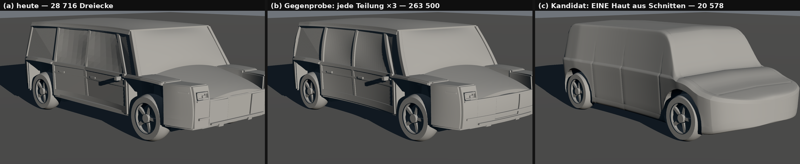
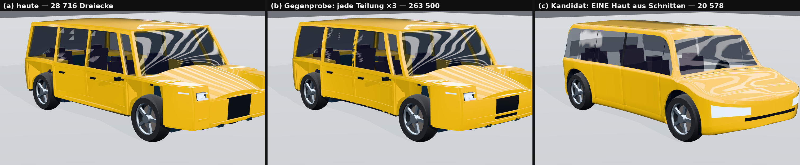
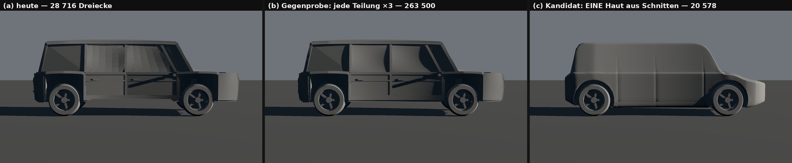
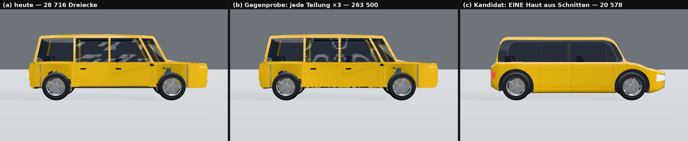
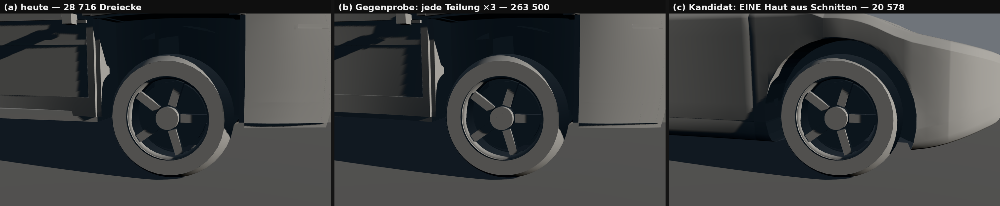
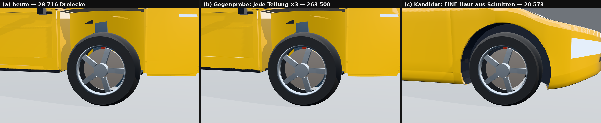
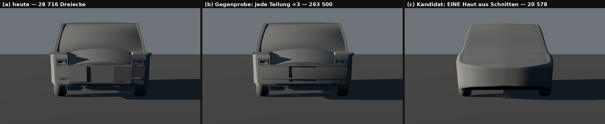
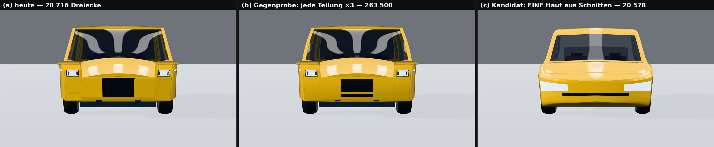
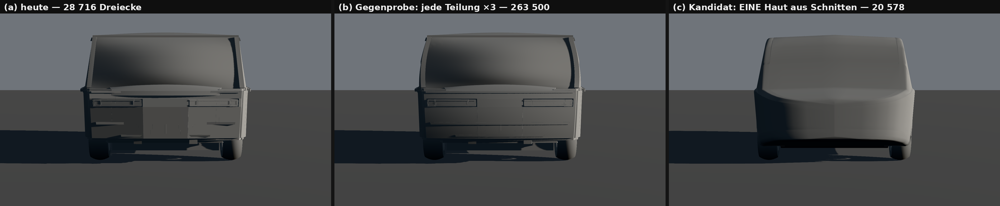
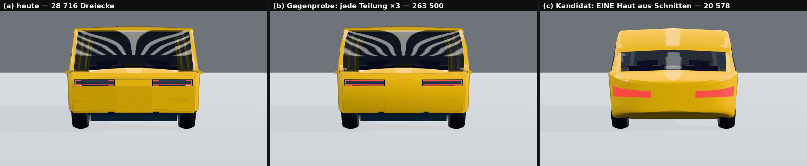
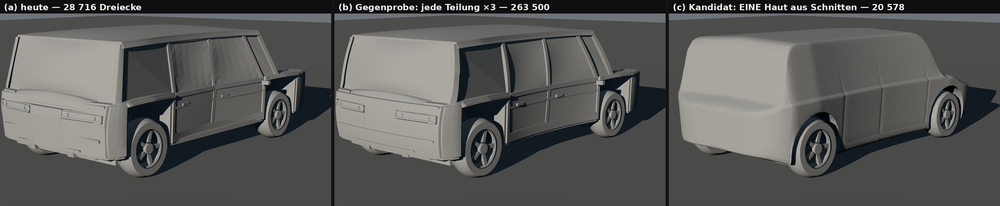
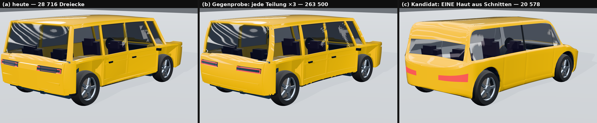

Einzelbilder in voller Größe: `<fall>-<blick>-<modus>.png` (a · b · c × vorn · hinten · seite · dreiviertel · heck34 · rad ×
nackt · lack). Der Kern kann es schon, eine Epoche weiter: 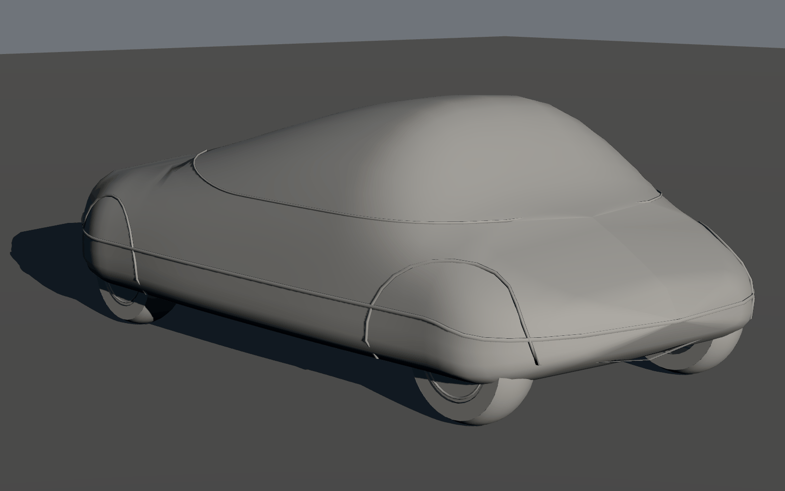

Was ich in den Bildern sehe: (a) und (b) sind dasselbe Bild — 9,2-mal so viele Dreiecke, kein Pixel Form. (c) ist eine
geschlossene Karosserie: die Licht-Bänder laufen über Haube und Dach durch, die Tür-Fugen und der Schweller-Stoß lesen sich,
das Glas liegt bündig, der Radlauf sitzt als Kreis um das Rad. (c) ist aber kein schöner Wagen: die Front hat kein Gesicht
(die Leuchte ist ein Zellen-Fleck, der Grill ein Strich), das Heck ist ein Seifenstück, die Bänder zittern an den Säulen.

## 5 · Urteil in fünf Sätzen

1. **Trägt der Kandidat bei gleichem Budget?** Für Fläche, Kanten, Fugen, Glas und Radlauf ja — mit 20 578 statt 28 716 Dreiecken (Haut 11 562 statt 18 704) fällt die Radlauf-Spanne von 225 auf 4 mm, die harte Kante von 538 auf 78 m und es stehen 17,9 m gebaute Fugen statt 0; für Gesicht, Heck und Spiegel-Fluss nein, die trägt er noch nicht.
2. **Was kostet er?** Keine Bau-Zeit (14,6 statt 28,6 ms), sondern den Byte-Beweis: jede Geometrie von „heute" ändert sich, also Re-Mint der Goldens aller 5 Rezepte × 8 Gestalten × 2 Stufen, ein neuer Umriss `__mass` für die Kollision, und die Türen der Werkstatt (`werk.doors`) müssen aus der Fläche geschnitten statt als Box gehängt werden.
3. **Wo reißt er?** An vier Stellen, alle gesehen oder gerechnet: die Silhouette bleibt ein Kasten, weil das die MASSE sind (Windschutz 62,5°, Dachbogen 0,02 — Fakt 16), nicht der Samen; der Kreis-Radlauf steht mit 75 mm Spalt gegen 144 mm Freigang aus der Fahrphysik des Kerns (die Wanne müsste höher sein als der Falz) und ist an `gt`/`supersport`, wo der Radlauf-Scheitel über dem Gürtel liegt, nicht gebaut; die Fläche ist nur tangenten-stetig bei 8,5 cm Stations-Abstand, der Spiegel zeigt es; und der ferne Box-Satz nähme aus 8 großen Haut-Meshes je eine AABB — schlechter als heute.
4. **Der EINE Schnitt im Kern:** `buildSkin` (:1379–2188) wird eine Haut aus Schnitten auf dem Gitter-Vokabular, das der Kern für die Kanzel schon trägt (`gitter` :2475) — feste Punkt-Folge je Station, Kanten als Punkte mit Radius, Fugen und Glas als Zonen des Gitters, der Radlauf als Kreis aus `wheelClearance`; die Stufe 1 ist dann dieselbe Funktion mit weniger Stationen und Zellen.
5. **Was dabei stirbt:** der Platten-Bausatz der Haut (223 Box-Meshes) mit seinem Verbiege-Stapel als Haut-Vokabular (`taperBody` · `bowEnds` · `clipSegs` · `Bsub` · `dome` · `bowedQuad` · `quad4`), die gezeichneten Organe (Akku, Motoren, Rahmen: Innen 1 276 → 280) und die Byte-Treue zum extrahierten Labor-Bau (:4–6) — das ist ein Vertrags-Akt (Lehre 11) und braucht das Wort des Schöpfers.

## 6 · Ehrlich offen (nicht gemessen)

- Nur EIN Rezept gebaut (`kompakt_fwd`); `limousine`, `suv`, `gt`, `supersport` sind am Kandidaten nicht gerendert.
- Nur swiftshader/WebGL2 im eigenen Gestell, nicht der Weg der Welt (Worker, Budget-Faltung, Vertex-Farbe, Karte, Box-Satz); kein Bild auf echter GPU, kein Bild im Spiel.
- Die Stufe 1 des Kandidaten ist nicht gebaut; die Zahl 20 578 steht 578 über dem Band 20 000 der Stufe 0.
- Die Räder sind in allen drei Fällen dieselben (8 736 Dreiecke = 42 % des Kandidaten); ihr Samen (Fakt 9) ist ein eigener Befund.
- Die Zeilen aus `stamm/` in den Fakten 18–21 stammen aus einem Suchlauf; stichprobenhaft bestätigt sind `siedlung-verkehr.js:605/:2127`, `foundry-core.js:420–421`, `foundry-bruecke.js:878`, `studio-stoff.js:279`, `studio-bruecke.js:1494/:3204/:3265`, `siedlung-satz.js:1754`.

## 7 · Nachfahren

```bash
node samen/fahrzeug/spike.cjs a,b,c kompakt_fwd 5
```

```bash
node samen/fahrzeug/fakten.cjs
```
