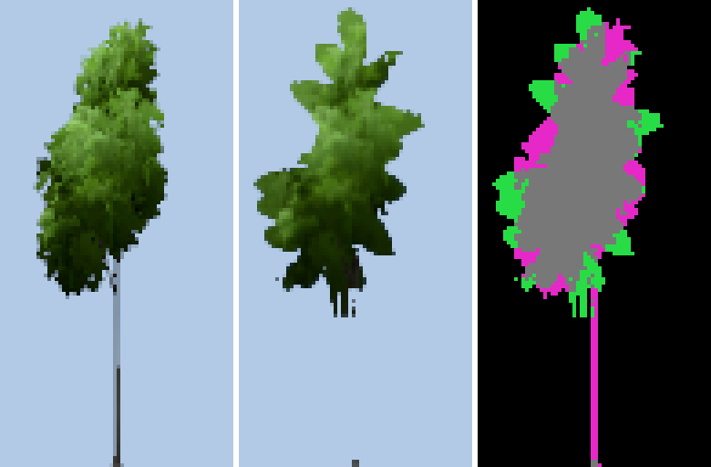
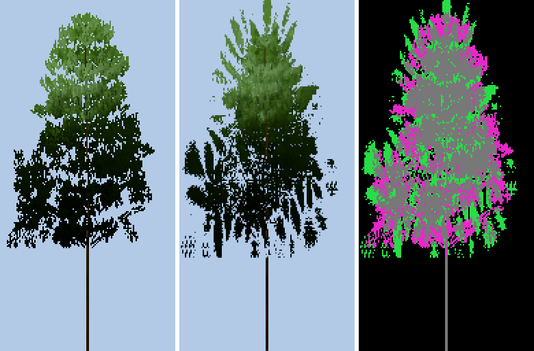
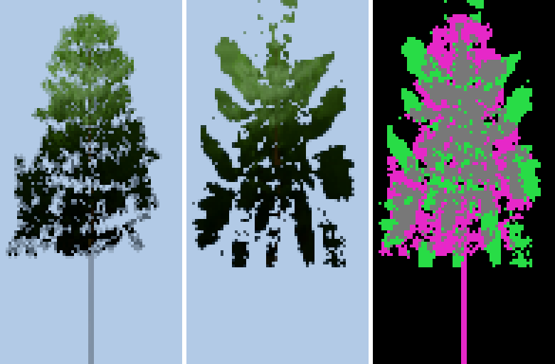
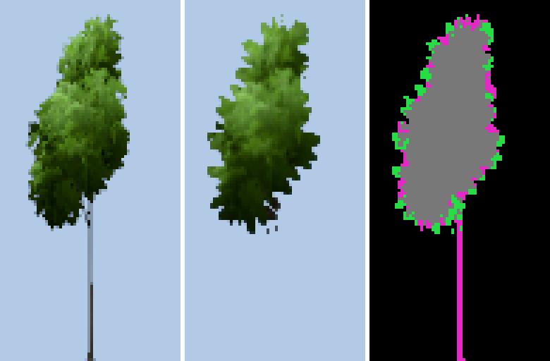
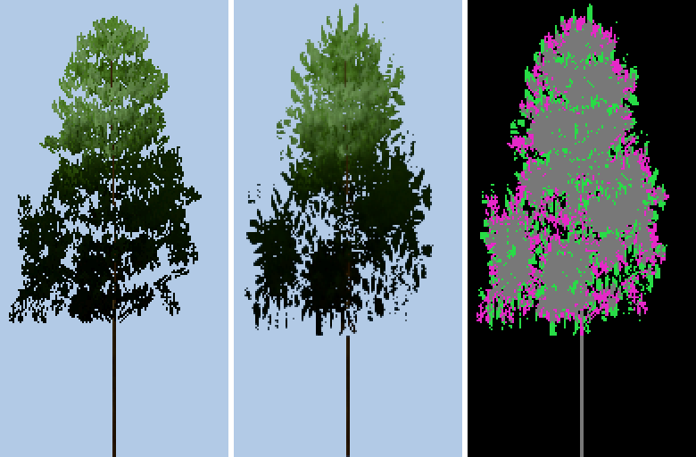
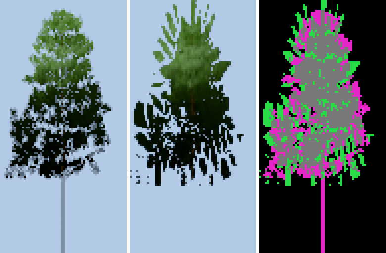
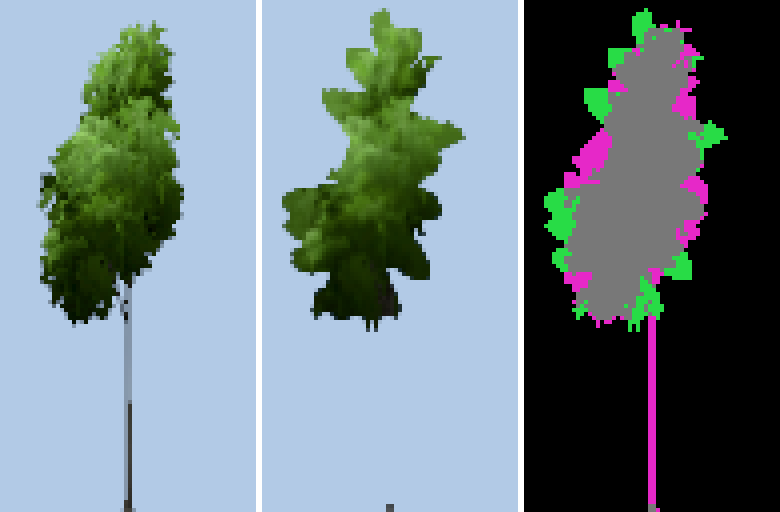
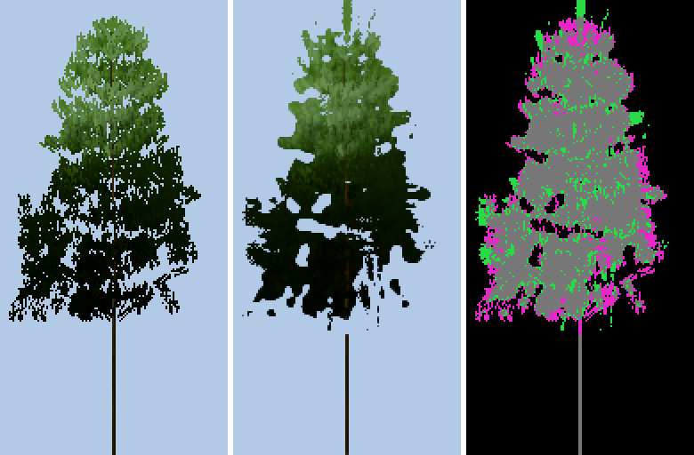
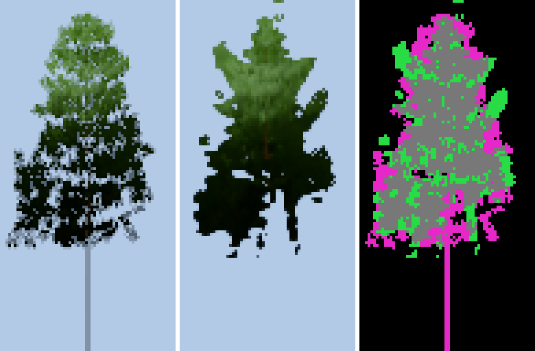

# SAMEN-BEFUND — die Karten-Stufe: Fläche und Rand aus EINER Zahl

Zweig `w28-samen-karten-stufe` · Stand V18.546.269 (main 1cd1c408) · 13.11.2026 · Befund, Vergleichs-Bühne und EIN Kandidat im Kern,
kein Zug, keine Abgabe. Gerät: Cloud-Container, 4 Kerne; die Welt läuft in der Werkbank auf swiftshader (`?holz=kienspan`) — ihr Bäcker
backt die Karten (zwei Starts, byte-gleich) und ihre GPU-Ablage legt sie ab (Texel für Texel wie der CPU-Codec). **Die Stationen
lod.K4#1 und lod.K1#1 (Radeon) sind hier nicht messbar**; jede Zahl unten ist ein CPU-Maß mit Formel, die Radeon-Zahlen stammen aus den
Commit-Rümpfen von 8f62f28f, 1611b54b und a0003927.

## In drei Sätzen

1. **Gesehen:** Die Karte zeichnet eine andere Krone als ihre Stufe davor — am Wechsel (Stufe 0–1) verlegt ihre Wahl 10–18 % (Buche)
   und 29–33 % (Fichte) der Deckung der Gestalt auf Texel, die die Gestalt nicht deckt: Lappen in den Himmel, echte Büschel und
   Ast-Etagen fallen, ab Stufe 1 fällt der Stamm; die GPU-Ablage der Welt wählt dieselben Texel (0 von 262 144 abweichend).
2. **Gemessen:** Die EINE Entscheidung: der Rand ist ein Gesetz der KARTE — erfunden über der verwischten Deckung g (σ 6 Texel) aus
   derselben festen Zahl M, die ihre Fläche trägt, die eigene Deckung nur Gleichstand (1e-6 · c); wo die Gestalt im Maß der Karte
   gerader ist als das Soll (Scheibe 0,944, Buche 0,544 / 0,632), schließen Fläche (Karte = Gestalt) und Rand (Kante ≤ 0,22)
   einander aus — die Gegenprobe (Band halb) verlegt weniger und verliert den Rand (Scheibe 0,565 statt 0,114).
3. **Ehrlich offen:** Der Kandidat (erfinden nur, wo die Gestalt keinen Rand trägt) halbiert an der Fichte die Verlegung (S0 29 → 14 %,
   S1 33 → 15 %) und nimmt ihr das Zweiton (0,217 → 0,031) bei grünem Gate, an der Buche ist er heute; den Sprung der Station sagt
   hier kein CPU-Licht vorher — keines ordnet die Radeon-Rück-Fälle (Abschnitt 5), der GPU-Zwilling `saumK` steht aus.

## 1 · Gesehen — Netz | Karte | Differenz, im selben Licht, gleiche Größe

Je Bild links das **Netz** (die Stufe davor: der Box-Anteil der gebackenen L1 in der Größe der Stufe, ihr Licht je Blatt), Mitte die
**Karte** (die Wahl des Kerns, Licht aus denselben Blättern), rechts die **Differenz**: grün = die Karte deckt, wo die Gestalt nicht
deckt (gefüllt), magenta = die Gestalt deckt, die Karte nicht (gefallen), grau = beide. Peilung 0 des Rings 0°, Uhr 0,5, vor Himmel;
Stufe 1 vierfach, Stufe 0 doppelt vergrößert (je Texel ein Block). Am Wechsel (d1 26 m, fov 75°, 1 080 Zeilen, Skala 0,75) steht die
Buche 146 px hoch (Stufe 0,8), die Fichte 127 px (Stufe 1,0).

| | Buche Stufe 1 | Fichte Stufe 0 | Fichte Stufe 1 |
| --- | --- | --- | --- |
| (a) heute |  |  |  |
| (b) Gegenprobe |  |  |  |
| (c) Kandidat |  |  |  |

Buche Stufe 0: `heute-buche-s0.png`, `gegenprobe-buche-s0.png`, `kandidat-buche-s0.png`.

**Wo der Unterschied sitzt.** (a) Buche: der Umriss läuft als Laib mit fünf bis sieben großen Lappen; die Lappen liegen im Himmel
(grün), dazwischen fallen echte Rand-Büschel (magenta), innen bleibt die Krone gleich; ab Stufe 1 fällt der Stamm ganz. Fichte: die
Ast-Etagen der Gestalt (waagrechte Bänder mit Himmel dazwischen) werden zu Nadel-Graten, die schräg in den Himmel stehen; an Stufe 0
Streifen und Inseln unter der Krone. Die Farbe der gefüllten Texel ist das Mittel ihres Bands (17 × 17 Abgriffe im Schritt 3) — ohne
eigene Normale und Sicht. (b) Das schmale Band hält die Buche näher an der Gestalt, aber glatt (der Rand fehlt); die Fichte trägt
dieselben Grate kürzer. (c) Fichte: die Ast-Etagen bleiben, die Lücken der Gestalt bleiben offen (größer und glatter: σ 2); Buche wie (a).

## 2 · Fakten aus der Quelle (main 1cd1c408)

**Wie die Karte entsteht**

- F1 Quelle der Karte ist die servierte L1 (`_karteStufe`, stamm/stoff-karte.js:430–432); die Bühne zeichnet sie orthographisch je Ring
  und Peilung in die Zelle 128 × 256 (Ring 0°, sonst 64 × 128: foundry-core.js:788; stoff-karte.js:1252–1265, 1375–1381).
- F2 Die Albedo der Bühne trägt Alpha 1, wo ein Fragment steht (MRT stoff-karte.js:1089–1093); der Versatz des Laubs ist in der Ortho-Kamera
  0 (m[3][3] = 1, vegetation-baum.js:221), die zeitliche Laub-Kante steht still (stoff-karte.js:1291). Gemessen: Alpha nur 0 oder 255
  (Buche 60 359, Fichte 74 791 deckende von 262 144 Texeln je Ring).
- F3 `c` = Deckung eines Texels der Stufe k: Stufe 0 binär an der Schwelle 0,45 (`deckt`, stoff-karte.js:2096–2098), tiefer der Anteil
  seines 2^k × 2^k Fußabdrucks (`summeK` :2143–2160; phyto-core.js:4805).
- F4 `dK` = c geglättet, binomial 3 × 3, 4 Gänge bis Stufe 2, danach 1 (phyto-core.js:4202–4205, :4766–4803; `glaette` stoff-karte.js:
  2167–2182) — er wählt nur unter dem Kronen-Fuß (den Stamm).
- F5 `g` = c im binomialen Kern von 17 Abgriffen (saumBand 8) im Schritt saumWeite 3 Texel der gröberen Achse: σ = 6 Texel, Reichweite
  ±24 Texel — auf JEDER Stufe in ihren eigenen Texeln (phyto-core.js:4291–4316; `band` stoff-karte.js:2235–2253).
- F6 Der Schlüssel über dem Fuß: g + 2 · saum · [g ≥ 1] + saum · 4g(1 − g) · (Muster − ½), saum 1,8, das Muster an der Höhenlinie g = ½
  gelesen (Zug, Zelle 2,5 Schritte); c geht nur als Gleichstand ein, + 1e-6 · c (phyto-core.js:4317–4340, :4337; `saumK`
  stoff-karte.js:2283–2314, :2311). Das gilt seit w23-karte-l2 auch für Stufe 0 (phyto-core.js:4703–4727).
- F7 Die Zahl: je Ansicht genau M = min(positiv, round(Deckung₀ · nA)) Texel, binär, BC1 (phyto-core.js:4846; `grenzeK`
  stoff-karte.js:2343–2344; `bc1` :2444).
- F8 Die FARBE eines gewählten Texels ohne eigene Deckung: Σ(rgb · a) / Σ a seines Bands (phyto-core.js:4723, :4836–4845, :4876;
  `bc1` stoff-karte.js:2447–2449); Normale und Tiefe die Summe seines Bands auf halber Auflösung (`ablageNT` :2578–2604), die
  Sonnen-Sicht auf ¼ der Stufe 0, ein Block ohne Blatt aus dem Band (`sicht`/`sichtBand` :2663–2719).
- F9 Die GPU-Ablage der Welt wählt wie der Codec des Kerns: Buche Stufe 0/1/2 und Fichte Stufe 0/2 0 abweichende Texel, Fichte Stufe 1
  2 von 65 536 (`gpu-gleich.txt`). Zwei Bakes in zwei Starts der Welt: 0 von 1 048 576 Bytes je Kanal abweichend.

**Wie die Stufe davor deckt**

- F10 Die L1 schneidet ihre Blätter an der Deckung des Blatt-Atlas (Castaño, Teil-Deckung), je Frame um ±1 Pixel versetzt; über die
  zeitliche Auflösung steht die Teil-Deckung der Büschel als Mischton (vegetation-baum.js:197–222). Die Karte schneidet binäre Texel
  — die Größe „Deckung" ist dort ein Anteil, hier ein Bit; ihre Zahl M ist die der GESCHNITTENEN Bühne (F2), nicht die Teil-Deckung.
- F11 Der Wechsel L1 → Karte bei d1 26 m Wahrnehmungs-Abstand (foundry-core.js:419–420; `_lodPerceptionDistance`
  stamm/vegetation-streu.js:1815), Bäume unter 12 m nominal.

**Was die Maße messen**

- F12 lod.K4#1: das Auge der Stufen ±4 m versetzt, Maske = Pixel mit max-Kanal-Differenz > 2, Sprung = |Ȳ_nach − Ȳ_vor| / Ȳ_vor (Rec. 709)
  — das Bild der Karte GEGEN das Bild der Stufe davor (punkte-maschine g3.js:1323–1361).
- F13 laub-kante (`klassenMasse`, scripts/lib/abnahme-urteil.cjs:634–755): Maske im Gauß σ 2 px, Struktur-Tensor im Fenster 17 × 17 px,
  Kohärenz gemittelt über die Rand-Pixel — die Karte ALLEIN gegen ein festes Soll ≤ 0,22; frei ≤ 0,007 (:756–821), zweiton (:569–606).
- F14 gate:streu-wahrheit (6e/6f, scripts/diag-streu-wahrheit.cjs:97–122): eine Scheibe r 48 in 128 × 256 (:100) — eine Gestalt OHNE
  eigenen Rand, unverändert 0,944 (:25) — muss auf Stufe 0 und 1 ≤ 0,22 fransen, frei ≤ 0,007.
- F15 Die Kante der Gestalt selbst (das Netz binär an ½, im Raster der Stufe, 8 Peilungen): Buche Stufe 0 / 1 **0,544 / 0,632**, Fichte
  **0,214 / 0,269**. Halbe Auflösung hebt sie um 0,09 / 0,06 — doppelte brächte die Buche nicht an 0,22.
- F16 Der Stamm unter dem Fuß wählt ab Stufe 1 mit dK gegen die Schlüssel des Bands (F4, F6): an der Buche hält Stufe 1 heute 4 %
  seiner Masse, vor w28 0 %, ohne Saum 26 %, Stufe 2 in jedem Gesetz 0 % (an der Fichte mischt das Maß Kronen-Texel unter dem Fuß
  hinein; im Bild fällt ihr Stamm an Stufe 1 ebenso).

**Können beide Maße an EINER Karte zugleich grün sein?** Der Rand misst die Karte allein gegen ein festes Soll, die Fläche misst sie
gegen ihre Gestalt. Eine Karte gleich ihrer Gestalt (Verlegung 0) trägt die Kante der Gestalt: 0,944 an der Scheibe, 0,544 / 0,632 an
der Buche — rot nach Definition. Beide zugleich grün sind also nur möglich, (i) wo die Gestalt das Soll im Maß der Karte schon trägt
(Fichte Stufe 0: 0,214), oder (ii) wo die erzwungene Verlegung im Licht des Wechsels zufällig nichts verschiebt — eine Eigenschaft des
Lichts, nicht der Definitionen. An der Scheibe und an jeder Gestalt wie der Buche schließen die Definitionen einander aus.

## 3 · Die EINE Entscheidung

**Der Rand ist ein Gesetz der Karte, nicht der Gestalt.** Seit w23-karte-l2 wählt jede Stufe — auch Stufe 0, die ihre Gestalt 1 : 1
trägt — ihre M Texel neu: nach der verwischten Deckung g und einem erfundenen Muster; die eigene Deckung der Gestalt hat im Band
keine Stimme außer dem Gleichstand (F6). Ihr Prüfling ist eine Scheibe, die keinen Rand hat (F14). Weil M fest und binär ist (F7),
ist jeder erfundene Texel aus der Fläche der Gestalt bezahlt. Daraus folgt beides, was die Bilder zeigen: (1) wo die Gestalt ihren
Rand selbst trägt (Fichte 0,214), wirft das Gesetz ihn trotzdem weg und zeichnet einen anderen (29 % verlegt, Zweiton 0,217, 28
Inseln) — vermeidbar; (2) wo sie keinen trägt (Buche 0,544), kann der Rand nur aus der Fläche geschnitten werden — in der Karte
unvermeidbar. Nicht die Breite des Bands begrenzt (Gegenprobe), nicht die Auflösung (F15).

## 4 · Drei Fälle am selben Objekt

Dieselben Abzüge (Buche und Fichte, Gestalt 0, Ring 0°, alle 8 Peilungen gemittelt), dasselbe Licht, dieselbe Schwelle. (a) heute =
phyto-core.js aus main; (b) Gegenprobe = dasselbe Gesetz, saumWeite 3 → 1,5 (Band und Zelle halb: σ 3 Texel) — die Falsifikation
von „das Band ist zu breit"; (c) Kandidat = `phyto-core.js` dieses Zweigs: `karteSaumSchluessel` mit `karteSaumEigen` /
`karteSaumGestalt`, `KARTEN_GESETZ.saumGestalt` [0,15, 0,3] — der Schlüssel g + w · (c̃ − g) + (1 − w) · Hub · (Muster − ½), w aus der
Kohärenz des eigenen Umrisses im Maß der Linse (c̃ = c in 8 Glätte-Gängen, σ 2; Tensor im Kern σ 5).

**Die CPU-Maße** (je Stufe k, Netz = Box-Anteil der Stufe 0, Karte = die Wahl des Codecs):

- Verlegung V = ½ · (Σ [gewählt ∧ c = 0] + Σ c · [nicht gewählt]) / Σ c — der Anteil der Fläche der Gestalt, den die Karte versetzt.
- Deckung D = Σ d_Karte / Σ d_Netz − 1, d_Karte = Anteil der 4 × 4 Proben je Pixel, deren bilineare Alpha über 0,45 steht.
- Helligkeit H = Ȳ(L der gewählten Texel) / Ȳ(L der deckenden Stufe-0-Texel) − 1, L = Albedo · (0,85 · max(0, n · s) · Sicht(s) + 0,15 ·
  (½ + ½ n_y)), Sonne 74° hoch; die Karte lichtet aus ihren abgelegten Werten (Albedo der Stufe, Normale ½, Sicht ¼, Band für Gefüllte, F8).
- Kante, Inseln, frei, Zweiton = `klassenMasse` im Raster der Stufe (wie F14), ohne den Versatz von F10 (die Welt löst Zweiton über
  drei Pixel auf: hier ist es eine Obergrenze).

**A · Der Rand**

| Fall | Scheibe (das Gate) Laub S0/S1 · Nadel S0/S1 · frei | Buche S0 / S1: Kante · Inseln · frei · Zweiton | Fichte S0 / S1: Kante · Inseln · frei · Zweiton | Gate |
| --- | --- | --- | --- | --- |
| Gestalt (Bezug) | 0,944 | 0,544 / 0,632 · 0,3 / 0 | 0,214 / 0,269 · 0 / 0 | — |
| (a) heute | 0,114 / 0,105 · 0,104 / 0,125 · ≤ 0,0004 | 0,272 / 0,180 · 1,4 / 0,4 · 0,0007 / 0,0003 · 0,003 / 0,002 | 0,239 / 0,227 · 28,5 / 7,9 · **0,030 / 0,026** · **0,217 / 0,089** | GRÜN |
| (b) Gegenprobe | **0,565 / 0,557 · 0,453 / 0,490** · ≤ 0,0017 | **0,493 / 0,383** · 3,0 / 0,4 · 0,0014 / 0,0004 · 0,002 / 0 | 0,181 / 0,163 · 16,9 / 5,4 · 0,006 / **0,008** · **0,210 / 0,184** | ROT |
| (c) Kandidat | 0,114 / 0,105 · 0,104 / 0,125 · ≤ 0,0004 | **0,299** / 0,184 · 0,9 / 0,5 · 0,0006 / 0,0003 · 0 / 0 | 0,230 / 0,207 · 10,1 / 3,9 · **0,011** / **0,0084** · 0,031 / 0,006 | GRÜN (Exit 0) |

**B · Die Fläche** (Verlegung V · Deckung D · Helligkeit H, Stufe 0 / Stufe 1)

| Fall | Buche V | Buche D | Buche H | Fichte V | Fichte D | Fichte H | Stamm S1 Buche | Codec je Ansicht |
| --- | --- | --- | --- | --- | --- | --- | --- | --- |
| (a) heute | 9,8 / 17,7 % | +0,7 / +1,0 % | +2,0 / +5,6 % | 28,8 / 32,7 % | +4,2 / +3,2 % | −1,1 / −1,3 % | 4 % | 421 / 441 ms |
| (b) Gegenprobe | 6,4 / 10,1 % | +0,6 / +0,9 % | +3,3 / +6,4 % | 22,2 / 23,3 % | +3,5 / +3,7 % | +3,3 / +1,5 % | 0 % | 419 / 461 ms |
| (c) Kandidat | 8,3 / 15,2 % | +0,6 / +0,9 % | +1,9 / +7,7 % | **14,3 / 15,3 %** | +1,4 / +1,3 % | +1,1 / +6,6 % | 3 % | 571 / 578 ms |
| ohne Saum (Bezug) | 0 / 2,1 % | +0,6 / +0,7 % | +2,4 / +6,2 % | 0 / 6,1 % | +3,7 / +1,5 % | +2,1 / +2,8 % | 26 % | 2–3 ms |

Lesart: H trägt schon ohne Saum +2 bis +6 % (Normale ½, Sicht ¼: das Licht aus abgelegten Werten), der Saum legt darauf ±4 %. Die
Probe des Bands der Bühne gegen den Codec (Farbe gefüllter Texel) weicht 0,4–1,3 % ab. Alle Zahlen: `ergebnis.json`, `buehne.txt`.

## 5 · Die Rück-Fälle der Radeon gegen die CPU-Maße (Eichung — sie trägt NICHT)

| Gesetz | Radeon lod.K4#1 | Scheibe | V S1 Buche / Fichte | H S1 Buche / Fichte | radial S1 Buche / Fichte |
| --- | --- | --- | --- | --- | --- |
| heute (Stärke 1,8 an der Deckung) | 2,19–2,26 % | grün | 17,7 / 32,7 % | +5,6 / −1,3 % | +3 / +8 % |
| Kandidat 1 (1611b54b: Schlüssel auf c, 3,6) | 1,06 % | grün (Radeon buche 0,244) | 17,5 / 35,5 % | +6,6 / +1,2 % | +6 / +18 % |
| nur stoff-karte zurück (Muster am Ort, 1,8) | 1,19 % | frei 0,053–0,149 rot | 25,6 / 42,1 % | +12,6 / +12,3 % | +10 / +20 % |
| vor w28 (3552f058, Muster am Ort, 8,4) | 0,45–0,54 % | frei 0,024–0,124 rot | 48,7 / 48,8 % | +32,4 / +26,1 % | +33 / +33 % |
| nur phyto-core zurück (Stärke 8,4 an der Deckung) | 0,02 % | Kante 0,274–0,391 rot | 35,1 / 49,4 % | +13,3 / +6,6 % | +18 / +34 % |

Kein CPU-Maß der Helligkeit ordnet die fünf Radeon-Werte (auch nicht der Sprung der Stations-Formel auf der freigestellten Krone, Maske
M oder Fußabdruck U, `ergebnis.json`). Was sie ordnet: (i) **jede Wahl unter 1 % auf der Radeon hat eine rote Scheibe** — die gemessene
Grenze der Rück-Fälle; (ii) eine Spur: der Sprung fällt, je weiter die Wahl die Deckung nach außen schiebt (radial = mittlerer Abstand
der Karten-Deckung zur Kronen-Mitte gegen den der Gestalt; Fichte 8 → 2,2 %, 18–20 → 1,1–1,2 %, 33–34 → 0,02–0,5 %).

## 6 · Urteil

1. Der Kandidat trägt beide Maße NICHT an jeder Art: an der Fichte, deren Gestalt ihren Rand selbst trägt, halbiert er die Verlegung
   (S0 28,8 → 14,3 %, S1 32,7 → 15,3 %), nimmt das Zweiton (0,217 → 0,031) und 18 von 28 Inseln, die Scheibe des Gates bleibt Zahl für
   Zahl (gate:streu-wahrheit Exit 0); an der Buche, deren Gestalt im Maß der Karte keinen Rand trägt, bleibt er bei heute (15,2 statt
   17,7 % verlegt, Kante S0 0,299 statt 0,272).
2. Er kostet kein Texel und kein Byte der Schicht (M, BC1, BC5, BC4 unverändert), auf der CPU +31–36 % Codec je Ansicht (421 → 571 ms
   Buche, 441 → 578 ms Fichte); auf der GPU bräuchte `saumK` acht Glätte-Gänge und drei Band-Faltungen des Tensors mehr (je 289
   Abgriffe neben den heutigen 289) und flüchtig bis 7,3 MB (c̃ und Tensor je Texel der Stufe 0 einer Schicht) — ungemessen, der Zwilling
   ist nicht geschrieben.
3. Er reißt an jeder Gestalt ohne eigenen Rand im Maß der Karte (Buche, die Scheibe: dort ist er heute), an Stufe 0 der Fichte mit frei
   0,011 > 0,007 im Raster der Stufe, und er lässt den Stamm ab Stufe 1 fallen wie jedes Saum-Gesetz (F16).
4. Der EINE Schnitt: der Wahl-Schlüssel liest die Gestalt — `karteSaumSchluessel` und sein Zwilling `saumK` (stoff-karte.js:2283)
   wählen die eigene Deckung, wo der eigene Umriss fransig ist, und erfinden nur, wo er gerade ist; dabei stirbt die Verlegung über
   fransigen Gestalten (die Nadel-Grate statt der Ast-Etagen) und der Gleichstand 1e-6 · c als einzige Stimme der Gestalt im Band —
   für die Buche liegt der Rand dann in der Gestalt (ihr Laub im Maß der Karte), nicht in der Karte.
5. Ungemessen bleiben der Sprung lod.K4#1 und die Kante lod.K1#1 auf der Radeon (der GPU-Zwilling fehlt, und kein CPU-Licht trägt den
   Sprung, Abschnitt 5), die Arten Birke, Eiche, Tanne, Strauch, die gehobenen Ringe (−20°, 40°, 80°) und die Mischung zweier Stufen
   im Filter der Welt am Kandidaten.

## 7 · Grenzen der Messung

- Die Radeon fehlt: lod.K4#1 und lod.K1#1 sind Zahlen eines Geräts mit echtem Licht, zeitlicher Auflösung, Blende und vielen Bäumen;
  die Bühne misst EINE freigestellte Krone je Art. Das Gerät prüft gegen: H und V je Fall an derselben Gestalt, und die Spur „radial".
- Netz = die gebackene L1 (F2: binär geschnitten, ohne den Versatz F10); die Teil-Deckung der L1 am Schirm ist darin nicht enthalten.
- Licht: EIN Gesetz für beide Seiten (Sonne 74°, Sicht-Feld der Bühne), nicht der Kartenstoff der Welt (Himmel, Kaskaden, Relief).
- Kante im Raster der Stufe 1 : 1 wie das Gate, nicht an der Tafel-Pose (dort Radeon heute: buche 0,188, fichte 0,191, frei ≤ 0,0004).
- Zwei Arten, Gestalt 0, Ring 0°; die Sonne aus einer Richtung; der Kandidat nur auf der CPU (der Codec ist die CPU-Seite des Gesetzes,
  F9 zeigt die Gleichheit für heute).
- Die Schwellen des Kandidaten (0,15 / 0,30) sind gesetzt, nicht gesucht; σ 2 und Fenster σ 5 folgen dem Maß der Linse (F13).

## 8 · Befehle zum Wiederholen

```bash
node samen/karten-stufe/buehne.cjs --bilder
```

```bash
node samen/karten-stufe/buehne.cjs --fall=heute,kandidat
```

```bash
npm run gate:streu-wahrheit
```

Die Abzüge neu aus der Welt (Werkbank, swiftshader genügt; `__ART__` = buche | fichte, `__GESTALT__` = 0):

```bash
node scripts/werkbank.cjs start --port 4490 --holz kienspan --ort wiese
```

```bash
node scripts/werkbank.cjs eval "$(sed 's/__ART__/buche/; s/__GESTALT__/0/' samen/karten-stufe/abzug.js)" --port 4490 > abzug-buche.json
```

Die GPU-Ablage gegen den Codec (nach dem Abzug derselben Art in derselben Welt):

```bash
node scripts/werkbank.cjs eval "$(sed 's/__ART__/buche/' samen/karten-stufe/bc1-lesen.js)" --port 4490 > bc1-buche.json
```

```bash
node samen/karten-stufe/gpu-gleich.cjs .
```

Dateien: `buehne.cjs` (die Bühne), `png.cjs`, `abzug/` (Albedo, Normale, Sonnen-Sicht des Rings 0° je Art, byte-genau, und der Saum
der Ablage), `abzug.js` / `bc1-lesen.js` (die Rufe in die Welt), `gpu-gleich.cjs` / `gpu-gleich.txt`, `ergebnis.json`, `buehne.txt`,
die Bilder `<fall>-<art>-s<k>.png`.
